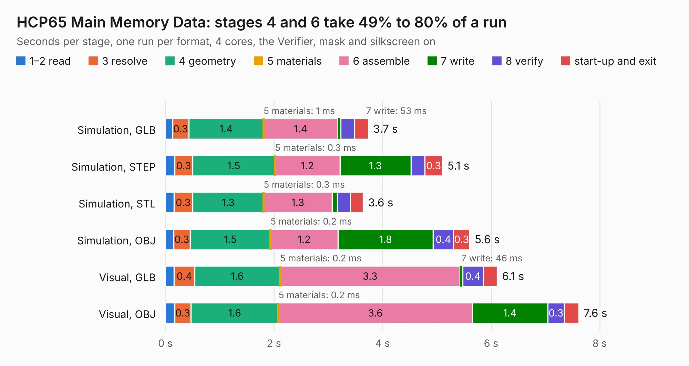

# 229. HCP65 Main Memory Data

Board 229 of the 3,104 of [Corpus Testing](../Corpus-Testing.md), on [Corpus Page 3](../CorpusTestingPages/Corpus-Testing-03.md#229-hcp65-main-memory-data).

| Mode and format | 1–2 read | 3 resolve | 4 geometry | 5 materials | 6 assemble | 7 write | 8 verify | start-up and exit | Total |
|---|---:|---:|---:|---:|---:|---:|---:|---:|---:|
| Simulation, GLB | 0.1 | 0.3 | 1.4 | 1&nbsp;ms | 1.4 | 53&nbsp;ms | 0.3 | 0.3 | 3.7 |
| Simulation, STEP | 0.2 | 0.3 | 1.5 | 0.3&nbsp;ms | 1.2 | 1.3 | 0.3 | 0.3 | 5.1 |
| Simulation, STL | 0.2 | 0.3 | 1.3 | 0.3&nbsp;ms | 1.3 | 98&nbsp;ms | 0.2 | 0.2 | 3.6 |
| Simulation, OBJ | 0.1 | 0.3 | 1.5 | 0.2&nbsp;ms | 1.2 | 1.8 | 0.4 | 0.3 | 5.6 |
| Visual, GLB | 0.2 | 0.4 | 1.6 | 0.2&nbsp;ms | 3.3 | 46&nbsp;ms | 0.4 | 0.3 | 6.1 |
| Visual, OBJ | 0.2 | 0.3 | 1.6 | 0.2&nbsp;ms | 3.6 | 1.4 | 0.3 | 0.3 | 7.6 |

<table align="center"><tr><td valign="top">

| Board | Repo: [andrewpaterson/658-Computer](https://github.com/andrewpaterson/658-Computer) Board: `HCP65 Main Memory Data.kicad_pcb` |
|---|---|
| Folder | Kicad / Computer / Processor / HCP65 Main Memory Data |
| Complexity | 213&nbsp;/&nbsp;1000 (size&nbsp;143, features&nbsp;70) |
| KESE&nbsp;features | through vias, rounded, trapezoid or chamfered pads, knockout text, stack-up, dielectric εr and tanδ |
| Tested | 9th November 2026 |
| Copper&nbsp;layers | 2 |
| File&nbsp;format | KiCad 9 (20241229) |
| Parts,&nbsp;tracks,&nbsp;vias | 12, 312, 30 |
| Triangles,&nbsp;simulation | 299,074 in 46 parts |
| Verifier | PASS in all six runs |

</td><td valign="top">

<table>
<tr><th>File type</th><th>File size</th><th>Peak memory used</th></tr>
<tr><th colspan="3" align="left">Simulation</th></tr>
<tr><td>GLB</td><td align="right">10&nbsp;MB</td><td align="right">234&nbsp;MB</td></tr>
<tr><td>STEP</td><td align="right">48&nbsp;MB</td><td align="right">269&nbsp;MB</td></tr>
<tr><td>STL</td><td align="right">15&nbsp;MB</td><td align="right">234&nbsp;MB</td></tr>
<tr><td>OBJ</td><td align="right">30&nbsp;MB</td><td align="right">258&nbsp;MB</td></tr>
<tr><th colspan="3" align="left">Visual</th></tr>
<tr><td>GLB</td><td align="right">7.6&nbsp;MB</td><td align="right">252&nbsp;MB</td></tr>
<tr><td>OBJ</td><td align="right">22&nbsp;MB</td><td align="right">254&nbsp;MB</td></tr>
</table>

</td></tr></table>

| Previous | Next |
|:---|---:|
| [228. HCP65 Main Memory Address](b0228b_658-Computer_HCP65-Main-Memory-Address.md) | [230. HCP65 MPU Address Decode](b0230b_658-Computer_HCP65-MPU-Address-Decode.md) |
