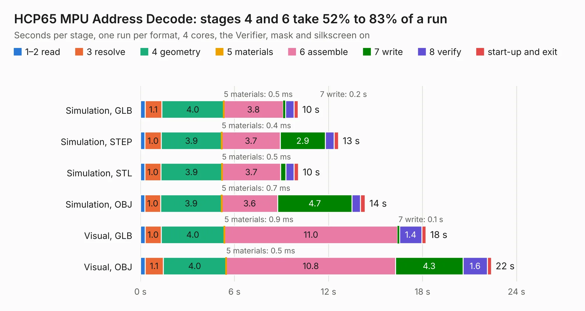

# 230. HCP65 MPU Address Decode

Board 230 of the 3,111 of [Corpus Testing](../Corpus-Testing.md), on [Corpus Page 3](../CorpusTestingPages/Corpus-Testing-03.md#230-hcp65-mpu-address-decode).

| Mode and format | 1–2 read | 3 resolve | 4 geometry | 5 materials | 6 assemble | 7 write | 8 verify | start-up and exit | Total |
|---|---:|---:|---:|---:|---:|---:|---:|---:|---:|
| Simulation, GLB | 0.3 | 1.1 | 4.0 | 0.5&nbsp;ms | 3.8 | 0.2 | 0.5 | 0.3 | 10.1 |
| Simulation, STEP | 0.3 | 1.0 | 3.9 | 0.4&nbsp;ms | 3.7 | 2.9 | 0.6 | 0.3 | 12.6 |
| Simulation, STL | 0.3 | 1.0 | 3.9 | 0.5&nbsp;ms | 3.7 | 0.3 | 0.5 | 0.3 | 10.1 |
| Simulation, OBJ | 0.3 | 1.0 | 3.9 | 0.7&nbsp;ms | 3.6 | 4.7 | 0.6 | 0.3 | 14.3 |
| Visual, GLB | 0.3 | 1.0 | 4.0 | 0.9&nbsp;ms | 11.0 | 0.1 | 1.4 | 0.3 | 18.2 |
| Visual, OBJ | 0.3 | 1.1 | 4.0 | 0.5&nbsp;ms | 10.8 | 4.3 | 1.6 | 0.3 | 22.4 |

<table align="center"><tr><td valign="top">

| Board | Repo: [andrewpaterson/658-Computer](https://github.com/andrewpaterson/658-Computer) Board: `HCP65 MPU Address Decode.kicad_pcb` |
|---|---|
| Folder | Kicad / Computer / Processor / HCP65 MPU Address Decode |
| Complexity | 251&nbsp;/&nbsp;1000 (size&nbsp;181, features&nbsp;70) |
| KESE&nbsp;features | through vias, rounded, trapezoid or chamfered pads, knockout text, stack-up, dielectric εr and tanδ |
| Tested | 9th November 2026 |
| Copper&nbsp;layers | 2 |
| File&nbsp;format | KiCad 9 (20241229) |
| Parts,&nbsp;tracks,&nbsp;vias | 44, 1,273, 168 |
| Triangles,&nbsp;simulation | 917,410 in 131 parts |
| Verifier | PASS in all six runs |

</td><td valign="top">

<table>
<tr><th>File type</th><th>File size</th><th>Peak memory used</th></tr>
<tr><th colspan="3" align="left">Simulation</th></tr>
<tr><td>GLB</td><td align="right">32&nbsp;MB</td><td align="right">475&nbsp;MB</td></tr>
<tr><td>STEP</td><td align="right">149&nbsp;MB</td><td align="right">530&nbsp;MB</td></tr>
<tr><td>STL</td><td align="right">46&nbsp;MB</td><td align="right">476&nbsp;MB</td></tr>
<tr><td>OBJ</td><td align="right">94&nbsp;MB</td><td align="right">661&nbsp;MB</td></tr>
<tr><th colspan="3" align="left">Visual</th></tr>
<tr><td>GLB</td><td align="right">27&nbsp;MB</td><td align="right">687&nbsp;MB</td></tr>
<tr><td>OBJ</td><td align="right">84&nbsp;MB</td><td align="right">644&nbsp;MB</td></tr>
</table>

</td></tr></table>

| Previous | Next |
|:---|---:|
| [229. HCP65 Main Memory Data](b0229b_658-Computer_HCP65-Main-Memory-Data.md) | [231. HCP65 MPU Memory](b0231b_658-Computer_HCP65-MPU-Memory.md) |
