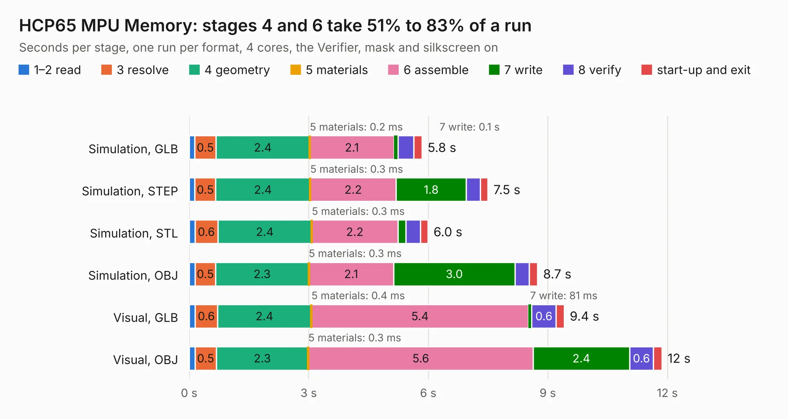

# 232 HCP65 MPU Memory

Board 232 of the 3,138 of [Corpus Testing](../Corpus-Testing.md), on [Corpus Page 3](../CorpusTestingPages/Corpus-Testing-03.md#232-hcp65-mpu-memory).

| Mode and format | 1–2 read | 3 resolve | 4 geometry | 5 materials | 6 assemble | 7 write | 8 verify | start-up and exit | Total |
|---|---:|---:|---:|---:|---:|---:|---:|---:|---:|
| Simulation, GLB | 0.1 | 0.5 | 2.4 | 0.2&nbsp;ms | 2.1 | 0.1 | 0.4 | 0.2 | 5.8 |
| Simulation, STEP | 0.1 | 0.5 | 2.4 | 0.3&nbsp;ms | 2.2 | 1.8 | 0.3 | 0.2 | 7.5 |
| Simulation, STL | 0.1 | 0.6 | 2.4 | 0.3&nbsp;ms | 2.2 | 0.2 | 0.4 | 0.2 | 6.0 |
| Simulation, OBJ | 0.2 | 0.5 | 2.3 | 0.3&nbsp;ms | 2.1 | 3.0 | 0.4 | 0.2 | 8.7 |
| Visual, GLB | 0.2 | 0.6 | 2.4 | 0.4&nbsp;ms | 5.4 | 81&nbsp;ms | 0.6 | 0.2 | 9.4 |
| Visual, OBJ | 0.1 | 0.5 | 2.3 | 0.3&nbsp;ms | 5.6 | 2.4 | 0.6 | 0.2 | 11.9 |

<table align="center"><tr><td valign="top">

| Board | Repo: [andrewpaterson/658-Computer](https://github.com/andrewpaterson/658-Computer) Board: `HCP65 MPU Memory.kicad_pcb` |
|---|---|
| Folder | Kicad / Computer / Processor / HCP65 MPU Memory |
| Complexity | 232&nbsp;/&nbsp;1000 (size&nbsp;162, features&nbsp;70) |
| KESE&nbsp;features | through vias, rounded, trapezoid or chamfered pads, knockout text, stack-up, dielectric εr and tanδ |
| Tested | 9th November 2026 |
| Copper&nbsp;layers | 2 |
| File&nbsp;format | KiCad 9 (20241229) |
| Parts,&nbsp;tracks,&nbsp;vias | 13, 868, 117 |
| Triangles,&nbsp;simulation | 752,164 in 70 parts |
| Verifier | PASS in all six runs |

</td><td valign="top">

<table>
<tr><th>File type</th><th>File size</th><th>Peak memory used</th></tr>
<tr><th colspan="3" align="left">Simulation</th></tr>
<tr><td>GLB</td><td align="right">26&nbsp;MB</td><td align="right">420&nbsp;MB</td></tr>
<tr><td>STEP</td><td align="right">109&nbsp;MB</td><td align="right">442&nbsp;MB</td></tr>
<tr><td>STL</td><td align="right">38&nbsp;MB</td><td align="right">409&nbsp;MB</td></tr>
<tr><td>OBJ</td><td align="right">76&nbsp;MB</td><td align="right">531&nbsp;MB</td></tr>
<tr><th colspan="3" align="left">Visual</th></tr>
<tr><td>GLB</td><td align="right">20&nbsp;MB</td><td align="right">529&nbsp;MB</td></tr>
<tr><td>OBJ</td><td align="right">60&nbsp;MB</td><td align="right">526&nbsp;MB</td></tr>
</table>

</td></tr></table>

| Previous | Next |
|:---|---:|
| [231 HCP65 MPU Address Decode](b0231b_658-Computer_HCP65-MPU-Address-Decode.md) | [233 HCP65 MPU NMI](b0233b_658-Computer_HCP65-MPU-NMI.md) |
