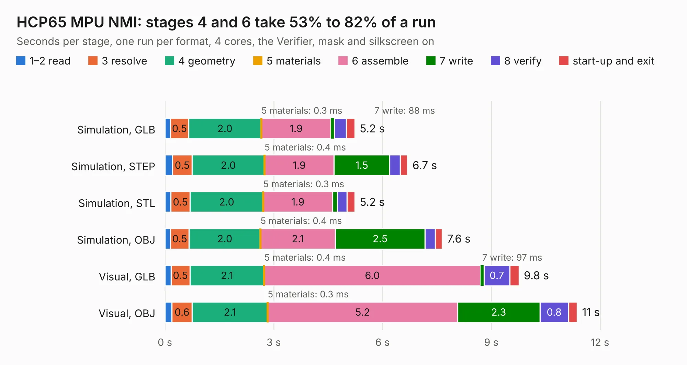

# 232. HCP65 MPU NMI

Board 232 of the 3,105 of [Corpus Testing](../Corpus-Testing.md), on [Corpus Page 3](../CorpusTestingPages/Corpus-Testing-03.md#232-hcp65-mpu-nmi).

| Mode and format | 1–2 read | 3 resolve | 4 geometry | 5 materials | 6 assemble | 7 write | 8 verify | start-up and exit | Total |
|---|---:|---:|---:|---:|---:|---:|---:|---:|---:|
| Simulation, GLB | 0.2 | 0.5 | 2.0 | 0.3&nbsp;ms | 1.9 | 88&nbsp;ms | 0.3 | 0.2 | 5.2 |
| Simulation, STEP | 0.2 | 0.5 | 2.0 | 0.4&nbsp;ms | 1.9 | 1.5 | 0.3 | 0.2 | 6.7 |
| Simulation, STL | 0.2 | 0.5 | 2.0 | 0.3&nbsp;ms | 1.9 | 0.1 | 0.3 | 0.2 | 5.2 |
| Simulation, OBJ | 0.1 | 0.5 | 2.0 | 0.4&nbsp;ms | 2.1 | 2.5 | 0.3 | 0.2 | 7.6 |
| Visual, GLB | 0.2 | 0.5 | 2.1 | 0.4&nbsp;ms | 6.0 | 97&nbsp;ms | 0.7 | 0.3 | 9.8 |
| Visual, OBJ | 0.2 | 0.6 | 2.1 | 0.3&nbsp;ms | 5.2 | 2.3 | 0.8 | 0.2 | 11.4 |

<table align="center"><tr><td valign="top">

| Board | Repo: [andrewpaterson/658-Computer](https://github.com/andrewpaterson/658-Computer) Board: `HCP65 MPU NMI.kicad_pcb` |
|---|---|
| Folder | Kicad / Computer / Processor / HCP65 MPU NMI |
| Complexity | 239&nbsp;/&nbsp;1000 (size&nbsp;169, features&nbsp;70) |
| KESE&nbsp;features | through vias, rounded, trapezoid or chamfered pads, knockout text, stack-up, dielectric εr and tanδ |
| Tested | 9th November 2026 |
| Copper&nbsp;layers | 2 |
| File&nbsp;format | KiCad 9 (20241229) |
| Parts,&nbsp;tracks,&nbsp;vias | 24, 916, 137 |
| Triangles,&nbsp;simulation | 628,840 in 68 parts |
| Verifier | PASS in all six runs |

</td><td valign="top">

<table>
<tr><th>File type</th><th>File size</th><th>Peak memory used</th></tr>
<tr><th colspan="3" align="left">Simulation</th></tr>
<tr><td>GLB</td><td align="right">22&nbsp;MB</td><td align="right">352&nbsp;MB</td></tr>
<tr><td>STEP</td><td align="right">101&nbsp;MB</td><td align="right">405&nbsp;MB</td></tr>
<tr><td>STL</td><td align="right">31&nbsp;MB</td><td align="right">376&nbsp;MB</td></tr>
<tr><td>OBJ</td><td align="right">64&nbsp;MB</td><td align="right">457&nbsp;MB</td></tr>
<tr><th colspan="3" align="left">Visual</th></tr>
<tr><td>GLB</td><td align="right">19&nbsp;MB</td><td align="right">479&nbsp;MB</td></tr>
<tr><td>OBJ</td><td align="right">58&nbsp;MB</td><td align="right">498&nbsp;MB</td></tr>
</table>

</td></tr></table>

| Previous | Next |
|:---|---:|
| [231. HCP65 MPU Memory](b0231b_658-Computer_HCP65-MPU-Memory.md) | [233. HCP65 MPU Timer](b0233b_658-Computer_HCP65-MPU-Timer.md) |
