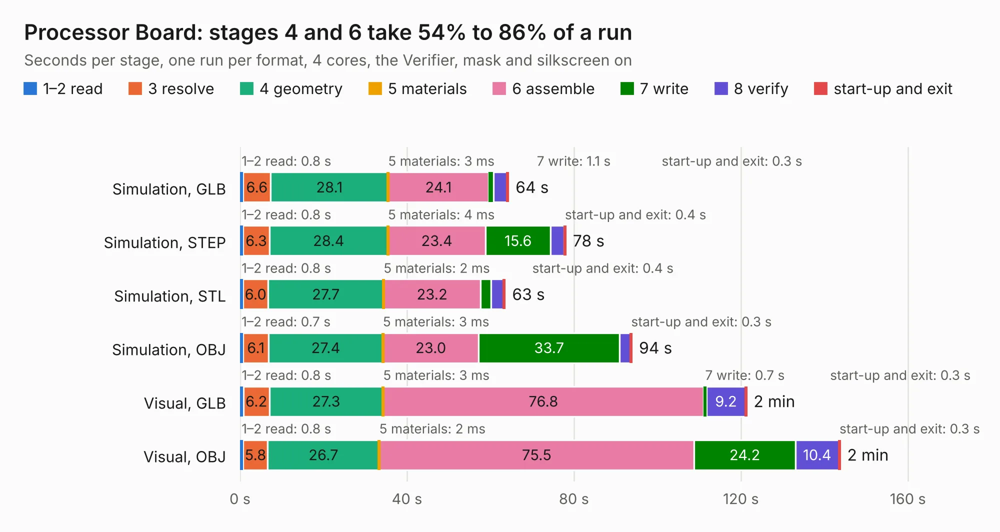

# 232. Processor Board

Board 232 of the 3,102 of [Corpus Testing](../Corpus-Testing.md), on [Corpus Page 3](../CorpusTestingPages/Corpus-Testing-03.md#232-processor-board).

| Mode and format | 1–2 read | 3 resolve | 4 geometry | 5 materials | 6 assemble | 7 write | 8 verify | start-up and exit | Total |
|---|---:|---:|---:|---:|---:|---:|---:|---:|---:|
| Simulation, GLB | 0.8 | 6.6 | 28.1 | 3&nbsp;ms | 24.1 | 1.1 | 3.3 | 0.3 | 64.3 |
| Simulation, STEP | 0.8 | 6.3 | 28.4 | 4&nbsp;ms | 23.4 | 15.6 | 3.3 | 0.4 | 78.0 |
| Simulation, STL | 0.8 | 6.0 | 27.7 | 2&nbsp;ms | 23.2 | 2.5 | 3.0 | 0.4 | 63.5 |
| Simulation, OBJ | 0.7 | 6.1 | 27.4 | 3&nbsp;ms | 23.0 | 33.7 | 2.6 | 0.3 | 93.9 |
| Visual, GLB | 0.8 | 6.2 | 27.3 | 3&nbsp;ms | 76.8 | 0.7 | 9.2 | 0.3 | 121.3 |
| Visual, OBJ | 0.8 | 5.8 | 26.7 | 2&nbsp;ms | 75.5 | 24.2 | 10.4 | 0.3 | 143.7 |

<table align="center"><tr><td valign="top">

| Board | Repo: [andrewpaterson/658-Computer](https://github.com/andrewpaterson/658-Computer) Board: `Processor Board.kicad_pcb` |
|---|---|
| Folder | Kicad / Computer / Processor / Processor Board |
| Complexity | 283&nbsp;/&nbsp;1000 (size&nbsp;203, features&nbsp;80) |
| KESE&nbsp;features | through vias, rounded, trapezoid or chamfered pads, curved board outline, knockout text, stack-up, dielectric εr and tanδ |
| Tested | 9th November 2026 |
| Copper&nbsp;layers | 2 |
| File&nbsp;format | KiCad 9 (20241229) |
| Parts,&nbsp;tracks,&nbsp;vias | 40, 4,940, 868 |
| Triangles,&nbsp;simulation | 7,131,364 in 393 parts |
| Verifier | PASS in all six runs |

</td><td valign="top">

<table>
<tr><th>File type</th><th>File size</th><th>Peak memory used</th></tr>
<tr><th colspan="3" align="left">Simulation</th></tr>
<tr><td>GLB</td><td align="right">240&nbsp;MB</td><td align="right">2.1&nbsp;GB</td></tr>
<tr><td>STEP</td><td align="right">1.1&nbsp;GB</td><td align="right">2.6&nbsp;GB</td></tr>
<tr><td>STL</td><td align="right">357&nbsp;MB</td><td align="right">2.1&nbsp;GB</td></tr>
<tr><td>OBJ</td><td align="right">758&nbsp;MB</td><td align="right">4.4&nbsp;GB</td></tr>
<tr><th colspan="3" align="left">Visual</th></tr>
<tr><td>GLB</td><td align="right">176&nbsp;MB</td><td align="right">2.9&nbsp;GB</td></tr>
<tr><td>OBJ</td><td align="right">566&nbsp;MB</td><td align="right">3.6&nbsp;GB</td></tr>
</table>

</td></tr></table>

| Previous | Next |
|:---|---:|
| [231. HCP65 MPU Timer](b0231b_658-Computer_HCP65-MPU-Timer.md) | [233. W65C816 Breakout](b0233b_658-Computer_W65C816-Breakout.md) |
