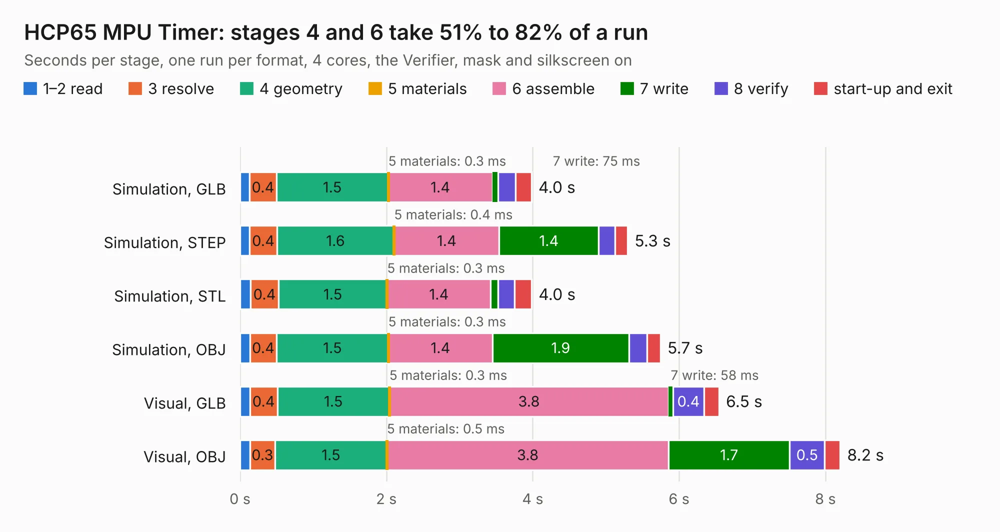

# 233. HCP65 MPU Timer

Board 233 of the 3,106 of [Corpus Testing](../Corpus-Testing.md), on [Corpus Page 3](../CorpusTestingPages/Corpus-Testing-03.md#233-hcp65-mpu-timer).

| Mode and format | 1–2 read | 3 resolve | 4 geometry | 5 materials | 6 assemble | 7 write | 8 verify | start-up and exit | Total |
|---|---:|---:|---:|---:|---:|---:|---:|---:|---:|
| Simulation, GLB | 0.1 | 0.4 | 1.5 | 0.3&nbsp;ms | 1.4 | 75&nbsp;ms | 0.2 | 0.2 | 4.0 |
| Simulation, STEP | 0.1 | 0.4 | 1.6 | 0.4&nbsp;ms | 1.4 | 1.4 | 0.2 | 0.2 | 5.3 |
| Simulation, STL | 0.1 | 0.4 | 1.5 | 0.3&nbsp;ms | 1.4 | 0.1 | 0.2 | 0.2 | 4.0 |
| Simulation, OBJ | 0.1 | 0.4 | 1.5 | 0.3&nbsp;ms | 1.4 | 1.9 | 0.3 | 0.2 | 5.7 |
| Visual, GLB | 0.1 | 0.4 | 1.5 | 0.3&nbsp;ms | 3.8 | 58&nbsp;ms | 0.4 | 0.2 | 6.5 |
| Visual, OBJ | 0.1 | 0.3 | 1.5 | 0.5&nbsp;ms | 3.8 | 1.7 | 0.5 | 0.2 | 8.2 |

<table align="center"><tr><td valign="top">

| Board | Repo: [andrewpaterson/658-Computer](https://github.com/andrewpaterson/658-Computer) Board: `HCP65 MPU Timer.kicad_pcb` |
|---|---|
| Folder | Kicad / Computer / Processor / HCP65 MPU Timer |
| Complexity | 230&nbsp;/&nbsp;1000 (size&nbsp;160, features&nbsp;70) |
| KESE&nbsp;features | through vias, rounded, trapezoid or chamfered pads, knockout text, stack-up, dielectric εr and tanδ |
| Tested | 9th November 2026 |
| Copper&nbsp;layers | 2 |
| File&nbsp;format | KiCad 9 (20241229) |
| Parts,&nbsp;tracks,&nbsp;vias | 18, 645, 81 |
| Triangles,&nbsp;simulation | 471,844 in 75 parts |
| Verifier | PASS in all six runs |

</td><td valign="top">

<table>
<tr><th>File type</th><th>File size</th><th>Peak memory used</th></tr>
<tr><th colspan="3" align="left">Simulation</th></tr>
<tr><td>GLB</td><td align="right">16&nbsp;MB</td><td align="right">318&nbsp;MB</td></tr>
<tr><td>STEP</td><td align="right">79&nbsp;MB</td><td align="right">339&nbsp;MB</td></tr>
<tr><td>STL</td><td align="right">24&nbsp;MB</td><td align="right">318&nbsp;MB</td></tr>
<tr><td>OBJ</td><td align="right">48&nbsp;MB</td><td align="right">365&nbsp;MB</td></tr>
<tr><th colspan="3" align="left">Visual</th></tr>
<tr><td>GLB</td><td align="right">14&nbsp;MB</td><td align="right">381&nbsp;MB</td></tr>
<tr><td>OBJ</td><td align="right">41&nbsp;MB</td><td align="right">377&nbsp;MB</td></tr>
</table>

</td></tr></table>

| Previous | Next |
|:---|---:|
| [232. HCP65 MPU NMI](b0232b_658-Computer_HCP65-MPU-NMI.md) | [234. Processor Board](b0234b_658-Computer_Processor-Board.md) |
