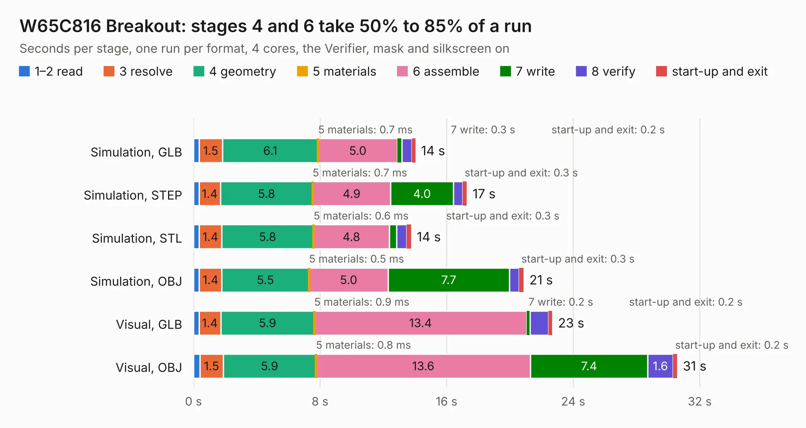

# 235. W65C816 Breakout

Board 235 of the 3,104 of [Corpus Testing](../Corpus-Testing.md), on [Corpus Page 3](../CorpusTestingPages/Corpus-Testing-03.md#235-w65c816-breakout).

| Mode and format | 1–2 read | 3 resolve | 4 geometry | 5 materials | 6 assemble | 7 write | 8 verify | start-up and exit | Total |
|---|---:|---:|---:|---:|---:|---:|---:|---:|---:|
| Simulation, GLB | 0.4 | 1.5 | 6.1 | 0.7&nbsp;ms | 5.0 | 0.3 | 0.6 | 0.2 | 14.0 |
| Simulation, STEP | 0.3 | 1.4 | 5.8 | 0.7&nbsp;ms | 4.9 | 4.0 | 0.6 | 0.3 | 17.3 |
| Simulation, STL | 0.4 | 1.4 | 5.8 | 0.6&nbsp;ms | 4.8 | 0.5 | 0.7 | 0.3 | 13.8 |
| Simulation, OBJ | 0.4 | 1.4 | 5.5 | 0.5&nbsp;ms | 5.0 | 7.7 | 0.6 | 0.3 | 20.9 |
| Visual, GLB | 0.3 | 1.4 | 5.9 | 0.9&nbsp;ms | 13.4 | 0.2 | 1.2 | 0.2 | 22.7 |
| Visual, OBJ | 0.4 | 1.5 | 5.9 | 0.8&nbsp;ms | 13.6 | 7.4 | 1.6 | 0.2 | 30.6 |

<table align="center"><tr><td valign="top">

| Board | Repo: [andrewpaterson/658-Computer](https://github.com/andrewpaterson/658-Computer) Board: `W65C816 Breakout.kicad_pcb` |
|---|---|
| Folder | Kicad / Computer / Processor / W65C816 Breakout |
| Complexity | 260&nbsp;/&nbsp;1000 (size&nbsp;190, features&nbsp;70) |
| KESE&nbsp;features | through vias, rounded, trapezoid or chamfered pads, knockout text, stack-up, dielectric εr and tanδ |
| Tested | 9th November 2026 |
| Copper&nbsp;layers | 2 |
| File&nbsp;format | KiCad 9 (20241229) |
| Parts,&nbsp;tracks,&nbsp;vias | 51, 2,018, 270 |
| Triangles,&nbsp;simulation | 1,320,418 in 119 parts |
| Verifier | PASS in all six runs |

</td><td valign="top">

<table>
<tr><th>File type</th><th>File size</th><th>Peak memory used</th></tr>
<tr><th colspan="3" align="left">Simulation</th></tr>
<tr><td>GLB</td><td align="right">46&nbsp;MB</td><td align="right">610&nbsp;MB</td></tr>
<tr><td>STEP</td><td align="right">217&nbsp;MB</td><td align="right">675&nbsp;MB</td></tr>
<tr><td>STL</td><td align="right">66&nbsp;MB</td><td align="right">624&nbsp;MB</td></tr>
<tr><td>OBJ</td><td align="right">136&nbsp;MB</td><td align="right">889&nbsp;MB</td></tr>
<tr><th colspan="3" align="left">Visual</th></tr>
<tr><td>GLB</td><td align="right">40&nbsp;MB</td><td align="right">823&nbsp;MB</td></tr>
<tr><td>OBJ</td><td align="right">122&nbsp;MB</td><td align="right">964&nbsp;MB</td></tr>
</table>

</td></tr></table>

| Previous | Next |
|:---|---:|
| [234. Processor Board](b0234b_658-Computer_Processor-Board.md) | [236. W65C816 Clock Hold](b0236b_658-Computer_W65C816-Clock-Hold.md) |
