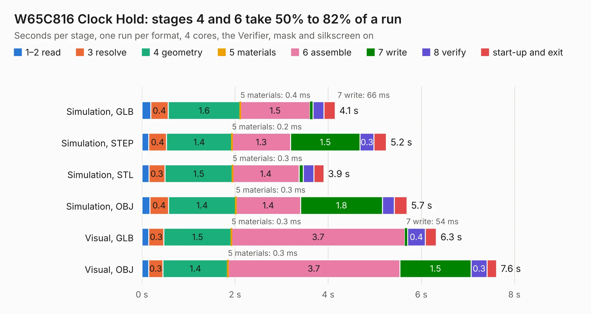

# 237. W65C816 Clock Hold

Board 237 of the 3,128 of [Corpus Testing](../Corpus-Testing.md), on [Corpus Page 3](../CorpusTestingPages/Corpus-Testing-03.md#237-w65c816-clock-hold).

| Mode and format | 1–2 read | 3 resolve | 4 geometry | 5 materials | 6 assemble | 7 write | 8 verify | start-up and exit | Total |
|---|---:|---:|---:|---:|---:|---:|---:|---:|---:|
| Simulation, GLB | 0.2 | 0.4 | 1.6 | 0.4&nbsp;ms | 1.5 | 66&nbsp;ms | 0.2 | 0.2 | 4.1 |
| Simulation, STEP | 0.1 | 0.4 | 1.4 | 0.2&nbsp;ms | 1.3 | 1.5 | 0.3 | 0.3 | 5.2 |
| Simulation, STL | 0.1 | 0.3 | 1.5 | 0.3&nbsp;ms | 1.4 | 91&nbsp;ms | 0.2 | 0.2 | 3.9 |
| Simulation, OBJ | 0.2 | 0.4 | 1.4 | 0.3&nbsp;ms | 1.4 | 1.8 | 0.3 | 0.3 | 5.7 |
| Visual, GLB | 0.1 | 0.3 | 1.5 | 0.3&nbsp;ms | 3.7 | 54&nbsp;ms | 0.4 | 0.2 | 6.3 |
| Visual, OBJ | 0.1 | 0.3 | 1.4 | 0.3&nbsp;ms | 3.7 | 1.5 | 0.3 | 0.2 | 7.6 |

<table align="center"><tr><td valign="top">

| Board | Repo: [andrewpaterson/658-Computer](https://github.com/andrewpaterson/658-Computer) Board: `W65C816 Clock Hold.kicad_pcb` |
|---|---|
| Folder | Kicad / Computer / Processor / W65C816 Clock Hold |
| Complexity | 225&nbsp;/&nbsp;1000 (size&nbsp;155, features&nbsp;70) |
| KESE&nbsp;features | through vias, rounded, trapezoid or chamfered pads, knockout text, stack-up, dielectric εr and tanδ |
| Tested | 9th November 2026 |
| Copper&nbsp;layers | 2 |
| File&nbsp;format | KiCad 9 (20241229) |
| Parts,&nbsp;tracks,&nbsp;vias | 20, 458, 55 |
| Triangles,&nbsp;simulation | 357,774 in 45 parts |
| Verifier | PASS in all six runs |

</td><td valign="top">

<table>
<tr><th>File type</th><th>File size</th><th>Peak memory used</th></tr>
<tr><th colspan="3" align="left">Simulation</th></tr>
<tr><td>GLB</td><td align="right">12&nbsp;MB</td><td align="right">244&nbsp;MB</td></tr>
<tr><td>STEP</td><td align="right">61&nbsp;MB</td><td align="right">291&nbsp;MB</td></tr>
<tr><td>STL</td><td align="right">18&nbsp;MB</td><td align="right">261&nbsp;MB</td></tr>
<tr><td>OBJ</td><td align="right">36&nbsp;MB</td><td align="right">291&nbsp;MB</td></tr>
<tr><th colspan="3" align="left">Visual</th></tr>
<tr><td>GLB</td><td align="right">10&nbsp;MB</td><td align="right">307&nbsp;MB</td></tr>
<tr><td>OBJ</td><td align="right">31&nbsp;MB</td><td align="right">308&nbsp;MB</td></tr>
</table>

</td></tr></table>

| Previous | Next |
|:---|---:|
| [236. W65C816 Breakout](b0236b_658-Computer_W65C816-Breakout.md) | [238. W65C816 Debug Display](b0238b_658-Computer_W65C816-Debug-Display.md) |
