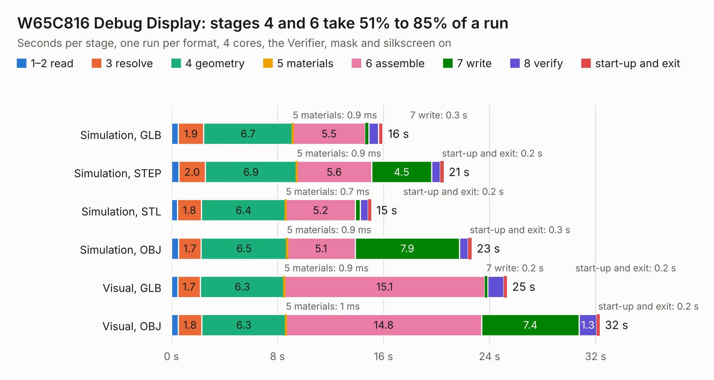

# 237. W65C816 Debug Display

Board 237 of the 3,116 of [Corpus Testing](../Corpus-Testing.md), on [Corpus Page 3](../CorpusTestingPages/Corpus-Testing-03.md#237-w65c816-debug-display).

| Mode and format | 1–2 read | 3 resolve | 4 geometry | 5 materials | 6 assemble | 7 write | 8 verify | start-up and exit | Total |
|---|---:|---:|---:|---:|---:|---:|---:|---:|---:|
| Simulation, GLB | 0.5 | 1.9 | 6.7 | 0.9&nbsp;ms | 5.5 | 0.3 | 0.7 | 0.3 | 16.0 |
| Simulation, STEP | 0.6 | 2.0 | 6.9 | 0.9&nbsp;ms | 5.6 | 4.5 | 0.7 | 0.2 | 20.5 |
| Simulation, STL | 0.5 | 1.8 | 6.4 | 0.7&nbsp;ms | 5.2 | 0.4 | 0.6 | 0.2 | 15.1 |
| Simulation, OBJ | 0.5 | 1.7 | 6.5 | 0.9&nbsp;ms | 5.1 | 7.9 | 0.7 | 0.3 | 22.6 |
| Visual, GLB | 0.5 | 1.7 | 6.3 | 0.9&nbsp;ms | 15.1 | 0.2 | 1.2 | 0.2 | 25.3 |
| Visual, OBJ | 0.5 | 1.8 | 6.3 | 1&nbsp;ms | 14.8 | 7.4 | 1.3 | 0.2 | 32.3 |

<table align="center"><tr><td valign="top">

| Board | Repo: [andrewpaterson/658-Computer](https://github.com/andrewpaterson/658-Computer) Board: `W65C816 Debug Display.kicad_pcb` |
|---|---|
| Folder | Kicad / Computer / Processor / W65C816 Debug Display |
| Complexity | 273&nbsp;/&nbsp;1000 (size&nbsp;193, features&nbsp;80) |
| KESE&nbsp;features | through vias, rounded, trapezoid or chamfered pads, curved board outline, knockout text, stack-up, dielectric εr and tanδ |
| Tested | 9th November 2026 |
| Copper&nbsp;layers | 2 |
| File&nbsp;format | KiCad 9 (20241229) |
| Parts,&nbsp;tracks,&nbsp;vias | 81, 1,782, 276 |
| Triangles,&nbsp;simulation | 1,312,130 in 243 parts |
| Verifier | PASS in all six runs |

</td><td valign="top">

<table>
<tr><th>File type</th><th>File size</th><th>Peak memory used</th></tr>
<tr><th colspan="3" align="left">Simulation</th></tr>
<tr><td>GLB</td><td align="right">46&nbsp;MB</td><td align="right">588&nbsp;MB</td></tr>
<tr><td>STEP</td><td align="right">216&nbsp;MB</td><td align="right">715&nbsp;MB</td></tr>
<tr><td>STL</td><td align="right">66&nbsp;MB</td><td align="right">572&nbsp;MB</td></tr>
<tr><td>OBJ</td><td align="right">137&nbsp;MB</td><td align="right">1.1&nbsp;GB</td></tr>
<tr><th colspan="3" align="left">Visual</th></tr>
<tr><td>GLB</td><td align="right">41&nbsp;MB</td><td align="right">868&nbsp;MB</td></tr>
<tr><td>OBJ</td><td align="right">126&nbsp;MB</td><td align="right">1.1&nbsp;GB</td></tr>
</table>

</td></tr></table>

| Previous | Next |
|:---|---:|
| [236. W65C816 Clock Hold](b0236b_658-Computer_W65C816-Clock-Hold.md) | [238. W65C816 Latch](b0238b_658-Computer_W65C816-Latch.md) |
