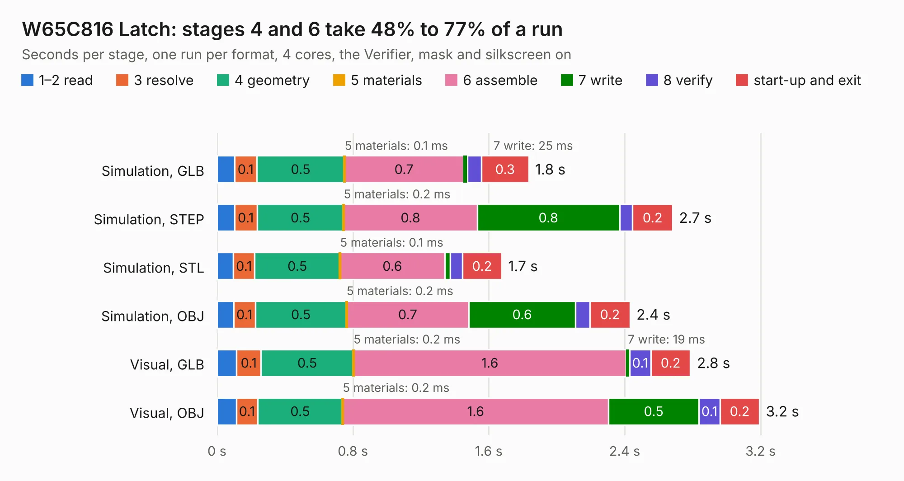

# 239. W65C816 Latch

Board 239 of the 3,123 of [Corpus Testing](../Corpus-Testing.md), on [Corpus Page 3](../CorpusTestingPages/Corpus-Testing-03.md#239-w65c816-latch).

| Mode and format | 1–2 read | 3 resolve | 4 geometry | 5 materials | 6 assemble | 7 write | 8 verify | start-up and exit | Total |
|---|---:|---:|---:|---:|---:|---:|---:|---:|---:|
| Simulation, GLB | 0.1 | 0.1 | 0.5 | 0.1&nbsp;ms | 0.7 | 25&nbsp;ms | 82&nbsp;ms | 0.3 | 1.8 |
| Simulation, STEP | 0.1 | 0.1 | 0.5 | 0.2&nbsp;ms | 0.8 | 0.8 | 77&nbsp;ms | 0.2 | 2.7 |
| Simulation, STL | 96&nbsp;ms | 0.1 | 0.5 | 0.1&nbsp;ms | 0.6 | 34&nbsp;ms | 71&nbsp;ms | 0.2 | 1.7 |
| Simulation, OBJ | 98&nbsp;ms | 0.1 | 0.5 | 0.2&nbsp;ms | 0.7 | 0.6 | 85&nbsp;ms | 0.2 | 2.4 |
| Visual, GLB | 0.1 | 0.1 | 0.5 | 0.2&nbsp;ms | 1.6 | 19&nbsp;ms | 0.1 | 0.2 | 2.8 |
| Visual, OBJ | 0.1 | 0.1 | 0.5 | 0.2&nbsp;ms | 1.6 | 0.5 | 0.1 | 0.2 | 3.2 |

<table align="center"><tr><td valign="top">

| Board | Repo: [andrewpaterson/658-Computer](https://github.com/andrewpaterson/658-Computer) Board: `W65C816 Latch.kicad_pcb` |
|---|---|
| Folder | Kicad / Computer / Processor / W65C816 Latch |
| Complexity | 194&nbsp;/&nbsp;1000 (size&nbsp;124, features&nbsp;70) |
| KESE&nbsp;features | through vias, rounded, trapezoid or chamfered pads, knockout text, stack-up, dielectric εr and tanδ |
| Tested | 9th November 2026 |
| Copper&nbsp;layers | 2 |
| File&nbsp;format | KiCad 9 (20241229) |
| Parts,&nbsp;tracks,&nbsp;vias | 11, 102, 12 |
| Triangles,&nbsp;simulation | 134,178 in 27 parts |
| Verifier | PASS in all six runs |

</td><td valign="top">

<table>
<tr><th>File type</th><th>File size</th><th>Peak memory used</th></tr>
<tr><th colspan="3" align="left">Simulation</th></tr>
<tr><td>GLB</td><td align="right">4.6&nbsp;MB</td><td align="right">190&nbsp;MB</td></tr>
<tr><td>STEP</td><td align="right">21&nbsp;MB</td><td align="right">204&nbsp;MB</td></tr>
<tr><td>STL</td><td align="right">6.7&nbsp;MB</td><td align="right">192&nbsp;MB</td></tr>
<tr><td>OBJ</td><td align="right">13&nbsp;MB</td><td align="right">190&nbsp;MB</td></tr>
<tr><th colspan="3" align="left">Visual</th></tr>
<tr><td>GLB</td><td align="right">3.4&nbsp;MB</td><td align="right">164&nbsp;MB</td></tr>
<tr><td>OBJ</td><td align="right">9.7&nbsp;MB</td><td align="right">164&nbsp;MB</td></tr>
</table>

</td></tr></table>

| Previous | Next |
|:---|---:|
| [238. W65C816 Debug Display](b0238b_658-Computer_W65C816-Debug-Display.md) | [240. W65C816 Minimal](b0240b_658-Computer_W65C816-Minimal.md) |
