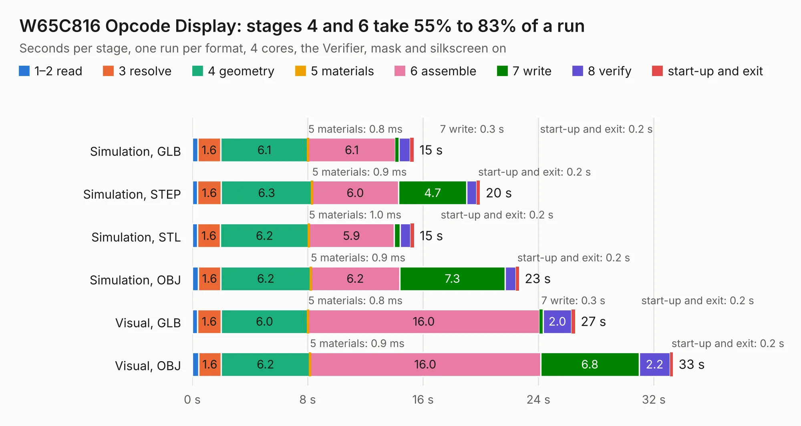

# 240. W65C816 Opcode Display

Board 240 of the 3,104 of [Corpus Testing](../Corpus-Testing.md), on [Corpus Page 3](../CorpusTestingPages/Corpus-Testing-03.md#240-w65c816-opcode-display).

| Mode and format | 1–2 read | 3 resolve | 4 geometry | 5 materials | 6 assemble | 7 write | 8 verify | start-up and exit | Total |
|---|---:|---:|---:|---:|---:|---:|---:|---:|---:|
| Simulation, GLB | 0.4 | 1.6 | 6.1 | 0.8&nbsp;ms | 6.1 | 0.3 | 0.8 | 0.2 | 15.4 |
| Simulation, STEP | 0.4 | 1.6 | 6.3 | 0.9&nbsp;ms | 6.0 | 4.7 | 0.7 | 0.2 | 19.9 |
| Simulation, STL | 0.4 | 1.6 | 6.2 | 1.0&nbsp;ms | 5.9 | 0.4 | 0.7 | 0.2 | 15.4 |
| Simulation, OBJ | 0.4 | 1.6 | 6.2 | 0.9&nbsp;ms | 6.2 | 7.3 | 0.7 | 0.2 | 22.7 |
| Visual, GLB | 0.4 | 1.6 | 6.0 | 0.8&nbsp;ms | 16.0 | 0.3 | 2.0 | 0.2 | 26.5 |
| Visual, OBJ | 0.4 | 1.6 | 6.2 | 0.9&nbsp;ms | 16.0 | 6.8 | 2.2 | 0.2 | 33.3 |

<table align="center"><tr><td valign="top">

| Board | Repo: [andrewpaterson/658-Computer](https://github.com/andrewpaterson/658-Computer) Board: `W65C816 Opcode Display.kicad_pcb` |
|---|---|
| Folder | Kicad / Computer / Processor / W65C816 Opcode Display |
| Complexity | 279&nbsp;/&nbsp;1000 (size&nbsp;199, features&nbsp;80) |
| KESE&nbsp;features | through vias, rounded, trapezoid or chamfered pads, curved board outline, knockout text, stack-up, dielectric εr and tanδ |
| Tested | 9th November 2026 |
| Copper&nbsp;layers | 2 |
| File&nbsp;format | KiCad 9 (20241229) |
| Parts,&nbsp;tracks,&nbsp;vias | 79, 2,531, 374 |
| Triangles,&nbsp;simulation | 1,650,672 in 283 parts |
| Verifier | PASS in all six runs |

</td><td valign="top">

<table>
<tr><th>File type</th><th>File size</th><th>Peak memory used</th></tr>
<tr><th colspan="3" align="left">Simulation</th></tr>
<tr><td>GLB</td><td align="right">58&nbsp;MB</td><td align="right">675&nbsp;MB</td></tr>
<tr><td>STEP</td><td align="right">304&nbsp;MB</td><td align="right">897&nbsp;MB</td></tr>
<tr><td>STL</td><td align="right">83&nbsp;MB</td><td align="right">692&nbsp;MB</td></tr>
<tr><td>OBJ</td><td align="right">174&nbsp;MB</td><td align="right">1.4&nbsp;GB</td></tr>
<tr><th colspan="3" align="left">Visual</th></tr>
<tr><td>GLB</td><td align="right">53&nbsp;MB</td><td align="right">1.1&nbsp;GB</td></tr>
<tr><td>OBJ</td><td align="right">163&nbsp;MB</td><td align="right">1.5&nbsp;GB</td></tr>
</table>

</td></tr></table>

| Previous | Next |
|:---|---:|
| [239. W65C816 Minimal](b0239b_658-Computer_W65C816-Minimal.md) | [241. W65C816 Power](b0241b_658-Computer_W65C816-Power.md) |
