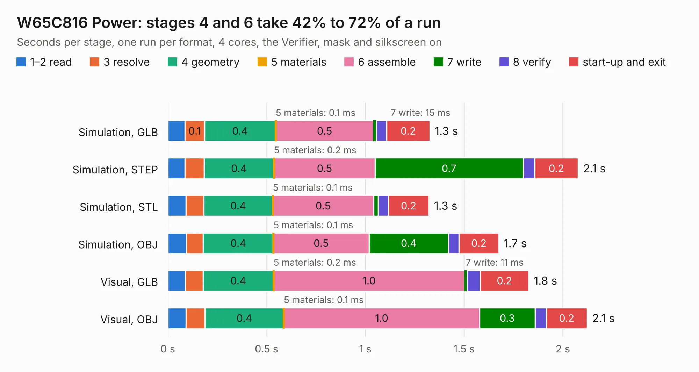

# 240. W65C816 Power

Board 240 of the 3,103 of [Corpus Testing](../Corpus-Testing.md), on [Corpus Page 3](../CorpusTestingPages/Corpus-Testing-03.md#240-w65c816-power).

| Mode and format | 1–2 read | 3 resolve | 4 geometry | 5 materials | 6 assemble | 7 write | 8 verify | start-up and exit | Total |
|---|---:|---:|---:|---:|---:|---:|---:|---:|---:|
| Simulation, GLB | 86&nbsp;ms | 0.1 | 0.4 | 0.1&nbsp;ms | 0.5 | 15&nbsp;ms | 52&nbsp;ms | 0.2 | 1.3 |
| Simulation, STEP | 86&nbsp;ms | 97&nbsp;ms | 0.4 | 0.2&nbsp;ms | 0.5 | 0.7 | 59&nbsp;ms | 0.2 | 2.1 |
| Simulation, STL | 92&nbsp;ms | 89&nbsp;ms | 0.4 | 0.1&nbsp;ms | 0.5 | 24&nbsp;ms | 51&nbsp;ms | 0.2 | 1.3 |
| Simulation, OBJ | 94&nbsp;ms | 85&nbsp;ms | 0.4 | 0.1&nbsp;ms | 0.5 | 0.4 | 53&nbsp;ms | 0.2 | 1.7 |
| Visual, GLB | 89&nbsp;ms | 89&nbsp;ms | 0.4 | 0.2&nbsp;ms | 1.0 | 11&nbsp;ms | 67&nbsp;ms | 0.2 | 1.8 |
| Visual, OBJ | 92&nbsp;ms | 96&nbsp;ms | 0.4 | 0.1&nbsp;ms | 1.0 | 0.3 | 56&nbsp;ms | 0.2 | 2.1 |

<table align="center"><tr><td valign="top">

| Board | Repo: [andrewpaterson/658-Computer](https://github.com/andrewpaterson/658-Computer) Board: `W65C816 Power.kicad_pcb` |
|---|---|
| Folder | Kicad / Computer / Processor / W65C816 Power |
| Complexity | 142&nbsp;/&nbsp;1000 (size&nbsp;87, features&nbsp;55) |
| KESE&nbsp;features | rounded, trapezoid or chamfered pads, knockout text, stack-up, dielectric εr and tanδ |
| Tested | 9th November 2026 |
| Copper&nbsp;layers | 2 |
| File&nbsp;format | KiCad 9 (20241229) |
| Parts,&nbsp;tracks,&nbsp;vias | 4, 24, 0 |
| Triangles,&nbsp;simulation | 80,774 in 22 parts |
| Verifier | PASS in all six runs |

</td><td valign="top">

<table>
<tr><th>File type</th><th>File size</th><th>Peak memory used</th></tr>
<tr><th colspan="3" align="left">Simulation</th></tr>
<tr><td>GLB</td><td align="right">2.8&nbsp;MB</td><td align="right">173&nbsp;MB</td></tr>
<tr><td>STEP</td><td align="right">11&nbsp;MB</td><td align="right">178&nbsp;MB</td></tr>
<tr><td>STL</td><td align="right">4.0&nbsp;MB</td><td align="right">172&nbsp;MB</td></tr>
<tr><td>OBJ</td><td align="right">7.7&nbsp;MB</td><td align="right">171&nbsp;MB</td></tr>
<tr><th colspan="3" align="left">Visual</th></tr>
<tr><td>GLB</td><td align="right">1.7&nbsp;MB</td><td align="right">150&nbsp;MB</td></tr>
<tr><td>OBJ</td><td align="right">4.7&nbsp;MB</td><td align="right">151&nbsp;MB</td></tr>
</table>

</td></tr></table>

| Previous | Next |
|:---|---:|
| [239. W65C816 Opcode Display](b0239b_658-Computer_W65C816-Opcode-Display.md) | [241. PS2 Board](b0241b_658-Computer_PS2-Board.md) |
