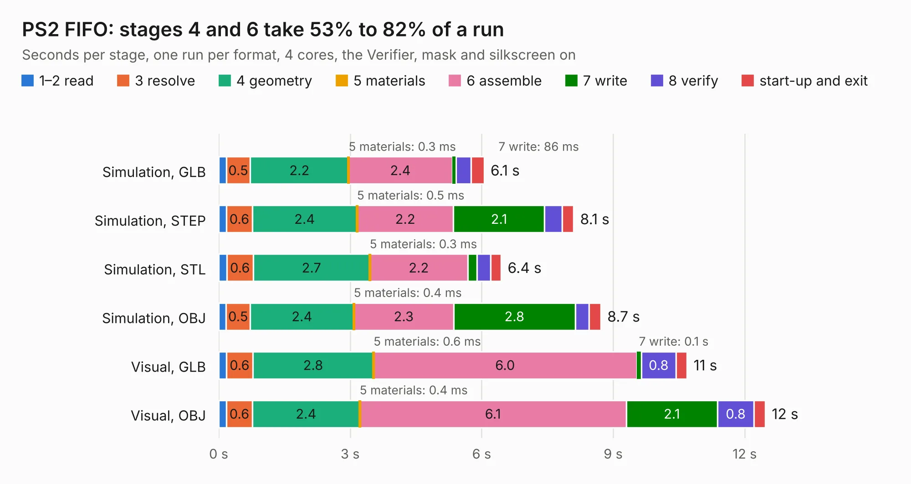

# 241. PS2 FIFO

Board 241 of the 3,100 of [Corpus Testing](../Corpus-Testing.md), on [Corpus Page 3](../CorpusTestingPages/Corpus-Testing-03.md#241-ps2-fifo).

| Mode and format | 1–2 read | 3 resolve | 4 geometry | 5 materials | 6 assemble | 7 write | 8 verify | start-up and exit | Total |
|---|---:|---:|---:|---:|---:|---:|---:|---:|---:|
| Simulation, GLB | 0.2 | 0.5 | 2.2 | 0.3&nbsp;ms | 2.4 | 86&nbsp;ms | 0.3 | 0.3 | 6.1 |
| Simulation, STEP | 0.2 | 0.6 | 2.4 | 0.5&nbsp;ms | 2.2 | 2.1 | 0.4 | 0.3 | 8.1 |
| Simulation, STL | 0.2 | 0.6 | 2.7 | 0.3&nbsp;ms | 2.2 | 0.2 | 0.3 | 0.2 | 6.4 |
| Simulation, OBJ | 0.2 | 0.5 | 2.4 | 0.4&nbsp;ms | 2.3 | 2.8 | 0.3 | 0.3 | 8.7 |
| Visual, GLB | 0.2 | 0.6 | 2.8 | 0.6&nbsp;ms | 6.0 | 0.1 | 0.8 | 0.3 | 10.7 |
| Visual, OBJ | 0.2 | 0.6 | 2.4 | 0.4&nbsp;ms | 6.1 | 2.1 | 0.8 | 0.3 | 12.5 |

<table align="center"><tr><td valign="top">

| Board | Repo: [andrewpaterson/658-Computer](https://github.com/andrewpaterson/658-Computer) Board: `PS2 FIFO.kicad_pcb` |
|---|---|
| Folder | Kicad / Computer / PS2 / PS2 FIFO |
| Complexity | 233&nbsp;/&nbsp;1000 (size&nbsp;163, features&nbsp;70) |
| KESE&nbsp;features | through vias, rounded, trapezoid or chamfered pads, knockout text, stack-up, dielectric εr and tanδ |
| Tested | 9th November 2026 |
| Copper&nbsp;layers | 2 |
| File&nbsp;format | KiCad 9 (20241229) |
| Parts,&nbsp;tracks,&nbsp;vias | 20, 710, 91 |
| Triangles,&nbsp;simulation | 502,188 in 79 parts |
| Verifier | PASS in all six runs |

</td><td valign="top">

<table>
<tr><th>File type</th><th>File size</th><th>Peak memory used</th></tr>
<tr><th colspan="3" align="left">Simulation</th></tr>
<tr><td>GLB</td><td align="right">17&nbsp;MB</td><td align="right">289&nbsp;MB</td></tr>
<tr><td>STEP</td><td align="right">81&nbsp;MB</td><td align="right">365&nbsp;MB</td></tr>
<tr><td>STL</td><td align="right">25&nbsp;MB</td><td align="right">298&nbsp;MB</td></tr>
<tr><td>OBJ</td><td align="right">51&nbsp;MB</td><td align="right">389&nbsp;MB</td></tr>
<tr><th colspan="3" align="left">Visual</th></tr>
<tr><td>GLB</td><td align="right">14&nbsp;MB</td><td align="right">391&nbsp;MB</td></tr>
<tr><td>OBJ</td><td align="right">43&nbsp;MB</td><td align="right">395&nbsp;MB</td></tr>
</table>

</td></tr></table>

| Previous | Next |
|:---|---:|
| [240. PS2 Board](b0240b_658-Computer_PS2-Board.md) | [242. PS2 Timing](b0242b_658-Computer_PS2-Timing.md) |
