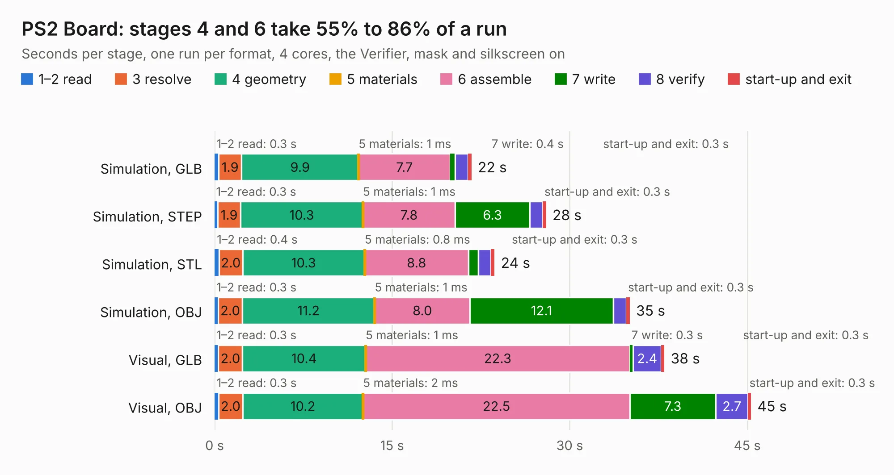

# 242. PS2 Board

Board 242 of the 3,110 of [Corpus Testing](../Corpus-Testing.md), on [Corpus Page 3](../CorpusTestingPages/Corpus-Testing-03.md#242-ps2-board).

| Mode and format | 1–2 read | 3 resolve | 4 geometry | 5 materials | 6 assemble | 7 write | 8 verify | start-up and exit | Total |
|---|---:|---:|---:|---:|---:|---:|---:|---:|---:|
| Simulation, GLB | 0.3 | 1.9 | 9.9 | 1&nbsp;ms | 7.7 | 0.4 | 1.1 | 0.3 | 21.7 |
| Simulation, STEP | 0.3 | 1.9 | 10.3 | 1&nbsp;ms | 7.8 | 6.3 | 1.1 | 0.3 | 28.0 |
| Simulation, STL | 0.4 | 2.0 | 10.3 | 0.8&nbsp;ms | 8.8 | 0.8 | 1.1 | 0.3 | 23.6 |
| Simulation, OBJ | 0.3 | 2.0 | 11.2 | 1&nbsp;ms | 8.0 | 12.1 | 1.1 | 0.3 | 35.1 |
| Visual, GLB | 0.3 | 2.0 | 10.4 | 1&nbsp;ms | 22.3 | 0.3 | 2.4 | 0.3 | 38.0 |
| Visual, OBJ | 0.3 | 2.0 | 10.2 | 2&nbsp;ms | 22.5 | 7.3 | 2.7 | 0.3 | 45.3 |

<table align="center"><tr><td valign="top">

| Board | Repo: [andrewpaterson/658-Computer](https://github.com/andrewpaterson/658-Computer) Board: `PS2 Board.kicad_pcb` |
|---|---|
| Folder | Kicad / Computer / PS2 / PS2 Board |
| Complexity | 254&nbsp;/&nbsp;1000 (size&nbsp;174, features&nbsp;80) |
| KESE&nbsp;features | through vias, rounded, trapezoid or chamfered pads, curved board outline, knockout text, stack-up, dielectric εr and tanδ |
| Tested | 9th November 2026 |
| Copper&nbsp;layers | 2 |
| File&nbsp;format | KiCad 9 (20241229) |
| Parts,&nbsp;tracks,&nbsp;vias | 23, 1,396, 151 |
| Triangles,&nbsp;simulation | 2,527,776 in 268 parts |
| Verifier | PASS in all six runs |

</td><td valign="top">

<table>
<tr><th>File type</th><th>File size</th><th>Peak memory used</th></tr>
<tr><th colspan="3" align="left">Simulation</th></tr>
<tr><td>GLB</td><td align="right">84&nbsp;MB</td><td align="right">881&nbsp;MB</td></tr>
<tr><td>STEP</td><td align="right">348&nbsp;MB</td><td align="right">1.0&nbsp;GB</td></tr>
<tr><td>STL</td><td align="right">126&nbsp;MB</td><td align="right">831&nbsp;MB</td></tr>
<tr><td>OBJ</td><td align="right">263&nbsp;MB</td><td align="right">1.7&nbsp;GB</td></tr>
<tr><th colspan="3" align="left">Visual</th></tr>
<tr><td>GLB</td><td align="right">55&nbsp;MB</td><td align="right">1.2&nbsp;GB</td></tr>
<tr><td>OBJ</td><td align="right">170&nbsp;MB</td><td align="right">1.2&nbsp;GB</td></tr>
</table>

</td></tr></table>

| Previous | Next |
|:---|---:|
| [241. W65C816 Power](b0241b_658-Computer_W65C816-Power.md) | [243. PS2 FIFO](b0243b_658-Computer_PS2-FIFO.md) |
