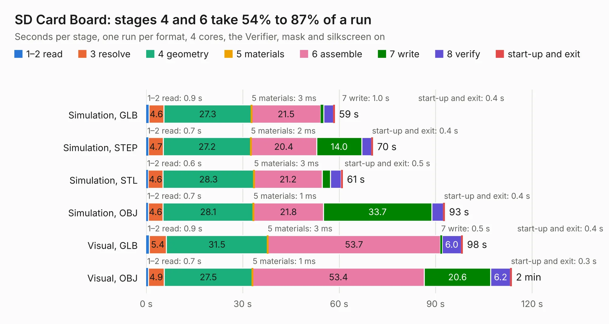

# 243. SD Card Board

Board 243 of the 3,100 of [Corpus Testing](../Corpus-Testing.md), on [Corpus Page 3](../CorpusTestingPages/Corpus-Testing-03.md#243-sd-card-board).

| Mode and format | 1–2 read | 3 resolve | 4 geometry | 5 materials | 6 assemble | 7 write | 8 verify | start-up and exit | Total |
|---|---:|---:|---:|---:|---:|---:|---:|---:|---:|
| Simulation, GLB | 0.9 | 4.6 | 27.3 | 3&nbsp;ms | 21.5 | 1.0 | 3.0 | 0.4 | 58.6 |
| Simulation, STEP | 0.7 | 4.7 | 27.2 | 2&nbsp;ms | 20.4 | 14.0 | 3.0 | 0.4 | 70.5 |
| Simulation, STL | 0.6 | 4.6 | 28.3 | 3&nbsp;ms | 21.2 | 2.6 | 3.3 | 0.5 | 61.1 |
| Simulation, OBJ | 0.7 | 4.6 | 28.1 | 1&nbsp;ms | 21.8 | 33.7 | 3.6 | 0.4 | 92.8 |
| Visual, GLB | 0.9 | 5.4 | 31.5 | 3&nbsp;ms | 53.7 | 0.5 | 6.0 | 0.4 | 98.4 |
| Visual, OBJ | 0.7 | 4.9 | 27.5 | 1&nbsp;ms | 53.4 | 20.6 | 6.2 | 0.3 | 113.6 |

<table align="center"><tr><td valign="top">

| Board | Repo: [andrewpaterson/658-Computer](https://github.com/andrewpaterson/658-Computer) Board: `SD Card Board.kicad_pcb` |
|---|---|
| Folder | Kicad / Computer / SD Card / SD Card Board |
| Complexity | 269&nbsp;/&nbsp;1000 (size&nbsp;189, features&nbsp;80) |
| KESE&nbsp;features | through vias, rounded, trapezoid or chamfered pads, curved board outline, knockout text, stack-up, dielectric εr and tanδ |
| Tested | 9th November 2026 |
| Copper&nbsp;layers | 2 |
| File&nbsp;format | KiCad 9 (20241229) |
| Parts,&nbsp;tracks,&nbsp;vias | 30, 2,871, 323 |
| Triangles,&nbsp;simulation | 4,703,678 in 427 parts |
| Verifier | PASS in all six runs |

</td><td valign="top">

<table>
<tr><th>File type</th><th>File size</th><th>Peak memory used</th></tr>
<tr><th colspan="3" align="left">Simulation</th></tr>
<tr><td>GLB</td><td align="right">159&nbsp;MB</td><td align="right">1.6&nbsp;GB</td></tr>
<tr><td>STEP</td><td align="right">740&nbsp;MB</td><td align="right">1.8&nbsp;GB</td></tr>
<tr><td>STL</td><td align="right">235&nbsp;MB</td><td align="right">1.7&nbsp;GB</td></tr>
<tr><td>OBJ</td><td align="right">501&nbsp;MB</td><td align="right">3.0&nbsp;GB</td></tr>
<tr><th colspan="3" align="left">Visual</th></tr>
<tr><td>GLB</td><td align="right">101&nbsp;MB</td><td align="right">1.8&nbsp;GB</td></tr>
<tr><td>OBJ</td><td align="right">322&nbsp;MB</td><td align="right">2.2&nbsp;GB</td></tr>
</table>

</td></tr></table>

| Previous | Next |
|:---|---:|
| [242. PS2 Timing](b0242b_658-Computer_PS2-Timing.md) | [244. SD Card Clock](b0244b_658-Computer_SD-Card-Clock.md) |
