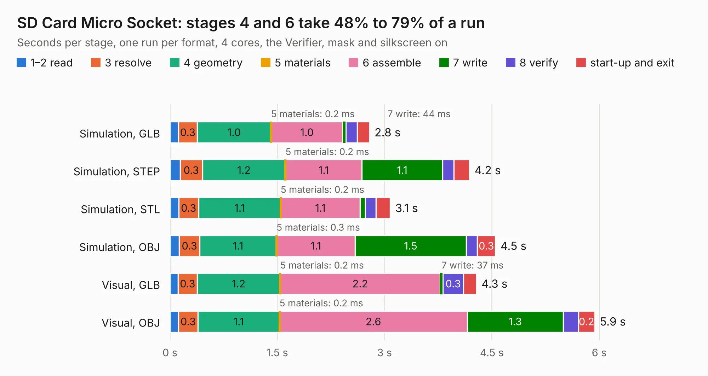

# 248. SD Card Micro Socket

Board 248 of the 3,117 of [Corpus Testing](../Corpus-Testing.md), on [Corpus Page 3](../CorpusTestingPages/Corpus-Testing-03.md#248-sd-card-micro-socket).

| Mode and format | 1–2 read | 3 resolve | 4 geometry | 5 materials | 6 assemble | 7 write | 8 verify | start-up and exit | Total |
|---|---:|---:|---:|---:|---:|---:|---:|---:|---:|
| Simulation, GLB | 0.1 | 0.3 | 1.0 | 0.2&nbsp;ms | 1.0 | 44&nbsp;ms | 0.2 | 0.2 | 2.8 |
| Simulation, STEP | 0.1 | 0.3 | 1.2 | 0.2&nbsp;ms | 1.1 | 1.1 | 0.2 | 0.2 | 4.2 |
| Simulation, STL | 0.1 | 0.3 | 1.1 | 0.2&nbsp;ms | 1.1 | 74&nbsp;ms | 0.1 | 0.2 | 3.1 |
| Simulation, OBJ | 0.1 | 0.3 | 1.1 | 0.3&nbsp;ms | 1.1 | 1.5 | 0.2 | 0.3 | 4.5 |
| Visual, GLB | 0.1 | 0.3 | 1.2 | 0.2&nbsp;ms | 2.2 | 37&nbsp;ms | 0.3 | 0.2 | 4.3 |
| Visual, OBJ | 0.1 | 0.3 | 1.1 | 0.2&nbsp;ms | 2.6 | 1.3 | 0.2 | 0.2 | 5.9 |

<table align="center"><tr><td valign="top">

| Board | Repo: [andrewpaterson/658-Computer](https://github.com/andrewpaterson/658-Computer) Board: `SD Card Micro Socket.kicad_pcb` |
|---|---|
| Folder | Kicad / Computer / SD Card / SD Card Micro Socket |
| Complexity | 216&nbsp;/&nbsp;1000 (size&nbsp;146, features&nbsp;70) |
| KESE&nbsp;features | through vias, rounded, trapezoid or chamfered pads, knockout text, stack-up, dielectric εr and tanδ |
| Tested | 9th November 2026 |
| Copper&nbsp;layers | 2 |
| File&nbsp;format | KiCad 9 (20241229) |
| Parts,&nbsp;tracks,&nbsp;vias | 14, 285, 49 |
| Triangles,&nbsp;simulation | 292,164 in 45 parts |
| Verifier | PASS in all six runs |

</td><td valign="top">

<table>
<tr><th>File type</th><th>File size</th><th>Peak memory used</th></tr>
<tr><th colspan="3" align="left">Simulation</th></tr>
<tr><td>GLB</td><td align="right">9.9&nbsp;MB</td><td align="right">236&nbsp;MB</td></tr>
<tr><td>STEP</td><td align="right">42&nbsp;MB</td><td align="right">271&nbsp;MB</td></tr>
<tr><td>STL</td><td align="right">15&nbsp;MB</td><td align="right">238&nbsp;MB</td></tr>
<tr><td>OBJ</td><td align="right">29&nbsp;MB</td><td align="right">253&nbsp;MB</td></tr>
<tr><th colspan="3" align="left">Visual</th></tr>
<tr><td>GLB</td><td align="right">7.9&nbsp;MB</td><td align="right">259&nbsp;MB</td></tr>
<tr><td>OBJ</td><td align="right">23&nbsp;MB</td><td align="right">259&nbsp;MB</td></tr>
</table>

</td></tr></table>

| Previous | Next |
|:---|---:|
| [247. SD Card Full Socket](b0247b_658-Computer_SD-Card-Full-Socket.md) | [249. SD Card Read Data](b0249b_658-Computer_SD-Card-Read-Data.md) |
