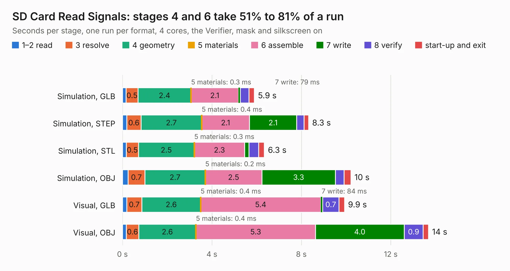

# 251. SD Card Read Signals

Board 251 of the 3,104 of [Corpus Testing](../Corpus-Testing.md), on [Corpus Page 3](../CorpusTestingPages/Corpus-Testing-03.md#251-sd-card-read-signals).

| Mode and format | 1–2 read | 3 resolve | 4 geometry | 5 materials | 6 assemble | 7 write | 8 verify | start-up and exit | Total |
|---|---:|---:|---:|---:|---:|---:|---:|---:|---:|
| Simulation, GLB | 0.2 | 0.5 | 2.4 | 0.3&nbsp;ms | 2.1 | 79&nbsp;ms | 0.4 | 0.2 | 5.9 |
| Simulation, STEP | 0.2 | 0.6 | 2.7 | 0.4&nbsp;ms | 2.1 | 2.1 | 0.3 | 0.2 | 8.3 |
| Simulation, STL | 0.2 | 0.5 | 2.5 | 0.3&nbsp;ms | 2.3 | 0.2 | 0.4 | 0.3 | 6.3 |
| Simulation, OBJ | 0.3 | 0.7 | 2.7 | 0.2&nbsp;ms | 2.5 | 3.3 | 0.4 | 0.3 | 10.2 |
| Visual, GLB | 0.2 | 0.7 | 2.6 | 0.4&nbsp;ms | 5.4 | 84&nbsp;ms | 0.7 | 0.2 | 9.9 |
| Visual, OBJ | 0.2 | 0.6 | 2.6 | 0.4&nbsp;ms | 5.3 | 4.0 | 0.9 | 0.2 | 13.7 |

<table align="center"><tr><td valign="top">

| Board | Repo: [andrewpaterson/658-Computer](https://github.com/andrewpaterson/658-Computer) Board: `SD Card Read Signals.kicad_pcb` |
|---|---|
| Folder | Kicad / Computer / SD Card / SD Card Read Signals |
| Complexity | 230&nbsp;/&nbsp;1000 (size&nbsp;160, features&nbsp;70) |
| KESE&nbsp;features | through vias, rounded, trapezoid or chamfered pads, knockout text, stack-up, dielectric εr and tanδ |
| Tested | 9th November 2026 |
| Copper&nbsp;layers | 2 |
| File&nbsp;format | KiCad 9 (20241229) |
| Parts,&nbsp;tracks,&nbsp;vias | 18, 620, 94 |
| Triangles,&nbsp;simulation | 495,498 in 62 parts |
| Verifier | PASS in all six runs |

</td><td valign="top">

<table>
<tr><th>File type</th><th>File size</th><th>Peak memory used</th></tr>
<tr><th colspan="3" align="left">Simulation</th></tr>
<tr><td>GLB</td><td align="right">17&nbsp;MB</td><td align="right">288&nbsp;MB</td></tr>
<tr><td>STEP</td><td align="right">78&nbsp;MB</td><td align="right">356&nbsp;MB</td></tr>
<tr><td>STL</td><td align="right">25&nbsp;MB</td><td align="right">293&nbsp;MB</td></tr>
<tr><td>OBJ</td><td align="right">50&nbsp;MB</td><td align="right">384&nbsp;MB</td></tr>
<tr><th colspan="3" align="left">Visual</th></tr>
<tr><td>GLB</td><td align="right">14&nbsp;MB</td><td align="right">412&nbsp;MB</td></tr>
<tr><td>OBJ</td><td align="right">42&nbsp;MB</td><td align="right">392&nbsp;MB</td></tr>
</table>

</td></tr></table>

| Previous | Next |
|:---|---:|
| [250. SD Card Read Function](b0250b_658-Computer_SD-Card-Read-Function.md) | [252. SD Card Write Data](b0252b_658-Computer_SD-Card-Write-Data.md) |
