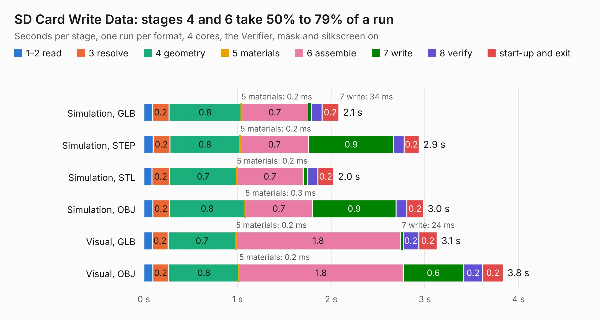

# 253. SD Card Write Data

Board 253 of the 3,125 of [Corpus Testing](../Corpus-Testing.md), on [Corpus Page 3](../CorpusTestingPages/Corpus-Testing-03.md#253-sd-card-write-data).

| Mode and format | 1–2 read | 3 resolve | 4 geometry | 5 materials | 6 assemble | 7 write | 8 verify | start-up and exit | Total |
|---|---:|---:|---:|---:|---:|---:|---:|---:|---:|
| Simulation, GLB | 91&nbsp;ms | 0.2 | 0.8 | 0.2&nbsp;ms | 0.7 | 34&nbsp;ms | 0.1 | 0.2 | 2.1 |
| Simulation, STEP | 98&nbsp;ms | 0.2 | 0.8 | 0.2&nbsp;ms | 0.7 | 0.9 | 0.1 | 0.2 | 2.9 |
| Simulation, STL | 86&nbsp;ms | 0.2 | 0.7 | 0.2&nbsp;ms | 0.7 | 49&nbsp;ms | 0.1 | 0.2 | 2.0 |
| Simulation, OBJ | 95&nbsp;ms | 0.2 | 0.8 | 0.3&nbsp;ms | 0.7 | 0.9 | 0.1 | 0.2 | 3.0 |
| Visual, GLB | 89&nbsp;ms | 0.2 | 0.7 | 0.2&nbsp;ms | 1.8 | 24&nbsp;ms | 0.2 | 0.2 | 3.1 |
| Visual, OBJ | 95&nbsp;ms | 0.2 | 0.8 | 0.2&nbsp;ms | 1.8 | 0.6 | 0.2 | 0.2 | 3.8 |

<table align="center"><tr><td valign="top">

| Board | Repo: [andrewpaterson/658-Computer](https://github.com/andrewpaterson/658-Computer) Board: `SD Card Write Data.kicad_pcb` |
|---|---|
| Folder | Kicad / Computer / SD Card / SD Card Write Data |
| Complexity | 205&nbsp;/&nbsp;1000 (size&nbsp;135, features&nbsp;70) |
| KESE&nbsp;features | through vias, rounded, trapezoid or chamfered pads, knockout text, stack-up, dielectric εr and tanδ |
| Tested | 9th November 2026 |
| Copper&nbsp;layers | 2 |
| File&nbsp;format | KiCad 9 (20241229) |
| Parts,&nbsp;tracks,&nbsp;vias | 7, 255, 32 |
| Triangles,&nbsp;simulation | 231,652 in 40 parts |
| Verifier | PASS in all six runs |

</td><td valign="top">

<table>
<tr><th>File type</th><th>File size</th><th>Peak memory used</th></tr>
<tr><th colspan="3" align="left">Simulation</th></tr>
<tr><td>GLB</td><td align="right">8.0&nbsp;MB</td><td align="right">227&nbsp;MB</td></tr>
<tr><td>STEP</td><td align="right">36&nbsp;MB</td><td align="right">243&nbsp;MB</td></tr>
<tr><td>STL</td><td align="right">12&nbsp;MB</td><td align="right">222&nbsp;MB</td></tr>
<tr><td>OBJ</td><td align="right">23&nbsp;MB</td><td align="right">218&nbsp;MB</td></tr>
<tr><th colspan="3" align="left">Visual</th></tr>
<tr><td>GLB</td><td align="right">5.8&nbsp;MB</td><td align="right">212&nbsp;MB</td></tr>
<tr><td>OBJ</td><td align="right">17&nbsp;MB</td><td align="right">209&nbsp;MB</td></tr>
</table>

</td></tr></table>

| Previous | Next |
|:---|---:|
| [252. SD Card Read Signals](b0252b_658-Computer_SD-Card-Read-Signals.md) | [254. SD Card Write Signals](b0254b_658-Computer_SD-Card-Write-Signals.md) |
