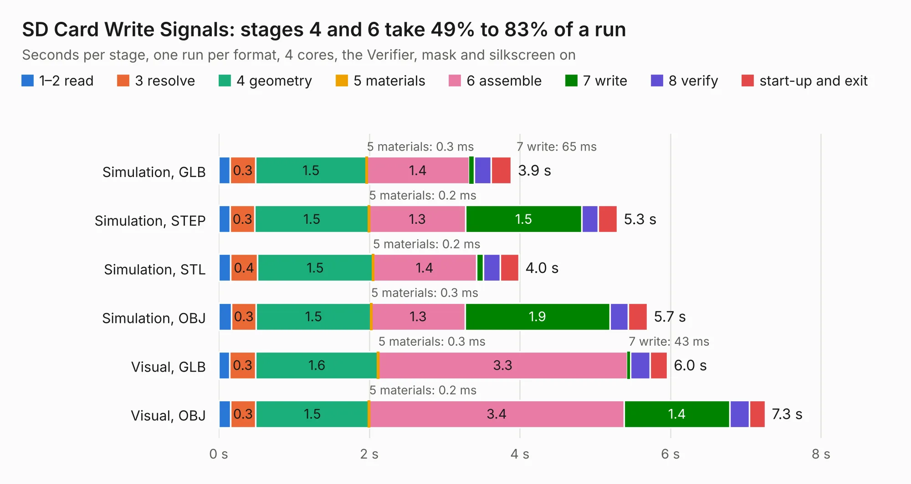

# 254. SD Card Write Signals

Board 254 of the 3,120 of [Corpus Testing](../Corpus-Testing.md), on [Corpus Page 3](../CorpusTestingPages/Corpus-Testing-03.md#254-sd-card-write-signals).

| Mode and format | 1–2 read | 3 resolve | 4 geometry | 5 materials | 6 assemble | 7 write | 8 verify | start-up and exit | Total |
|---|---:|---:|---:|---:|---:|---:|---:|---:|---:|
| Simulation, GLB | 0.2 | 0.3 | 1.5 | 0.3&nbsp;ms | 1.4 | 65&nbsp;ms | 0.2 | 0.3 | 3.9 |
| Simulation, STEP | 0.2 | 0.3 | 1.5 | 0.2&nbsp;ms | 1.3 | 1.5 | 0.2 | 0.3 | 5.3 |
| Simulation, STL | 0.2 | 0.4 | 1.5 | 0.2&nbsp;ms | 1.4 | 91&nbsp;ms | 0.2 | 0.2 | 4.0 |
| Simulation, OBJ | 0.2 | 0.3 | 1.5 | 0.3&nbsp;ms | 1.3 | 1.9 | 0.2 | 0.3 | 5.7 |
| Visual, GLB | 0.1 | 0.3 | 1.6 | 0.3&nbsp;ms | 3.3 | 43&nbsp;ms | 0.3 | 0.2 | 6.0 |
| Visual, OBJ | 0.2 | 0.3 | 1.5 | 0.2&nbsp;ms | 3.4 | 1.4 | 0.3 | 0.2 | 7.3 |

<table align="center"><tr><td valign="top">

| Board | Repo: [andrewpaterson/658-Computer](https://github.com/andrewpaterson/658-Computer) Board: `SD Card Write Signals.kicad_pcb` |
|---|---|
| Folder | Kicad / Computer / SD Card / SD Card Write Signals |
| Complexity | 220&nbsp;/&nbsp;1000 (size&nbsp;150, features&nbsp;70) |
| KESE&nbsp;features | through vias, rounded, trapezoid or chamfered pads, knockout text, stack-up, dielectric εr and tanδ |
| Tested | 9th November 2026 |
| Copper&nbsp;layers | 2 |
| File&nbsp;format | KiCad 9 (20241229) |
| Parts,&nbsp;tracks,&nbsp;vias | 18, 348, 43 |
| Triangles,&nbsp;simulation | 334,140 in 58 parts |
| Verifier | PASS in all six runs |

</td><td valign="top">

<table>
<tr><th>File type</th><th>File size</th><th>Peak memory used</th></tr>
<tr><th colspan="3" align="left">Simulation</th></tr>
<tr><td>GLB</td><td align="right">11&nbsp;MB</td><td align="right">249&nbsp;MB</td></tr>
<tr><td>STEP</td><td align="right">51&nbsp;MB</td><td align="right">282&nbsp;MB</td></tr>
<tr><td>STL</td><td align="right">17&nbsp;MB</td><td align="right">243&nbsp;MB</td></tr>
<tr><td>OBJ</td><td align="right">34&nbsp;MB</td><td align="right">262&nbsp;MB</td></tr>
<tr><th colspan="3" align="left">Visual</th></tr>
<tr><td>GLB</td><td align="right">8.8&nbsp;MB</td><td align="right">277&nbsp;MB</td></tr>
<tr><td>OBJ</td><td align="right">26&nbsp;MB</td><td align="right">279&nbsp;MB</td></tr>
</table>

</td></tr></table>

| Previous | Next |
|:---|---:|
| [253. SD Card Write Data](b0253b_658-Computer_SD-Card-Write-Data.md) | [255. SNES Controller Clock](b0255b_658-Computer_SNES-Controller-Clock.md) |
