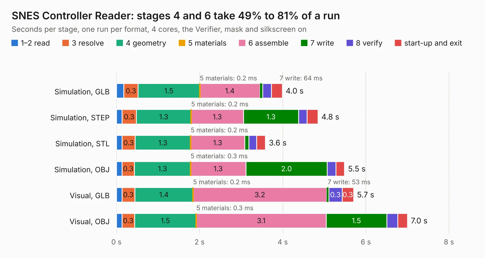

# 255. SNES Controller Reader

Board 255 of the 3,108 of [Corpus Testing](../Corpus-Testing.md), on [Corpus Page 3](../CorpusTestingPages/Corpus-Testing-03.md#255-snes-controller-reader).

| Mode and format | 1–2 read | 3 resolve | 4 geometry | 5 materials | 6 assemble | 7 write | 8 verify | start-up and exit | Total |
|---|---:|---:|---:|---:|---:|---:|---:|---:|---:|
| Simulation, GLB | 0.2 | 0.3 | 1.5 | 0.2&nbsp;ms | 1.4 | 64&nbsp;ms | 0.2 | 0.3 | 4.0 |
| Simulation, STEP | 0.1 | 0.3 | 1.3 | 0.2&nbsp;ms | 1.3 | 1.3 | 0.2 | 0.3 | 4.8 |
| Simulation, STL | 0.1 | 0.3 | 1.3 | 0.2&nbsp;ms | 1.3 | 0.1 | 0.2 | 0.2 | 3.6 |
| Simulation, OBJ | 0.1 | 0.3 | 1.3 | 0.3&nbsp;ms | 1.3 | 2.0 | 0.2 | 0.2 | 5.5 |
| Visual, GLB | 0.1 | 0.3 | 1.4 | 0.2&nbsp;ms | 3.2 | 53&nbsp;ms | 0.3 | 0.3 | 5.7 |
| Visual, OBJ | 0.1 | 0.3 | 1.5 | 0.3&nbsp;ms | 3.1 | 1.5 | 0.3 | 0.2 | 7.0 |

<table align="center"><tr><td valign="top">

| Board | Repo: [andrewpaterson/658-Computer](https://github.com/andrewpaterson/658-Computer) Board: `SNES Controller Reader.kicad_pcb` |
|---|---|
| Folder | Kicad / Computer / SNES / SNES Controller Reader |
| Complexity | 215&nbsp;/&nbsp;1000 (size&nbsp;145, features&nbsp;70) |
| KESE&nbsp;features | through vias, rounded, trapezoid or chamfered pads, knockout text, stack-up, dielectric εr and tanδ |
| Tested | 9th November 2026 |
| Copper&nbsp;layers | 2 |
| File&nbsp;format | KiCad 9 (20241229) |
| Parts,&nbsp;tracks,&nbsp;vias | 12, 332, 39 |
| Triangles,&nbsp;simulation | 305,672 in 37 parts |
| Verifier | PASS in all six runs |

</td><td valign="top">

<table>
<tr><th>File type</th><th>File size</th><th>Peak memory used</th></tr>
<tr><th colspan="3" align="left">Simulation</th></tr>
<tr><td>GLB</td><td align="right">10&nbsp;MB</td><td align="right">244&nbsp;MB</td></tr>
<tr><td>STEP</td><td align="right">45&nbsp;MB</td><td align="right">272&nbsp;MB</td></tr>
<tr><td>STL</td><td align="right">15&nbsp;MB</td><td align="right">237&nbsp;MB</td></tr>
<tr><td>OBJ</td><td align="right">30&nbsp;MB</td><td align="right">268&nbsp;MB</td></tr>
<tr><th colspan="3" align="left">Visual</th></tr>
<tr><td>GLB</td><td align="right">7.9&nbsp;MB</td><td align="right">259&nbsp;MB</td></tr>
<tr><td>OBJ</td><td align="right">23&nbsp;MB</td><td align="right">255&nbsp;MB</td></tr>
</table>

</td></tr></table>

| Previous | Next |
|:---|---:|
| [254. SNES Controller Clock](b0254b_658-Computer_SNES-Controller-Clock.md) | [256. RS232](b0256b_658-Computer_RS232.md) |
