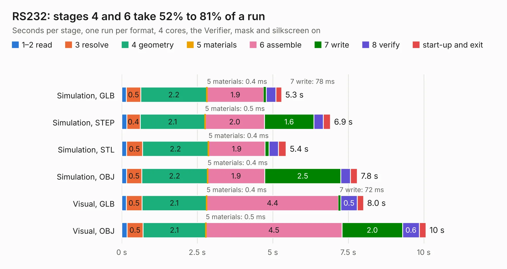

# 256. RS232

Board 256 of the 3,106 of [Corpus Testing](../Corpus-Testing.md), on [Corpus Page 3](../CorpusTestingPages/Corpus-Testing-03.md#256-rs232).

| Mode and format | 1–2 read | 3 resolve | 4 geometry | 5 materials | 6 assemble | 7 write | 8 verify | start-up and exit | Total |
|---|---:|---:|---:|---:|---:|---:|---:|---:|---:|
| Simulation, GLB | 0.2 | 0.5 | 2.2 | 0.4&nbsp;ms | 1.9 | 78&nbsp;ms | 0.3 | 0.2 | 5.3 |
| Simulation, STEP | 0.2 | 0.4 | 2.1 | 0.5&nbsp;ms | 2.0 | 1.6 | 0.3 | 0.2 | 6.9 |
| Simulation, STL | 0.2 | 0.5 | 2.2 | 0.4&nbsp;ms | 1.9 | 0.1 | 0.3 | 0.3 | 5.4 |
| Simulation, OBJ | 0.2 | 0.5 | 2.2 | 0.4&nbsp;ms | 1.9 | 2.5 | 0.3 | 0.2 | 7.8 |
| Visual, GLB | 0.1 | 0.5 | 2.1 | 0.4&nbsp;ms | 4.4 | 72&nbsp;ms | 0.5 | 0.2 | 8.0 |
| Visual, OBJ | 0.2 | 0.5 | 2.1 | 0.5&nbsp;ms | 4.5 | 2.0 | 0.6 | 0.2 | 10.1 |

<table align="center"><tr><td valign="top">

| Board | Repo: [andrewpaterson/658-Computer](https://github.com/andrewpaterson/658-Computer) Board: `RS232.kicad_pcb` |
|---|---|
| Folder | Kicad / Computer / UART / RS232 |
| Complexity | 281&nbsp;/&nbsp;1000 (size&nbsp;201, features&nbsp;80) |
| KESE&nbsp;features | through vias, rounded, trapezoid or chamfered pads, curved board outline, knockout text, stack-up, dielectric εr and tanδ |
| Tested | 9th November 2026 |
| Copper&nbsp;layers | 2 |
| File&nbsp;format | KiCad 9 (20241229) |
| Parts,&nbsp;tracks,&nbsp;vias | 21, 611, 87 |
| Triangles,&nbsp;simulation | 533,172 in 85 parts |
| Verifier | PASS in all six runs |

</td><td valign="top">

<table>
<tr><th>File type</th><th>File size</th><th>Peak memory used</th></tr>
<tr><th colspan="3" align="left">Simulation</th></tr>
<tr><td>GLB</td><td align="right">18&nbsp;MB</td><td align="right">303&nbsp;MB</td></tr>
<tr><td>STEP</td><td align="right">82&nbsp;MB</td><td align="right">372&nbsp;MB</td></tr>
<tr><td>STL</td><td align="right">27&nbsp;MB</td><td align="right">300&nbsp;MB</td></tr>
<tr><td>OBJ</td><td align="right">54&nbsp;MB</td><td align="right">410&nbsp;MB</td></tr>
<tr><th colspan="3" align="left">Visual</th></tr>
<tr><td>GLB</td><td align="right">14&nbsp;MB</td><td align="right">389&nbsp;MB</td></tr>
<tr><td>OBJ</td><td align="right">43&nbsp;MB</td><td align="right">382&nbsp;MB</td></tr>
</table>

</td></tr></table>

| Previous | Next |
|:---|---:|
| [255. SNES Controller Reader](b0255b_658-Computer_SNES-Controller-Reader.md) | [257. TTL5V](b0257b_658-Computer_TTL5V.md) |
