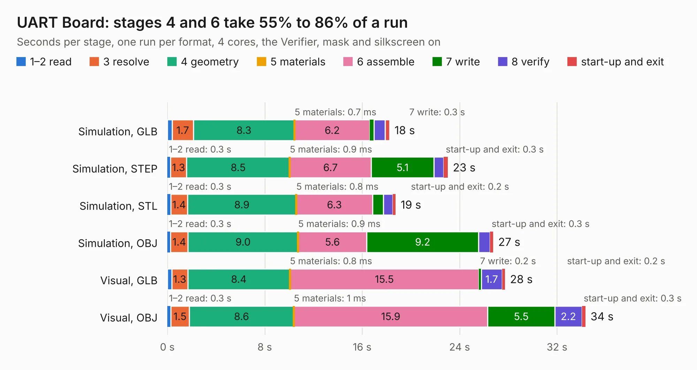

# 257. UART Board

Board 257 of the 3,103 of [Corpus Testing](../Corpus-Testing.md), on [Corpus Page 3](../CorpusTestingPages/Corpus-Testing-03.md#257-uart-board).

| Mode and format | 1–2 read | 3 resolve | 4 geometry | 5 materials | 6 assemble | 7 write | 8 verify | start-up and exit | Total |
|---|---:|---:|---:|---:|---:|---:|---:|---:|---:|
| Simulation, GLB | 0.4 | 1.7 | 8.3 | 0.7&nbsp;ms | 6.2 | 0.3 | 0.9 | 0.4 | 18.2 |
| Simulation, STEP | 0.3 | 1.3 | 8.5 | 0.9&nbsp;ms | 6.7 | 5.1 | 0.8 | 0.3 | 23.0 |
| Simulation, STL | 0.3 | 1.4 | 8.9 | 0.8&nbsp;ms | 6.3 | 0.9 | 0.8 | 0.2 | 18.8 |
| Simulation, OBJ | 0.3 | 1.4 | 9.0 | 0.9&nbsp;ms | 5.6 | 9.2 | 0.9 | 0.3 | 26.8 |
| Visual, GLB | 0.4 | 1.3 | 8.4 | 0.8&nbsp;ms | 15.5 | 0.2 | 1.7 | 0.2 | 27.7 |
| Visual, OBJ | 0.3 | 1.5 | 8.6 | 1&nbsp;ms | 15.9 | 5.5 | 2.2 | 0.3 | 34.3 |

<table align="center"><tr><td valign="top">

| Board | Repo: [andrewpaterson/658-Computer](https://github.com/andrewpaterson/658-Computer) Board: `UART Board.kicad_pcb` |
|---|---|
| Folder | Kicad / Computer / UART / UART Board |
| Complexity | 243&nbsp;/&nbsp;1000 (size&nbsp;163, features&nbsp;80) |
| KESE&nbsp;features | through vias, rounded, trapezoid or chamfered pads, curved board outline, knockout text, stack-up, dielectric εr and tanδ |
| Tested | 9th November 2026 |
| Copper&nbsp;layers | 2 |
| File&nbsp;format | KiCad 9 (20241229) |
| Parts,&nbsp;tracks,&nbsp;vias | 14, 873, 123 |
| Triangles,&nbsp;simulation | 1,667,694 in 181 parts |
| Verifier | PASS in all six runs |

</td><td valign="top">

<table>
<tr><th>File type</th><th>File size</th><th>Peak memory used</th></tr>
<tr><th colspan="3" align="left">Simulation</th></tr>
<tr><td>GLB</td><td align="right">57&nbsp;MB</td><td align="right">728&nbsp;MB</td></tr>
<tr><td>STEP</td><td align="right">265&nbsp;MB</td><td align="right">728&nbsp;MB</td></tr>
<tr><td>STL</td><td align="right">83&nbsp;MB</td><td align="right">717&nbsp;MB</td></tr>
<tr><td>OBJ</td><td align="right">174&nbsp;MB</td><td align="right">1.1&nbsp;GB</td></tr>
<tr><th colspan="3" align="left">Visual</th></tr>
<tr><td>GLB</td><td align="right">37&nbsp;MB</td><td align="right">719&nbsp;MB</td></tr>
<tr><td>OBJ</td><td align="right">112&nbsp;MB</td><td align="right">843&nbsp;MB</td></tr>
</table>

</td></tr></table>

| Previous | Next |
|:---|---:|
| [256. TTL5V](b0256b_658-Computer_TTL5V.md) | [258. UART Signals](b0258b_658-Computer_UART-Signals.md) |
