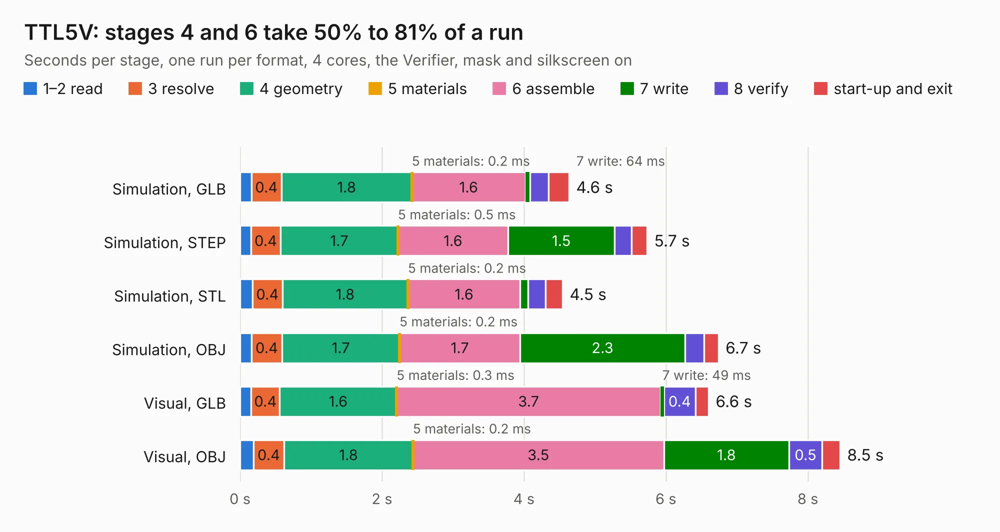

# 258. TTL5V

Board 258 of the 3,119 of [Corpus Testing](../Corpus-Testing.md), on [Corpus Page 3](../CorpusTestingPages/Corpus-Testing-03.md#258-ttl5v).

| Mode and format | 1–2 read | 3 resolve | 4 geometry | 5 materials | 6 assemble | 7 write | 8 verify | start-up and exit | Total |
|---|---:|---:|---:|---:|---:|---:|---:|---:|---:|
| Simulation, GLB | 0.2 | 0.4 | 1.8 | 0.2&nbsp;ms | 1.6 | 64&nbsp;ms | 0.3 | 0.3 | 4.6 |
| Simulation, STEP | 0.2 | 0.4 | 1.7 | 0.5&nbsp;ms | 1.6 | 1.5 | 0.2 | 0.2 | 5.7 |
| Simulation, STL | 0.2 | 0.4 | 1.8 | 0.2&nbsp;ms | 1.6 | 0.1 | 0.2 | 0.2 | 4.5 |
| Simulation, OBJ | 0.2 | 0.4 | 1.7 | 0.2&nbsp;ms | 1.7 | 2.3 | 0.3 | 0.2 | 6.7 |
| Visual, GLB | 0.2 | 0.4 | 1.6 | 0.3&nbsp;ms | 3.7 | 49&nbsp;ms | 0.4 | 0.2 | 6.6 |
| Visual, OBJ | 0.2 | 0.4 | 1.8 | 0.2&nbsp;ms | 3.5 | 1.8 | 0.5 | 0.3 | 8.5 |

<table align="center"><tr><td valign="top">

| Board | Repo: [andrewpaterson/658-Computer](https://github.com/andrewpaterson/658-Computer) Board: `TTL5V.kicad_pcb` |
|---|---|
| Folder | Kicad / Computer / UART / TTL5V |
| Complexity | 276&nbsp;/&nbsp;1000 (size&nbsp;196, features&nbsp;80) |
| KESE&nbsp;features | through vias, rounded, trapezoid or chamfered pads, curved board outline, knockout text, stack-up, dielectric εr and tanδ |
| Tested | 9th November 2026 |
| Copper&nbsp;layers | 2 |
| File&nbsp;format | KiCad 9 (20241229) |
| Parts,&nbsp;tracks,&nbsp;vias | 16, 558, 69 |
| Triangles,&nbsp;simulation | 432,350 in 70 parts |
| Verifier | PASS in all six runs |

</td><td valign="top">

<table>
<tr><th>File type</th><th>File size</th><th>Peak memory used</th></tr>
<tr><th colspan="3" align="left">Simulation</th></tr>
<tr><td>GLB</td><td align="right">15&nbsp;MB</td><td align="right">275&nbsp;MB</td></tr>
<tr><td>STEP</td><td align="right">65&nbsp;MB</td><td align="right">327&nbsp;MB</td></tr>
<tr><td>STL</td><td align="right">22&nbsp;MB</td><td align="right">272&nbsp;MB</td></tr>
<tr><td>OBJ</td><td align="right">44&nbsp;MB</td><td align="right">342&nbsp;MB</td></tr>
<tr><th colspan="3" align="left">Visual</th></tr>
<tr><td>GLB</td><td align="right">11&nbsp;MB</td><td align="right">328&nbsp;MB</td></tr>
<tr><td>OBJ</td><td align="right">34&nbsp;MB</td><td align="right">332&nbsp;MB</td></tr>
</table>

</td></tr></table>

| Previous | Next |
|:---|---:|
| [257. RS232](b0257b_658-Computer_RS232.md) | [259. UART Board](b0259b_658-Computer_UART-Board.md) |
