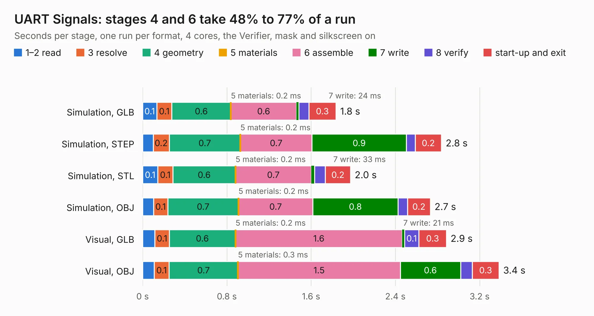

# 260. UART Signals

Board 260 of the 3,124 of [Corpus Testing](../Corpus-Testing.md), on [Corpus Page 3](../CorpusTestingPages/Corpus-Testing-03.md#260-uart-signals).

| Mode and format | 1–2 read | 3 resolve | 4 geometry | 5 materials | 6 assemble | 7 write | 8 verify | start-up and exit | Total |
|---|---:|---:|---:|---:|---:|---:|---:|---:|---:|
| Simulation, GLB | 0.1 | 0.1 | 0.6 | 0.2&nbsp;ms | 0.6 | 24&nbsp;ms | 94&nbsp;ms | 0.3 | 1.8 |
| Simulation, STEP | 0.1 | 0.2 | 0.7 | 0.2&nbsp;ms | 0.7 | 0.9 | 83&nbsp;ms | 0.2 | 2.8 |
| Simulation, STL | 0.1 | 0.1 | 0.6 | 0.2&nbsp;ms | 0.7 | 33&nbsp;ms | 0.1 | 0.2 | 2.0 |
| Simulation, OBJ | 0.1 | 0.1 | 0.7 | 0.2&nbsp;ms | 0.7 | 0.8 | 91&nbsp;ms | 0.2 | 2.7 |
| Visual, GLB | 0.1 | 0.1 | 0.6 | 0.2&nbsp;ms | 1.6 | 21&nbsp;ms | 0.1 | 0.3 | 2.9 |
| Visual, OBJ | 0.1 | 0.1 | 0.7 | 0.3&nbsp;ms | 1.5 | 0.6 | 0.1 | 0.3 | 3.4 |

<table align="center"><tr><td valign="top">

| Board | Repo: [andrewpaterson/658-Computer](https://github.com/andrewpaterson/658-Computer) Board: `UART Signals.kicad_pcb` |
|---|---|
| Folder | Kicad / Computer / UART / UART Signals |
| Complexity | 192&nbsp;/&nbsp;1000 (size&nbsp;122, features&nbsp;70) |
| KESE&nbsp;features | through vias, rounded, trapezoid or chamfered pads, knockout text, stack-up, dielectric εr and tanδ |
| Tested | 9th November 2026 |
| Copper&nbsp;layers | 2 |
| File&nbsp;format | KiCad 9 (20241229) |
| Parts,&nbsp;tracks,&nbsp;vias | 9, 105, 9 |
| Triangles,&nbsp;simulation | 124,004 in 28 parts |
| Verifier | PASS in all six runs |

</td><td valign="top">

<table>
<tr><th>File type</th><th>File size</th><th>Peak memory used</th></tr>
<tr><th colspan="3" align="left">Simulation</th></tr>
<tr><td>GLB</td><td align="right">4.4&nbsp;MB</td><td align="right">195&nbsp;MB</td></tr>
<tr><td>STEP</td><td align="right">21&nbsp;MB</td><td align="right">196&nbsp;MB</td></tr>
<tr><td>STL</td><td align="right">6.2&nbsp;MB</td><td align="right">189&nbsp;MB</td></tr>
<tr><td>OBJ</td><td align="right">12&nbsp;MB</td><td align="right">189&nbsp;MB</td></tr>
<tr><th colspan="3" align="left">Visual</th></tr>
<tr><td>GLB</td><td align="right">3.4&nbsp;MB</td><td align="right">162&nbsp;MB</td></tr>
<tr><td>OBJ</td><td align="right">9.6&nbsp;MB</td><td align="right">160&nbsp;MB</td></tr>
</table>

</td></tr></table>

| Previous | Next |
|:---|---:|
| [259. UART Board](b0259b_658-Computer_UART-Board.md) | [261. VIA Board](b0261b_658-Computer_VIA-Board.md) |
