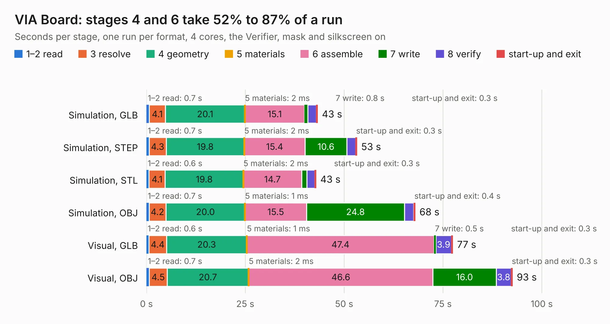

# 261. VIA Board

Board 261 of the 3,130 of [Corpus Testing](../Corpus-Testing.md), on [Corpus Page 3](../CorpusTestingPages/Corpus-Testing-03.md#261-via-board).

| Mode and format | 1–2 read | 3 resolve | 4 geometry | 5 materials | 6 assemble | 7 write | 8 verify | start-up and exit | Total |
|---|---:|---:|---:|---:|---:|---:|---:|---:|---:|
| Simulation, GLB | 0.7 | 4.1 | 20.1 | 2&nbsp;ms | 15.1 | 0.8 | 2.2 | 0.3 | 43.3 |
| Simulation, STEP | 0.7 | 4.3 | 19.8 | 2&nbsp;ms | 15.4 | 10.6 | 2.2 | 0.3 | 53.2 |
| Simulation, STL | 0.6 | 4.1 | 19.8 | 2&nbsp;ms | 14.7 | 1.3 | 2.0 | 0.3 | 42.9 |
| Simulation, OBJ | 0.7 | 4.2 | 20.0 | 1&nbsp;ms | 15.5 | 24.8 | 2.3 | 0.4 | 68.0 |
| Visual, GLB | 0.6 | 4.4 | 20.3 | 1&nbsp;ms | 47.4 | 0.5 | 3.9 | 0.3 | 77.5 |
| Visual, OBJ | 0.7 | 4.5 | 20.7 | 2&nbsp;ms | 46.6 | 16.0 | 3.8 | 0.3 | 92.6 |

<table align="center"><tr><td valign="top">

| Board | Repo: [andrewpaterson/658-Computer](https://github.com/andrewpaterson/658-Computer) Board: `VIA Board.kicad_pcb` |
|---|---|
| Folder | Kicad / Computer / VIA / VIA Board |
| Complexity | 269&nbsp;/&nbsp;1000 (size&nbsp;189, features&nbsp;80) |
| KESE&nbsp;features | through vias, rounded, trapezoid or chamfered pads, curved board outline, knockout text, stack-up, dielectric εr and tanδ |
| Tested | 9th November 2026 |
| Copper&nbsp;layers | 2 |
| File&nbsp;format | KiCad 9 (20241229) |
| Parts,&nbsp;tracks,&nbsp;vias | 28, 3,012, 337 |
| Triangles,&nbsp;simulation | 4,037,762 in 338 parts |
| Verifier | PASS in all six runs |

</td><td valign="top">

<table>
<tr><th>File type</th><th>File size</th><th>Peak memory used</th></tr>
<tr><th colspan="3" align="left">Simulation</th></tr>
<tr><td>GLB</td><td align="right">136&nbsp;MB</td><td align="right">1.3&nbsp;GB</td></tr>
<tr><td>STEP</td><td align="right">568&nbsp;MB</td><td align="right">1.6&nbsp;GB</td></tr>
<tr><td>STL</td><td align="right">202&nbsp;MB</td><td align="right">1.3&nbsp;GB</td></tr>
<tr><td>OBJ</td><td align="right">424&nbsp;MB</td><td align="right">2.5&nbsp;GB</td></tr>
<tr><th colspan="3" align="left">Visual</th></tr>
<tr><td>GLB</td><td align="right">92&nbsp;MB</td><td align="right">1.6&nbsp;GB</td></tr>
<tr><td>OBJ</td><td align="right">294&nbsp;MB</td><td align="right">2.0&nbsp;GB</td></tr>
</table>

</td></tr></table>

| Previous | Next |
|:---|---:|
| [260. UART Signals](b0260b_658-Computer_UART-Signals.md) | [262. VIA Breakout](b0262b_658-Computer_VIA-Breakout.md) |
