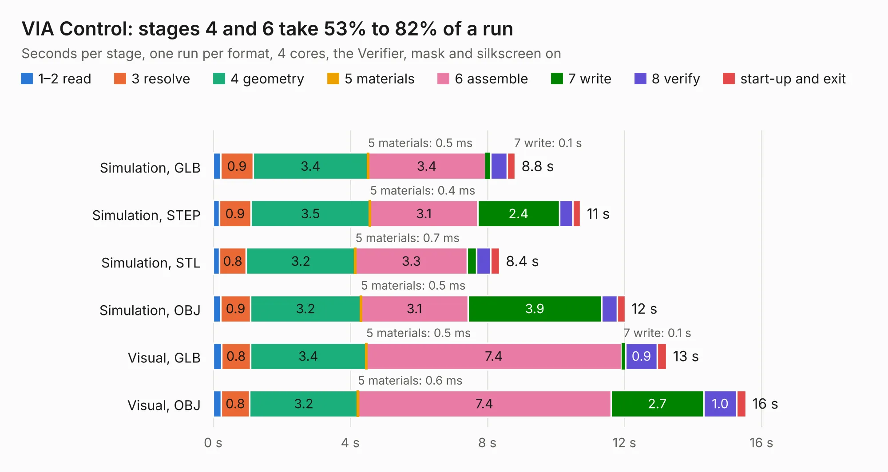

# 263. VIA Control

Board 263 of the 3,118 of [Corpus Testing](../Corpus-Testing.md), on [Corpus Page 3](../CorpusTestingPages/Corpus-Testing-03.md#263-via-control).

| Mode and format | 1–2 read | 3 resolve | 4 geometry | 5 materials | 6 assemble | 7 write | 8 verify | start-up and exit | Total |
|---|---:|---:|---:|---:|---:|---:|---:|---:|---:|
| Simulation, GLB | 0.2 | 0.9 | 3.4 | 0.5&nbsp;ms | 3.4 | 0.1 | 0.5 | 0.2 | 8.8 |
| Simulation, STEP | 0.2 | 0.9 | 3.5 | 0.4&nbsp;ms | 3.1 | 2.4 | 0.4 | 0.2 | 10.7 |
| Simulation, STL | 0.2 | 0.8 | 3.2 | 0.7&nbsp;ms | 3.3 | 0.3 | 0.4 | 0.3 | 8.4 |
| Simulation, OBJ | 0.2 | 0.9 | 3.2 | 0.5&nbsp;ms | 3.1 | 3.9 | 0.4 | 0.2 | 12.0 |
| Visual, GLB | 0.2 | 0.8 | 3.4 | 0.5&nbsp;ms | 7.4 | 0.1 | 0.9 | 0.3 | 13.2 |
| Visual, OBJ | 0.2 | 0.8 | 3.2 | 0.6&nbsp;ms | 7.4 | 2.7 | 1.0 | 0.3 | 15.5 |

<table align="center"><tr><td valign="top">

| Board | Repo: [andrewpaterson/658-Computer](https://github.com/andrewpaterson/658-Computer) Board: `VIA Control.kicad_pcb` |
|---|---|
| Folder | Kicad / Computer / VIA / VIA Control |
| Complexity | 243&nbsp;/&nbsp;1000 (size&nbsp;173, features&nbsp;70) |
| KESE&nbsp;features | through vias, rounded, trapezoid or chamfered pads, knockout text, stack-up, dielectric εr and tanδ |
| Tested | 9th November 2026 |
| Copper&nbsp;layers | 2 |
| File&nbsp;format | KiCad 9 (20241229) |
| Parts,&nbsp;tracks,&nbsp;vias | 28, 1,020, 154 |
| Triangles,&nbsp;simulation | 807,056 in 106 parts |
| Verifier | PASS in all six runs |

</td><td valign="top">

<table>
<tr><th>File type</th><th>File size</th><th>Peak memory used</th></tr>
<tr><th colspan="3" align="left">Simulation</th></tr>
<tr><td>GLB</td><td align="right">28&nbsp;MB</td><td align="right">373&nbsp;MB</td></tr>
<tr><td>STEP</td><td align="right">126&nbsp;MB</td><td align="right">478&nbsp;MB</td></tr>
<tr><td>STL</td><td align="right">40&nbsp;MB</td><td align="right">387&nbsp;MB</td></tr>
<tr><td>OBJ</td><td align="right">82&nbsp;MB</td><td align="right">584&nbsp;MB</td></tr>
<tr><th colspan="3" align="left">Visual</th></tr>
<tr><td>GLB</td><td align="right">23&nbsp;MB</td><td align="right">559&nbsp;MB</td></tr>
<tr><td>OBJ</td><td align="right">68&nbsp;MB</td><td align="right">585&nbsp;MB</td></tr>
</table>

</td></tr></table>

| Previous | Next |
|:---|---:|
| [262. VIA Breakout](b0262b_658-Computer_VIA-Breakout.md) | [264. Video Address Reader](b0264b_658-Computer_Video-Address-Reader.md) |
