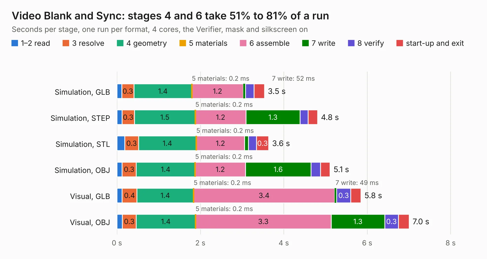

# 265. Video Blank and Sync

Board 265 of the 3,132 of [Corpus Testing](../Corpus-Testing.md), on [Corpus Page 3](../CorpusTestingPages/Corpus-Testing-03.md#265-video-blank-and-sync).

| Mode and format | 1–2 read | 3 resolve | 4 geometry | 5 materials | 6 assemble | 7 write | 8 verify | start-up and exit | Total |
|---|---:|---:|---:|---:|---:|---:|---:|---:|---:|
| Simulation, GLB | 0.1 | 0.3 | 1.4 | 0.2&nbsp;ms | 1.2 | 52&nbsp;ms | 0.2 | 0.3 | 3.5 |
| Simulation, STEP | 0.1 | 0.3 | 1.5 | 0.2&nbsp;ms | 1.2 | 1.3 | 0.2 | 0.2 | 4.8 |
| Simulation, STL | 0.2 | 0.3 | 1.4 | 0.2&nbsp;ms | 1.2 | 90&nbsp;ms | 0.2 | 0.3 | 3.6 |
| Simulation, OBJ | 0.1 | 0.3 | 1.4 | 0.2&nbsp;ms | 1.2 | 1.6 | 0.2 | 0.2 | 5.1 |
| Visual, GLB | 0.1 | 0.4 | 1.4 | 0.2&nbsp;ms | 3.4 | 49&nbsp;ms | 0.3 | 0.2 | 5.8 |
| Visual, OBJ | 0.1 | 0.3 | 1.4 | 0.2&nbsp;ms | 3.3 | 1.3 | 0.3 | 0.3 | 7.0 |

<table align="center"><tr><td valign="top">

| Board | Repo: [andrewpaterson/658-Computer](https://github.com/andrewpaterson/658-Computer) Board: `Video Blank and Sync.kicad_pcb` |
|---|---|
| Folder | Kicad / Computer / Video / Video Blank and Sync |
| Complexity | 213&nbsp;/&nbsp;1000 (size&nbsp;143, features&nbsp;70) |
| KESE&nbsp;features | through vias, rounded, trapezoid or chamfered pads, knockout text, stack-up, dielectric εr and tanδ |
| Tested | 9th November 2026 |
| Copper&nbsp;layers | 2 |
| File&nbsp;format | KiCad 9 (20241229) |
| Parts,&nbsp;tracks,&nbsp;vias | 10, 301, 49 |
| Triangles,&nbsp;simulation | 336,140 in 44 parts |
| Verifier | PASS in all six runs |

</td><td valign="top">

<table>
<tr><th>File type</th><th>File size</th><th>Peak memory used</th></tr>
<tr><th colspan="3" align="left">Simulation</th></tr>
<tr><td>GLB</td><td align="right">12&nbsp;MB</td><td align="right">246&nbsp;MB</td></tr>
<tr><td>STEP</td><td align="right">51&nbsp;MB</td><td align="right">287&nbsp;MB</td></tr>
<tr><td>STL</td><td align="right">17&nbsp;MB</td><td align="right">254&nbsp;MB</td></tr>
<tr><td>OBJ</td><td align="right">34&nbsp;MB</td><td align="right">270&nbsp;MB</td></tr>
<tr><th colspan="3" align="left">Visual</th></tr>
<tr><td>GLB</td><td align="right">8.8&nbsp;MB</td><td align="right">285&nbsp;MB</td></tr>
<tr><td>OBJ</td><td align="right">26&nbsp;MB</td><td align="right">277&nbsp;MB</td></tr>
</table>

</td></tr></table>

| Previous | Next |
|:---|---:|
| [264. Video Address Reader](b0264b_658-Computer_Video-Address-Reader.md) | [266. Video Board - Memory](b0266b_658-Computer_Video-Board-Memory.md) |
