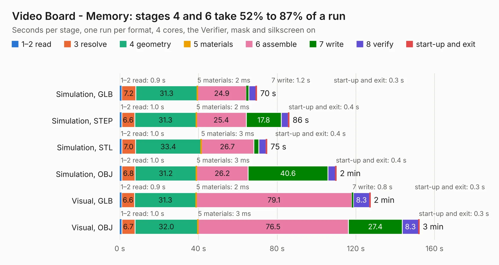

# 265. Video Board - Memory

Board 265 of the 3,107 of [Corpus Testing](../Corpus-Testing.md), on [Corpus Page 3](../CorpusTestingPages/Corpus-Testing-03.md#265-video-board---memory).

| Mode and format | 1–2 read | 3 resolve | 4 geometry | 5 materials | 6 assemble | 7 write | 8 verify | start-up and exit | Total |
|---|---:|---:|---:|---:|---:|---:|---:|---:|---:|
| Simulation, GLB | 0.9 | 7.2 | 31.3 | 2&nbsp;ms | 24.9 | 1.2 | 3.7 | 0.3 | 69.6 |
| Simulation, STEP | 1.0 | 6.6 | 31.3 | 2&nbsp;ms | 25.4 | 17.8 | 3.6 | 0.4 | 86.1 |
| Simulation, STL | 1.0 | 7.0 | 33.4 | 3&nbsp;ms | 26.7 | 2.6 | 3.7 | 0.4 | 74.8 |
| Simulation, OBJ | 1.0 | 6.8 | 31.2 | 3&nbsp;ms | 26.2 | 40.6 | 3.9 | 0.4 | 110.1 |
| Visual, GLB | 0.9 | 6.6 | 31.3 | 2&nbsp;ms | 79.1 | 0.8 | 8.3 | 0.3 | 127.3 |
| Visual, OBJ | 1.0 | 6.7 | 32.0 | 3&nbsp;ms | 76.5 | 27.4 | 8.3 | 0.3 | 152.2 |

<table align="center"><tr><td valign="top">

| Board | Repo: [andrewpaterson/658-Computer](https://github.com/andrewpaterson/658-Computer) Board: `Video Board - Memory.kicad_pcb` |
|---|---|
| Folder | Kicad / Computer / Video / Video Board - Memory |
| Complexity | 282&nbsp;/&nbsp;1000 (size&nbsp;202, features&nbsp;80) |
| KESE&nbsp;features | through vias, rounded, trapezoid or chamfered pads, curved board outline, knockout text, stack-up, dielectric εr and tanδ |
| Tested | 9th November 2026 |
| Copper&nbsp;layers | 2 |
| File&nbsp;format | KiCad 9 (20241229) |
| Parts,&nbsp;tracks,&nbsp;vias | 30, 6,354, 685 |
| Triangles,&nbsp;simulation | 7,111,072 in 328 parts |
| Verifier | PASS in all six runs |

</td><td valign="top">

<table>
<tr><th>File type</th><th>File size</th><th>Peak memory used</th></tr>
<tr><th colspan="3" align="left">Simulation</th></tr>
<tr><td>GLB</td><td align="right">240&nbsp;MB</td><td align="right">2.2&nbsp;GB</td></tr>
<tr><td>STEP</td><td align="right">1.1&nbsp;GB</td><td align="right">2.6&nbsp;GB</td></tr>
<tr><td>STL</td><td align="right">356&nbsp;MB</td><td align="right">2.1&nbsp;GB</td></tr>
<tr><td>OBJ</td><td align="right">755&nbsp;MB</td><td align="right">4.4&nbsp;GB</td></tr>
<tr><th colspan="3" align="left">Visual</th></tr>
<tr><td>GLB</td><td align="right">167&nbsp;MB</td><td align="right">2.7&nbsp;GB</td></tr>
<tr><td>OBJ</td><td align="right">542&nbsp;MB</td><td align="right">3.5&nbsp;GB</td></tr>
</table>

</td></tr></table>

| Previous | Next |
|:---|---:|
| [264. Video Blank and Sync](b0264b_658-Computer_Video-Blank-and-Sync.md) | [266. Video Board - Signals](b0266b_658-Computer_Video-Board-Signals.md) |
