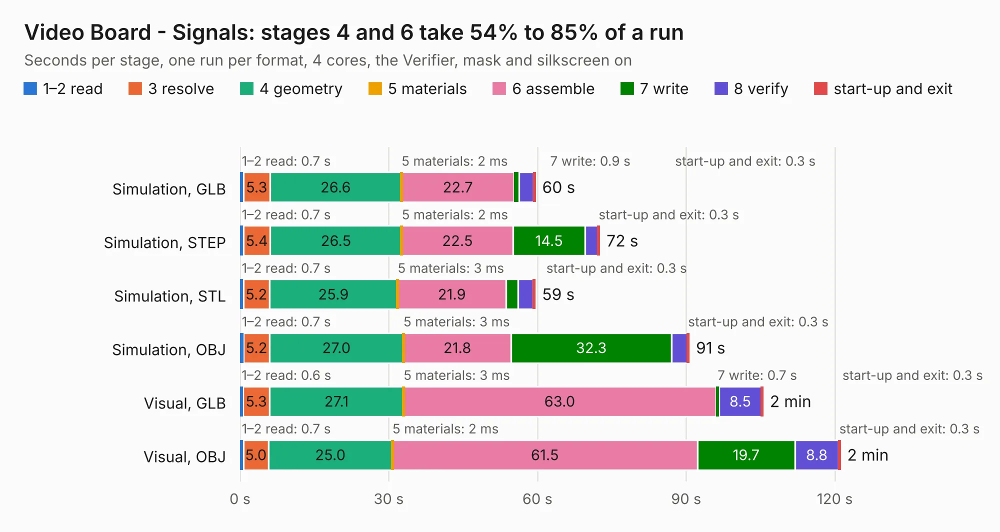

# 267. Video Board - Signals

Board 267 of the 3,120 of [Corpus Testing](../Corpus-Testing.md), on [Corpus Page 3](../CorpusTestingPages/Corpus-Testing-03.md#267-video-board---signals).

| Mode and format | 1–2 read | 3 resolve | 4 geometry | 5 materials | 6 assemble | 7 write | 8 verify | start-up and exit | Total |
|---|---:|---:|---:|---:|---:|---:|---:|---:|---:|
| Simulation, GLB | 0.7 | 5.3 | 26.6 | 2&nbsp;ms | 22.7 | 0.9 | 3.0 | 0.3 | 59.5 |
| Simulation, STEP | 0.7 | 5.4 | 26.5 | 2&nbsp;ms | 22.5 | 14.5 | 2.6 | 0.3 | 72.5 |
| Simulation, STL | 0.7 | 5.2 | 25.9 | 3&nbsp;ms | 21.9 | 2.4 | 3.0 | 0.3 | 59.5 |
| Simulation, OBJ | 0.7 | 5.2 | 27.0 | 3&nbsp;ms | 21.8 | 32.3 | 3.2 | 0.3 | 90.5 |
| Visual, GLB | 0.6 | 5.3 | 27.1 | 3&nbsp;ms | 63.0 | 0.7 | 8.5 | 0.3 | 105.4 |
| Visual, OBJ | 0.7 | 5.0 | 25.0 | 2&nbsp;ms | 61.5 | 19.7 | 8.8 | 0.3 | 121.0 |

<table align="center"><tr><td valign="top">

| Board | Repo: [andrewpaterson/658-Computer](https://github.com/andrewpaterson/658-Computer) Board: `Video Board - Signals.kicad_pcb` |
|---|---|
| Folder | Kicad / Computer / Video / Video Board - Signals |
| Complexity | 280&nbsp;/&nbsp;1000 (size&nbsp;200, features&nbsp;80) |
| KESE&nbsp;features | through vias, rounded, trapezoid or chamfered pads, curved board outline, knockout text, stack-up, dielectric εr and tanδ |
| Tested | 9th November 2026 |
| Copper&nbsp;layers | 2 |
| File&nbsp;format | KiCad 9 (20241229) |
| Parts,&nbsp;tracks,&nbsp;vias | 38, 4,452, 608 |
| Triangles,&nbsp;simulation | 6,820,772 in 505 parts |
| Verifier | PASS in all six runs |

</td><td valign="top">

<table>
<tr><th>File type</th><th>File size</th><th>Peak memory used</th></tr>
<tr><th colspan="3" align="left">Simulation</th></tr>
<tr><td>GLB</td><td align="right">228&nbsp;MB</td><td align="right">2.0&nbsp;GB</td></tr>
<tr><td>STEP</td><td align="right">968&nbsp;MB</td><td align="right">2.5&nbsp;GB</td></tr>
<tr><td>STL</td><td align="right">341&nbsp;MB</td><td align="right">1.9&nbsp;GB</td></tr>
<tr><td>OBJ</td><td align="right">720&nbsp;MB</td><td align="right">4.3&nbsp;GB</td></tr>
<tr><th colspan="3" align="left">Visual</th></tr>
<tr><td>GLB</td><td align="right">153&nbsp;MB</td><td align="right">2.5&nbsp;GB</td></tr>
<tr><td>OBJ</td><td align="right">492&nbsp;MB</td><td align="right">3.0&nbsp;GB</td></tr>
</table>

</td></tr></table>

| Previous | Next |
|:---|---:|
| [266. Video Board - Memory](b0266b_658-Computer_Video-Board-Memory.md) | [268. Video Clock](b0268b_658-Computer_Video-Clock.md) |
