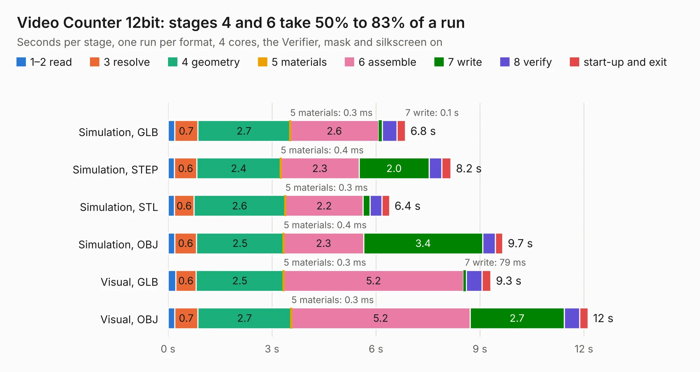

# 267. Video Counter 12bit

Board 267 of the 3,103 of [Corpus Testing](../Corpus-Testing.md), on [Corpus Page 3](../CorpusTestingPages/Corpus-Testing-03.md#267-video-counter-12bit).

| Mode and format | 1–2 read | 3 resolve | 4 geometry | 5 materials | 6 assemble | 7 write | 8 verify | start-up and exit | Total |
|---|---:|---:|---:|---:|---:|---:|---:|---:|---:|
| Simulation, GLB | 0.2 | 0.7 | 2.7 | 0.3&nbsp;ms | 2.6 | 0.1 | 0.4 | 0.2 | 6.8 |
| Simulation, STEP | 0.2 | 0.6 | 2.4 | 0.4&nbsp;ms | 2.3 | 2.0 | 0.4 | 0.3 | 8.2 |
| Simulation, STL | 0.2 | 0.6 | 2.6 | 0.3&nbsp;ms | 2.2 | 0.2 | 0.3 | 0.2 | 6.4 |
| Simulation, OBJ | 0.2 | 0.6 | 2.5 | 0.4&nbsp;ms | 2.3 | 3.4 | 0.4 | 0.2 | 9.7 |
| Visual, GLB | 0.2 | 0.6 | 2.5 | 0.3&nbsp;ms | 5.2 | 79&nbsp;ms | 0.5 | 0.3 | 9.3 |
| Visual, OBJ | 0.2 | 0.7 | 2.7 | 0.3&nbsp;ms | 5.2 | 2.7 | 0.4 | 0.2 | 12.1 |

<table align="center"><tr><td valign="top">

| Board | Repo: [andrewpaterson/658-Computer](https://github.com/andrewpaterson/658-Computer) Board: `Video Counter 12bit.kicad_pcb` |
|---|---|
| Folder | Kicad / Computer / Video / Video Counter 12bit |
| Complexity | 233&nbsp;/&nbsp;1000 (size&nbsp;163, features&nbsp;70) |
| KESE&nbsp;features | through vias, rounded, trapezoid or chamfered pads, knockout text, stack-up, dielectric εr and tanδ |
| Tested | 9th November 2026 |
| Copper&nbsp;layers | 2 |
| File&nbsp;format | KiCad 9 (20241229) |
| Parts,&nbsp;tracks,&nbsp;vias | 18, 761, 104 |
| Triangles,&nbsp;simulation | 561,818 in 51 parts |
| Verifier | PASS in all six runs |

</td><td valign="top">

<table>
<tr><th>File type</th><th>File size</th><th>Peak memory used</th></tr>
<tr><th colspan="3" align="left">Simulation</th></tr>
<tr><td>GLB</td><td align="right">19&nbsp;MB</td><td align="right">323&nbsp;MB</td></tr>
<tr><td>STEP</td><td align="right">92&nbsp;MB</td><td align="right">386&nbsp;MB</td></tr>
<tr><td>STL</td><td align="right">28&nbsp;MB</td><td align="right">312&nbsp;MB</td></tr>
<tr><td>OBJ</td><td align="right">57&nbsp;MB</td><td align="right">399&nbsp;MB</td></tr>
<tr><th colspan="3" align="left">Visual</th></tr>
<tr><td>GLB</td><td align="right">15&nbsp;MB</td><td align="right">404&nbsp;MB</td></tr>
<tr><td>OBJ</td><td align="right">46&nbsp;MB</td><td align="right">408&nbsp;MB</td></tr>
</table>

</td></tr></table>

| Previous | Next |
|:---|---:|
| [266. Video Clock](b0266b_658-Computer_Video-Clock.md) | [268. Video DAC](b0268b_658-Computer_Video-DAC.md) |
