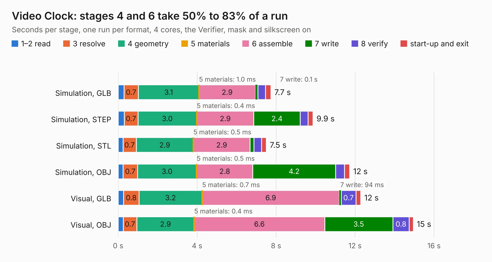

# 268 Video Clock

Board 268 of the 3,138 of [Corpus Testing](../Corpus-Testing.md), on [Corpus Page 3](../CorpusTestingPages/Corpus-Testing-03.md#268-video-clock).

| Mode and format | 1–2 read | 3 resolve | 4 geometry | 5 materials | 6 assemble | 7 write | 8 verify | start-up and exit | Total |
|---|---:|---:|---:|---:|---:|---:|---:|---:|---:|
| Simulation, GLB | 0.3 | 0.7 | 3.1 | 1.0&nbsp;ms | 2.9 | 0.1 | 0.4 | 0.3 | 7.7 |
| Simulation, STEP | 0.3 | 0.7 | 3.0 | 0.4&nbsp;ms | 2.9 | 2.4 | 0.4 | 0.2 | 9.9 |
| Simulation, STL | 0.2 | 0.7 | 2.9 | 0.5&nbsp;ms | 2.9 | 0.2 | 0.4 | 0.2 | 7.5 |
| Simulation, OBJ | 0.3 | 0.7 | 3.0 | 0.5&nbsp;ms | 2.8 | 4.2 | 0.5 | 0.3 | 11.7 |
| Visual, GLB | 0.3 | 0.8 | 3.2 | 0.7&nbsp;ms | 6.9 | 94&nbsp;ms | 0.7 | 0.2 | 12.3 |
| Visual, OBJ | 0.3 | 0.7 | 2.9 | 0.4&nbsp;ms | 6.6 | 3.5 | 0.8 | 0.2 | 14.9 |

<table align="center"><tr><td valign="top">

| Board | Repo: [andrewpaterson/658-Computer](https://github.com/andrewpaterson/658-Computer) Board: `Video Clock.kicad_pcb` |
|---|---|
| Folder | Kicad / Computer / Video / Video Clock |
| Complexity | 242&nbsp;/&nbsp;1000 (size&nbsp;172, features&nbsp;70) |
| KESE&nbsp;features | through vias, rounded, trapezoid or chamfered pads, knockout text, stack-up, dielectric εr and tanδ |
| Tested | 9th November 2026 |
| Copper&nbsp;layers | 2 |
| File&nbsp;format | KiCad 9 (20241229) |
| Parts,&nbsp;tracks,&nbsp;vias | 39, 778, 111 |
| Triangles,&nbsp;simulation | 623,350 in 103 parts |
| Verifier | PASS in all six runs |

</td><td valign="top">

<table>
<tr><th>File type</th><th>File size</th><th>Peak memory used</th></tr>
<tr><th colspan="3" align="left">Simulation</th></tr>
<tr><td>GLB</td><td align="right">21&nbsp;MB</td><td align="right">343&nbsp;MB</td></tr>
<tr><td>STEP</td><td align="right">98&nbsp;MB</td><td align="right">414&nbsp;MB</td></tr>
<tr><td>STL</td><td align="right">31&nbsp;MB</td><td align="right">335&nbsp;MB</td></tr>
<tr><td>OBJ</td><td align="right">63&nbsp;MB</td><td align="right">459&nbsp;MB</td></tr>
<tr><th colspan="3" align="left">Visual</th></tr>
<tr><td>GLB</td><td align="right">18&nbsp;MB</td><td align="right">483&nbsp;MB</td></tr>
<tr><td>OBJ</td><td align="right">52&nbsp;MB</td><td align="right">480&nbsp;MB</td></tr>
</table>

</td></tr></table>

| Previous | Next |
|:---|---:|
| [267 Video Board - Signals](b0267b_658-Computer_Video-Board-Signals.md) | [269 Video Counter 12bit](b0269b_658-Computer_Video-Counter-12bit.md) |
