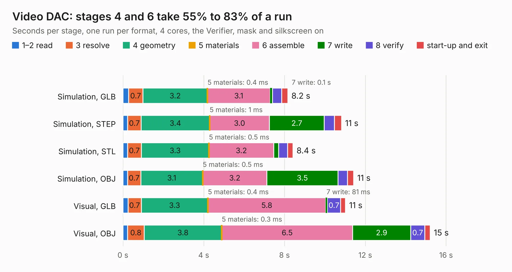

# 269. Video DAC

Board 269 of the 3,111 of [Corpus Testing](../Corpus-Testing.md), on [Corpus Page 3](../CorpusTestingPages/Corpus-Testing-03.md#269-video-dac).

| Mode and format | 1–2 read | 3 resolve | 4 geometry | 5 materials | 6 assemble | 7 write | 8 verify | start-up and exit | Total |
|---|---:|---:|---:|---:|---:|---:|---:|---:|---:|
| Simulation, GLB | 0.3 | 0.7 | 3.2 | 0.4&nbsp;ms | 3.1 | 0.1 | 0.5 | 0.3 | 8.2 |
| Simulation, STEP | 0.2 | 0.7 | 3.4 | 1&nbsp;ms | 3.0 | 2.7 | 0.5 | 0.3 | 10.8 |
| Simulation, STL | 0.2 | 0.7 | 3.3 | 0.5&nbsp;ms | 3.2 | 0.2 | 0.5 | 0.3 | 8.4 |
| Simulation, OBJ | 0.2 | 0.7 | 3.1 | 0.5&nbsp;ms | 3.2 | 3.5 | 0.5 | 0.3 | 11.4 |
| Visual, GLB | 0.2 | 0.7 | 3.3 | 0.4&nbsp;ms | 5.8 | 81&nbsp;ms | 0.7 | 0.2 | 11.0 |
| Visual, OBJ | 0.2 | 0.8 | 3.8 | 0.3&nbsp;ms | 6.5 | 2.9 | 0.7 | 0.3 | 15.2 |

<table align="center"><tr><td valign="top">

| Board | Repo: [andrewpaterson/658-Computer](https://github.com/andrewpaterson/658-Computer) Board: `Video DAC.kicad_pcb` |
|---|---|
| Folder | Kicad / Computer / Video / Video DAC |
| Complexity | 285&nbsp;/&nbsp;1000 (size&nbsp;205, features&nbsp;80) |
| KESE&nbsp;features | through vias, rounded, trapezoid or chamfered pads, curved board outline, knockout text, stack-up, dielectric εr and tanδ |
| Tested | 9th November 2026 |
| Copper&nbsp;layers | 2 |
| File&nbsp;format | KiCad 9 (20241229) |
| Parts,&nbsp;tracks,&nbsp;vias | 26, 714, 84 |
| Triangles,&nbsp;simulation | 618,172 in 73 parts |
| Verifier | PASS in all six runs |

</td><td valign="top">

<table>
<tr><th>File type</th><th>File size</th><th>Peak memory used</th></tr>
<tr><th colspan="3" align="left">Simulation</th></tr>
<tr><td>GLB</td><td align="right">21&nbsp;MB</td><td align="right">322&nbsp;MB</td></tr>
<tr><td>STEP</td><td align="right">96&nbsp;MB</td><td align="right">407&nbsp;MB</td></tr>
<tr><td>STL</td><td align="right">31&nbsp;MB</td><td align="right">319&nbsp;MB</td></tr>
<tr><td>OBJ</td><td align="right">63&nbsp;MB</td><td align="right">453&nbsp;MB</td></tr>
<tr><th colspan="3" align="left">Visual</th></tr>
<tr><td>GLB</td><td align="right">16&nbsp;MB</td><td align="right">415&nbsp;MB</td></tr>
<tr><td>OBJ</td><td align="right">49&nbsp;MB</td><td align="right">451&nbsp;MB</td></tr>
</table>

</td></tr></table>

| Previous | Next |
|:---|---:|
| [268. Video Counter 12bit](b0268b_658-Computer_Video-Counter-12bit.md) | [270. Video Data Select](b0270b_658-Computer_Video-Data-Select.md) |
