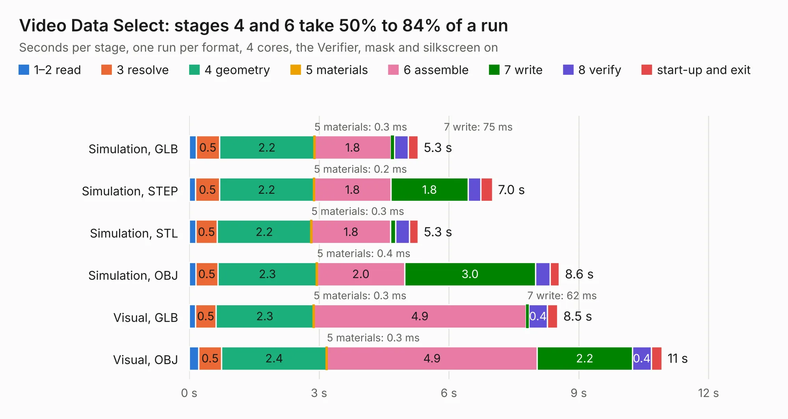

# 271. Video Data Select

Board 271 of the 3,124 of [Corpus Testing](../Corpus-Testing.md), on [Corpus Page 3](../CorpusTestingPages/Corpus-Testing-03.md#271-video-data-select).

| Mode and format | 1–2 read | 3 resolve | 4 geometry | 5 materials | 6 assemble | 7 write | 8 verify | start-up and exit | Total |
|---|---:|---:|---:|---:|---:|---:|---:|---:|---:|
| Simulation, GLB | 0.2 | 0.5 | 2.2 | 0.3&nbsp;ms | 1.8 | 75&nbsp;ms | 0.3 | 0.2 | 5.3 |
| Simulation, STEP | 0.1 | 0.5 | 2.2 | 0.2&nbsp;ms | 1.8 | 1.8 | 0.3 | 0.3 | 7.0 |
| Simulation, STL | 0.2 | 0.5 | 2.2 | 0.3&nbsp;ms | 1.8 | 0.1 | 0.3 | 0.2 | 5.3 |
| Simulation, OBJ | 0.2 | 0.5 | 2.3 | 0.4&nbsp;ms | 2.0 | 3.0 | 0.3 | 0.2 | 8.6 |
| Visual, GLB | 0.1 | 0.5 | 2.3 | 0.3&nbsp;ms | 4.9 | 62&nbsp;ms | 0.4 | 0.2 | 8.5 |
| Visual, OBJ | 0.2 | 0.5 | 2.4 | 0.3&nbsp;ms | 4.9 | 2.2 | 0.4 | 0.2 | 10.9 |

<table align="center"><tr><td valign="top">

| Board | Repo: [andrewpaterson/658-Computer](https://github.com/andrewpaterson/658-Computer) Board: `Video Data Select.kicad_pcb` |
|---|---|
| Folder | Kicad / Computer / Video / Video Data Select |
| Complexity | 230&nbsp;/&nbsp;1000 (size&nbsp;160, features&nbsp;70) |
| KESE&nbsp;features | through vias, rounded, trapezoid or chamfered pads, knockout text, stack-up, dielectric εr and tanδ |
| Tested | 9th November 2026 |
| Copper&nbsp;layers | 2 |
| File&nbsp;format | KiCad 9 (20241229) |
| Parts,&nbsp;tracks,&nbsp;vias | 18, 596, 99 |
| Triangles,&nbsp;simulation | 539,780 in 54 parts |
| Verifier | PASS in all six runs |

</td><td valign="top">

<table>
<tr><th>File type</th><th>File size</th><th>Peak memory used</th></tr>
<tr><th colspan="3" align="left">Simulation</th></tr>
<tr><td>GLB</td><td align="right">19&nbsp;MB</td><td align="right">327&nbsp;MB</td></tr>
<tr><td>STEP</td><td align="right">88&nbsp;MB</td><td align="right">370&nbsp;MB</td></tr>
<tr><td>STL</td><td align="right">27&nbsp;MB</td><td align="right">331&nbsp;MB</td></tr>
<tr><td>OBJ</td><td align="right">55&nbsp;MB</td><td align="right">413&nbsp;MB</td></tr>
<tr><th colspan="3" align="left">Visual</th></tr>
<tr><td>GLB</td><td align="right">15&nbsp;MB</td><td align="right">396&nbsp;MB</td></tr>
<tr><td>OBJ</td><td align="right">44&nbsp;MB</td><td align="right">401&nbsp;MB</td></tr>
</table>

</td></tr></table>

| Previous | Next |
|:---|---:|
| [270. Video DAC](b0270b_658-Computer_Video-DAC.md) | [272. Video Device RAM Select](b0272b_658-Computer_Video-Device-RAM-Select.md) |
