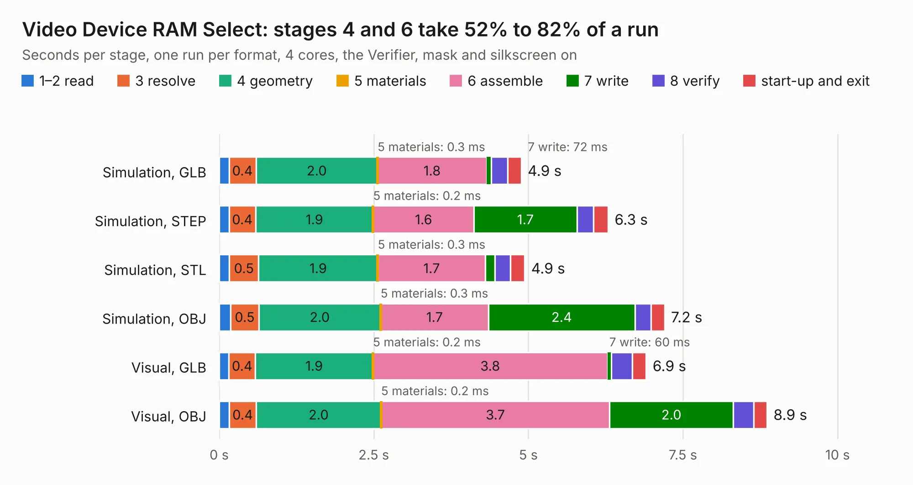

# 272. Video Device RAM Select

Board 272 of the 3,119 of [Corpus Testing](../Corpus-Testing.md), on [Corpus Page 3](../CorpusTestingPages/Corpus-Testing-03.md#272-video-device-ram-select).

| Mode and format | 1–2 read | 3 resolve | 4 geometry | 5 materials | 6 assemble | 7 write | 8 verify | start-up and exit | Total |
|---|---:|---:|---:|---:|---:|---:|---:|---:|---:|
| Simulation, GLB | 0.2 | 0.4 | 2.0 | 0.3&nbsp;ms | 1.8 | 72&nbsp;ms | 0.3 | 0.2 | 4.9 |
| Simulation, STEP | 0.2 | 0.4 | 1.9 | 0.2&nbsp;ms | 1.6 | 1.7 | 0.3 | 0.2 | 6.3 |
| Simulation, STL | 0.2 | 0.5 | 1.9 | 0.3&nbsp;ms | 1.7 | 0.1 | 0.3 | 0.2 | 4.9 |
| Simulation, OBJ | 0.2 | 0.5 | 2.0 | 0.3&nbsp;ms | 1.7 | 2.4 | 0.3 | 0.2 | 7.2 |
| Visual, GLB | 0.2 | 0.4 | 1.9 | 0.2&nbsp;ms | 3.8 | 60&nbsp;ms | 0.3 | 0.2 | 6.9 |
| Visual, OBJ | 0.2 | 0.4 | 2.0 | 0.2&nbsp;ms | 3.7 | 2.0 | 0.3 | 0.2 | 8.9 |

<table align="center"><tr><td valign="top">

| Board | Repo: [andrewpaterson/658-Computer](https://github.com/andrewpaterson/658-Computer) Board: `Video Device RAM Select.kicad_pcb` |
|---|---|
| Folder | Kicad / Computer / Video / Video Device RAM Select |
| Complexity | 227&nbsp;/&nbsp;1000 (size&nbsp;157, features&nbsp;70) |
| KESE&nbsp;features | through vias, rounded, trapezoid or chamfered pads, knockout text, stack-up, dielectric εr and tanδ |
| Tested | 9th November 2026 |
| Copper&nbsp;layers | 2 |
| File&nbsp;format | KiCad 9 (20241229) |
| Parts,&nbsp;tracks,&nbsp;vias | 18, 519, 73 |
| Triangles,&nbsp;simulation | 431,068 in 55 parts |
| Verifier | PASS in all six runs |

</td><td valign="top">

<table>
<tr><th>File type</th><th>File size</th><th>Peak memory used</th></tr>
<tr><th colspan="3" align="left">Simulation</th></tr>
<tr><td>GLB</td><td align="right">15&nbsp;MB</td><td align="right">272&nbsp;MB</td></tr>
<tr><td>STEP</td><td align="right">70&nbsp;MB</td><td align="right">334&nbsp;MB</td></tr>
<tr><td>STL</td><td align="right">22&nbsp;MB</td><td align="right">271&nbsp;MB</td></tr>
<tr><td>OBJ</td><td align="right">44&nbsp;MB</td><td align="right">345&nbsp;MB</td></tr>
<tr><th colspan="3" align="left">Visual</th></tr>
<tr><td>GLB</td><td align="right">12&nbsp;MB</td><td align="right">342&nbsp;MB</td></tr>
<tr><td>OBJ</td><td align="right">35&nbsp;MB</td><td align="right">353&nbsp;MB</td></tr>
</table>

</td></tr></table>

| Previous | Next |
|:---|---:|
| [271. Video Data Select](b0271b_658-Computer_Video-Data-Select.md) | [273. Video Memory 2MB](b0273b_658-Computer_Video-Memory-2MB.md) |
