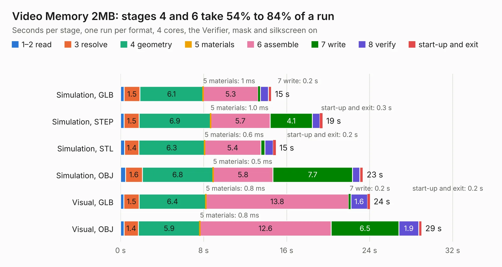

# 273. Video Memory 2MB

Board 273 of the 3,122 of [Corpus Testing](../Corpus-Testing.md), on [Corpus Page 3](../CorpusTestingPages/Corpus-Testing-03.md#273-video-memory-2mb).

| Mode and format | 1–2 read | 3 resolve | 4 geometry | 5 materials | 6 assemble | 7 write | 8 verify | start-up and exit | Total |
|---|---:|---:|---:|---:|---:|---:|---:|---:|---:|
| Simulation, GLB | 0.3 | 1.5 | 6.1 | 1&nbsp;ms | 5.3 | 0.2 | 0.8 | 0.3 | 14.5 |
| Simulation, STEP | 0.3 | 1.5 | 6.9 | 1.0&nbsp;ms | 5.7 | 4.1 | 0.7 | 0.3 | 19.5 |
| Simulation, STL | 0.4 | 1.4 | 6.3 | 0.6&nbsp;ms | 5.4 | 0.4 | 0.8 | 0.2 | 15.0 |
| Simulation, OBJ | 0.5 | 1.6 | 6.8 | 0.5&nbsp;ms | 5.8 | 7.7 | 0.7 | 0.3 | 23.4 |
| Visual, GLB | 0.3 | 1.5 | 6.4 | 0.8&nbsp;ms | 13.8 | 0.2 | 1.6 | 0.2 | 24.0 |
| Visual, OBJ | 0.3 | 1.4 | 5.9 | 0.8&nbsp;ms | 12.6 | 6.5 | 1.9 | 0.3 | 29.0 |

<table align="center"><tr><td valign="top">

| Board | Repo: [andrewpaterson/658-Computer](https://github.com/andrewpaterson/658-Computer) Board: `Video Memory 2MB.kicad_pcb` |
|---|---|
| Folder | Kicad / Computer / Video / Video Memory 2MB |
| Complexity | 252&nbsp;/&nbsp;1000 (size&nbsp;182, features&nbsp;70) |
| KESE&nbsp;features | through vias, rounded, trapezoid or chamfered pads, knockout text, stack-up, dielectric εr and tanδ |
| Tested | 9th November 2026 |
| Copper&nbsp;layers | 2 |
| File&nbsp;format | KiCad 9 (20241229) |
| Parts,&nbsp;tracks,&nbsp;vias | 29, 1,720, 272 |
| Triangles,&nbsp;simulation | 1,213,368 in 122 parts |
| Verifier | PASS in all six runs |

</td><td valign="top">

<table>
<tr><th>File type</th><th>File size</th><th>Peak memory used</th></tr>
<tr><th colspan="3" align="left">Simulation</th></tr>
<tr><td>GLB</td><td align="right">41&nbsp;MB</td><td align="right">500&nbsp;MB</td></tr>
<tr><td>STEP</td><td align="right">190&nbsp;MB</td><td align="right">625&nbsp;MB</td></tr>
<tr><td>STL</td><td align="right">61&nbsp;MB</td><td align="right">536&nbsp;MB</td></tr>
<tr><td>OBJ</td><td align="right">124&nbsp;MB</td><td align="right">828&nbsp;MB</td></tr>
<tr><th colspan="3" align="left">Visual</th></tr>
<tr><td>GLB</td><td align="right">34&nbsp;MB</td><td align="right">690&nbsp;MB</td></tr>
<tr><td>OBJ</td><td align="right">105&nbsp;MB</td><td align="right">817&nbsp;MB</td></tr>
</table>

</td></tr></table>

| Previous | Next |
|:---|---:|
| [272. Video Device RAM Select](b0272b_658-Computer_Video-Device-RAM-Select.md) | [274. Video Pixel Advance](b0274b_658-Computer_Video-Pixel-Advance.md) |
