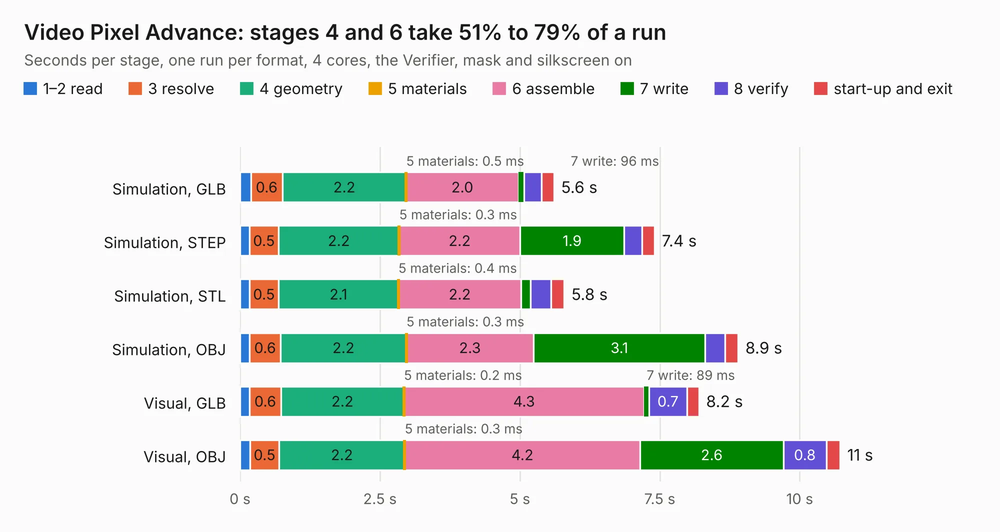

# 273. Video Pixel Advance

Board 273 of the 3,107 of [Corpus Testing](../Corpus-Testing.md), on [Corpus Page 3](../CorpusTestingPages/Corpus-Testing-03.md#273-video-pixel-advance).

| Mode and format | 1–2 read | 3 resolve | 4 geometry | 5 materials | 6 assemble | 7 write | 8 verify | start-up and exit | Total |
|---|---:|---:|---:|---:|---:|---:|---:|---:|---:|
| Simulation, GLB | 0.2 | 0.6 | 2.2 | 0.5&nbsp;ms | 2.0 | 96&nbsp;ms | 0.3 | 0.2 | 5.6 |
| Simulation, STEP | 0.2 | 0.5 | 2.2 | 0.3&nbsp;ms | 2.2 | 1.9 | 0.3 | 0.2 | 7.4 |
| Simulation, STL | 0.2 | 0.5 | 2.1 | 0.4&nbsp;ms | 2.2 | 0.2 | 0.4 | 0.2 | 5.8 |
| Simulation, OBJ | 0.2 | 0.6 | 2.2 | 0.3&nbsp;ms | 2.3 | 3.1 | 0.4 | 0.2 | 8.9 |
| Visual, GLB | 0.2 | 0.6 | 2.2 | 0.2&nbsp;ms | 4.3 | 89&nbsp;ms | 0.7 | 0.2 | 8.2 |
| Visual, OBJ | 0.2 | 0.5 | 2.2 | 0.3&nbsp;ms | 4.2 | 2.6 | 0.8 | 0.2 | 10.7 |

<table align="center"><tr><td valign="top">

| Board | Repo: [andrewpaterson/658-Computer](https://github.com/andrewpaterson/658-Computer) Board: `Video Pixel Advance.kicad_pcb` |
|---|---|
| Folder | Kicad / Computer / Video / Video Pixel Advance |
| Complexity | 231&nbsp;/&nbsp;1000 (size&nbsp;161, features&nbsp;70) |
| KESE&nbsp;features | through vias, rounded, trapezoid or chamfered pads, knockout text, stack-up, dielectric εr and tanδ |
| Tested | 9th November 2026 |
| Copper&nbsp;layers | 2 |
| File&nbsp;format | KiCad 9 (20241229) |
| Parts,&nbsp;tracks,&nbsp;vias | 17, 711, 98 |
| Triangles,&nbsp;simulation | 498,308 in 66 parts |
| Verifier | PASS in all six runs |

</td><td valign="top">

<table>
<tr><th>File type</th><th>File size</th><th>Peak memory used</th></tr>
<tr><th colspan="3" align="left">Simulation</th></tr>
<tr><td>GLB</td><td align="right">17&nbsp;MB</td><td align="right">295&nbsp;MB</td></tr>
<tr><td>STEP</td><td align="right">78&nbsp;MB</td><td align="right">356&nbsp;MB</td></tr>
<tr><td>STL</td><td align="right">25&nbsp;MB</td><td align="right">297&nbsp;MB</td></tr>
<tr><td>OBJ</td><td align="right">50&nbsp;MB</td><td align="right">384&nbsp;MB</td></tr>
<tr><th colspan="3" align="left">Visual</th></tr>
<tr><td>GLB</td><td align="right">14&nbsp;MB</td><td align="right">388&nbsp;MB</td></tr>
<tr><td>OBJ</td><td align="right">43&nbsp;MB</td><td align="right">408&nbsp;MB</td></tr>
</table>

</td></tr></table>

| Previous | Next |
|:---|---:|
| [272. Video Memory 2MB](b0272b_658-Computer_Video-Memory-2MB.md) | [274. Video Row Latch](b0274b_658-Computer_Video-Row-Latch.md) |
