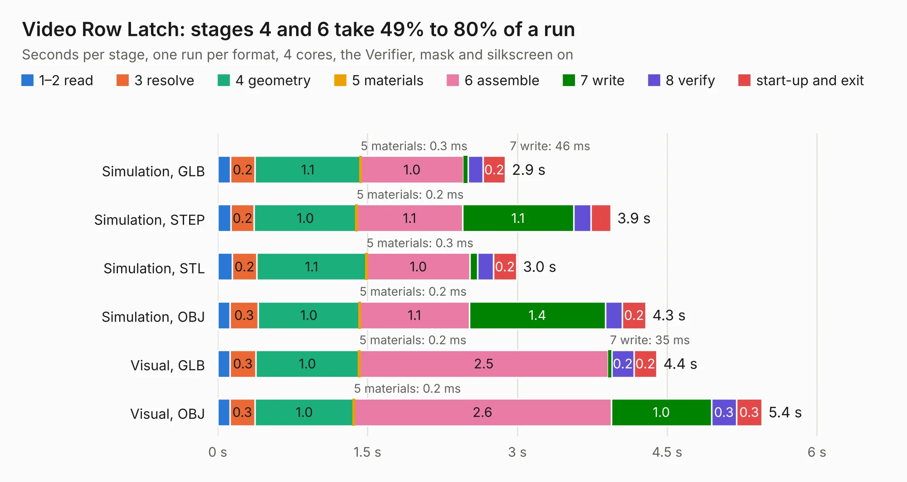

# 275. Video Row Latch

Board 275 of the 3,129 of [Corpus Testing](../Corpus-Testing.md), on [Corpus Page 3](../CorpusTestingPages/Corpus-Testing-03.md#275-video-row-latch).

| Mode and format | 1–2 read | 3 resolve | 4 geometry | 5 materials | 6 assemble | 7 write | 8 verify | start-up and exit | Total |
|---|---:|---:|---:|---:|---:|---:|---:|---:|---:|
| Simulation, GLB | 0.1 | 0.2 | 1.1 | 0.3&nbsp;ms | 1.0 | 46&nbsp;ms | 0.2 | 0.2 | 2.9 |
| Simulation, STEP | 0.1 | 0.2 | 1.0 | 0.2&nbsp;ms | 1.1 | 1.1 | 0.2 | 0.2 | 3.9 |
| Simulation, STL | 0.1 | 0.2 | 1.1 | 0.3&nbsp;ms | 1.0 | 73&nbsp;ms | 0.2 | 0.2 | 3.0 |
| Simulation, OBJ | 0.1 | 0.3 | 1.0 | 0.2&nbsp;ms | 1.1 | 1.4 | 0.2 | 0.2 | 4.3 |
| Visual, GLB | 0.1 | 0.3 | 1.0 | 0.2&nbsp;ms | 2.5 | 35&nbsp;ms | 0.2 | 0.2 | 4.4 |
| Visual, OBJ | 0.1 | 0.3 | 1.0 | 0.2&nbsp;ms | 2.6 | 1.0 | 0.3 | 0.3 | 5.4 |

<table align="center"><tr><td valign="top">

| Board | Repo: [andrewpaterson/658-Computer](https://github.com/andrewpaterson/658-Computer) Board: `Video Row Latch.kicad_pcb` |
|---|---|
| Folder | Kicad / Computer / Video / Video Row Latch |
| Complexity | 215&nbsp;/&nbsp;1000 (size&nbsp;145, features&nbsp;70) |
| KESE&nbsp;features | through vias, rounded, trapezoid or chamfered pads, knockout text, stack-up, dielectric εr and tanδ |
| Tested | 9th November 2026 |
| Copper&nbsp;layers | 2 |
| File&nbsp;format | KiCad 9 (20241229) |
| Parts,&nbsp;tracks,&nbsp;vias | 12, 327, 42 |
| Triangles,&nbsp;simulation | 277,850 in 49 parts |
| Verifier | PASS in all six runs |

</td><td valign="top">

<table>
<tr><th>File type</th><th>File size</th><th>Peak memory used</th></tr>
<tr><th colspan="3" align="left">Simulation</th></tr>
<tr><td>GLB</td><td align="right">9.6&nbsp;MB</td><td align="right">227&nbsp;MB</td></tr>
<tr><td>STEP</td><td align="right">43&nbsp;MB</td><td align="right">262&nbsp;MB</td></tr>
<tr><td>STL</td><td align="right">14&nbsp;MB</td><td align="right">245&nbsp;MB</td></tr>
<tr><td>OBJ</td><td align="right">28&nbsp;MB</td><td align="right">234&nbsp;MB</td></tr>
<tr><th colspan="3" align="left">Visual</th></tr>
<tr><td>GLB</td><td align="right">7.3&nbsp;MB</td><td align="right">246&nbsp;MB</td></tr>
<tr><td>OBJ</td><td align="right">21&nbsp;MB</td><td align="right">246&nbsp;MB</td></tr>
</table>

</td></tr></table>

| Previous | Next |
|:---|---:|
| [274. Video Pixel Advance](b0274b_658-Computer_Video-Pixel-Advance.md) | [276. Video Signal Dragger](b0276b_658-Computer_Video-Signal-Dragger.md) |
