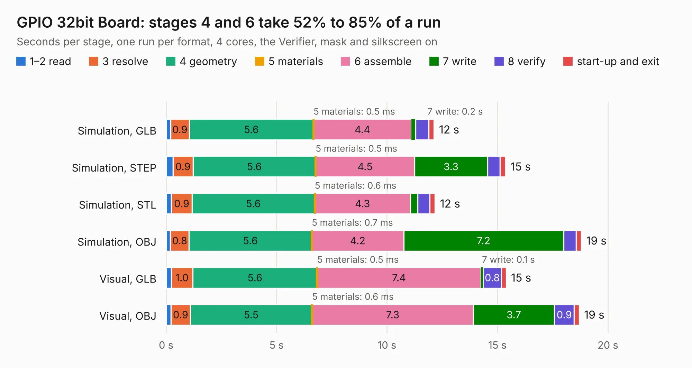

# 276. GPIO 32bit Board

Board 276 of the 3,101 of [Corpus Testing](../Corpus-Testing.md), on [Corpus Page 3](../CorpusTestingPages/Corpus-Testing-03.md#276-gpio-32bit-board).

| Mode and format | 1–2 read | 3 resolve | 4 geometry | 5 materials | 6 assemble | 7 write | 8 verify | start-up and exit | Total |
|---|---:|---:|---:|---:|---:|---:|---:|---:|---:|
| Simulation, GLB | 0.2 | 0.9 | 5.6 | 0.5&nbsp;ms | 4.4 | 0.2 | 0.6 | 0.2 | 12.1 |
| Simulation, STEP | 0.3 | 0.9 | 5.6 | 0.5&nbsp;ms | 4.5 | 3.3 | 0.6 | 0.3 | 15.4 |
| Simulation, STL | 0.2 | 0.9 | 5.6 | 0.6&nbsp;ms | 4.3 | 0.3 | 0.5 | 0.2 | 12.2 |
| Simulation, OBJ | 0.2 | 0.8 | 5.6 | 0.7&nbsp;ms | 4.2 | 7.2 | 0.6 | 0.2 | 18.8 |
| Visual, GLB | 0.2 | 1.0 | 5.6 | 0.5&nbsp;ms | 7.4 | 0.1 | 0.8 | 0.2 | 15.4 |
| Visual, OBJ | 0.2 | 0.9 | 5.5 | 0.6&nbsp;ms | 7.3 | 3.7 | 0.9 | 0.2 | 18.7 |

<table align="center"><tr><td valign="top">

| Board | Repo: [andrewpaterson/658-Computer](https://github.com/andrewpaterson/658-Computer) Board: `GPIO 32bit Board.kicad_pcb` |
|---|---|
| Folder | Kicad / Pico / GPIO 32bit Board |
| Complexity | 226&nbsp;/&nbsp;1000 (size&nbsp;156, features&nbsp;70) |
| KESE&nbsp;features | through vias, curved board outline, knockout text, stack-up, dielectric εr and tanδ |
| Tested | 9th November 2026 |
| Copper&nbsp;layers | 2 |
| File&nbsp;format | KiCad 10 (20260206) |
| Parts,&nbsp;tracks,&nbsp;vias | 12, 771, 35 |
| Triangles,&nbsp;simulation | 1,137,618 in 108 parts |
| Verifier | PASS in all six runs |

</td><td valign="top">

<table>
<tr><th>File type</th><th>File size</th><th>Peak memory used</th></tr>
<tr><th colspan="3" align="left">Simulation</th></tr>
<tr><td>GLB</td><td align="right">38&nbsp;MB</td><td align="right">482&nbsp;MB</td></tr>
<tr><td>STEP</td><td align="right">154&nbsp;MB</td><td align="right">569&nbsp;MB</td></tr>
<tr><td>STL</td><td align="right">57&nbsp;MB</td><td align="right">446&nbsp;MB</td></tr>
<tr><td>OBJ</td><td align="right">114&nbsp;MB</td><td align="right">1.0&nbsp;GB</td></tr>
<tr><th colspan="3" align="left">Visual</th></tr>
<tr><td>GLB</td><td align="right">22&nbsp;MB</td><td align="right">612&nbsp;MB</td></tr>
<tr><td>OBJ</td><td align="right">67&nbsp;MB</td><td align="right">651&nbsp;MB</td></tr>
</table>

</td></tr></table>

| Previous | Next |
|:---|---:|
| [275. Keypad](b0275b_658-Computer_Keypad.md) | [277. GPIO Address Decode](b0277b_658-Computer_GPIO-Address-Decode.md) |
