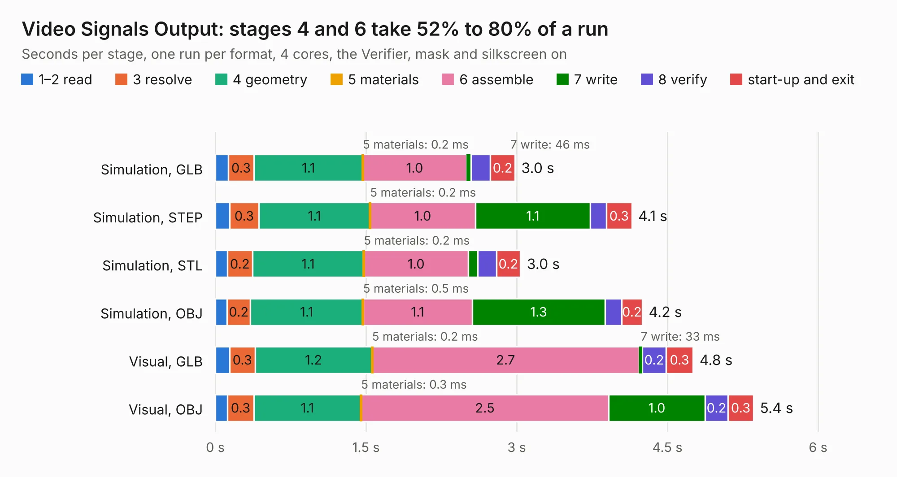

# 277. Video Signals Output

Board 277 of the 3,120 of [Corpus Testing](../Corpus-Testing.md), on [Corpus Page 3](../CorpusTestingPages/Corpus-Testing-03.md#277-video-signals-output).

| Mode and format | 1–2 read | 3 resolve | 4 geometry | 5 materials | 6 assemble | 7 write | 8 verify | start-up and exit | Total |
|---|---:|---:|---:|---:|---:|---:|---:|---:|---:|
| Simulation, GLB | 0.1 | 0.3 | 1.1 | 0.2&nbsp;ms | 1.0 | 46&nbsp;ms | 0.2 | 0.2 | 3.0 |
| Simulation, STEP | 0.1 | 0.3 | 1.1 | 0.2&nbsp;ms | 1.0 | 1.1 | 0.2 | 0.3 | 4.1 |
| Simulation, STL | 0.1 | 0.2 | 1.1 | 0.2&nbsp;ms | 1.0 | 92&nbsp;ms | 0.2 | 0.2 | 3.0 |
| Simulation, OBJ | 0.1 | 0.2 | 1.1 | 0.5&nbsp;ms | 1.1 | 1.3 | 0.2 | 0.2 | 4.2 |
| Visual, GLB | 0.1 | 0.3 | 1.2 | 0.2&nbsp;ms | 2.7 | 33&nbsp;ms | 0.2 | 0.3 | 4.8 |
| Visual, OBJ | 0.1 | 0.3 | 1.1 | 0.3&nbsp;ms | 2.5 | 1.0 | 0.2 | 0.3 | 5.4 |

<table align="center"><tr><td valign="top">

| Board | Repo: [andrewpaterson/658-Computer](https://github.com/andrewpaterson/658-Computer) Board: `Video Signals Output.kicad_pcb` |
|---|---|
| Folder | Kicad / Computer / Video / Video Signals Output |
| Complexity | 205&nbsp;/&nbsp;1000 (size&nbsp;135, features&nbsp;70) |
| KESE&nbsp;features | through vias, rounded, trapezoid or chamfered pads, knockout text, stack-up, dielectric εr and tanδ |
| Tested | 9th November 2026 |
| Copper&nbsp;layers | 2 |
| File&nbsp;format | KiCad 9 (20241229) |
| Parts,&nbsp;tracks,&nbsp;vias | 10, 220, 22 |
| Triangles,&nbsp;simulation | 264,788 in 42 parts |
| Verifier | PASS in all six runs |

</td><td valign="top">

<table>
<tr><th>File type</th><th>File size</th><th>Peak memory used</th></tr>
<tr><th colspan="3" align="left">Simulation</th></tr>
<tr><td>GLB</td><td align="right">9.1&nbsp;MB</td><td align="right">229&nbsp;MB</td></tr>
<tr><td>STEP</td><td align="right">41&nbsp;MB</td><td align="right">250&nbsp;MB</td></tr>
<tr><td>STL</td><td align="right">13&nbsp;MB</td><td align="right">230&nbsp;MB</td></tr>
<tr><td>OBJ</td><td align="right">27&nbsp;MB</td><td align="right">229&nbsp;MB</td></tr>
<tr><th colspan="3" align="left">Visual</th></tr>
<tr><td>GLB</td><td align="right">6.4&nbsp;MB</td><td align="right">226&nbsp;MB</td></tr>
<tr><td>OBJ</td><td align="right">19&nbsp;MB</td><td align="right">225&nbsp;MB</td></tr>
</table>

</td></tr></table>

| Previous | Next |
|:---|---:|
| [276. Video Signal Dragger](b0276b_658-Computer_Video-Signal-Dragger.md) | [278. Keypad](b0278b_658-Computer_Keypad.md) |
