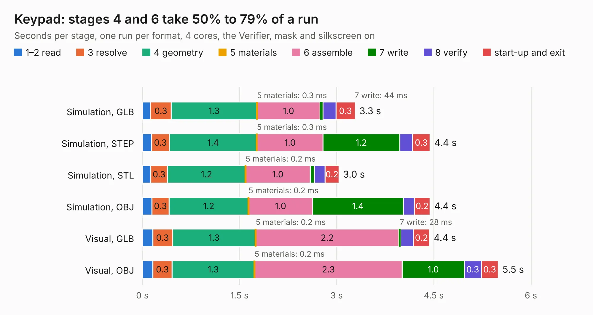

# 278. Keypad

Board 278 of the 3,139 of [Corpus Testing](../Corpus-Testing.md), on [Corpus Page 3](../CorpusTestingPages/Corpus-Testing-03.md#278-keypad).

| Mode and format | 1–2 read | 3 resolve | 4 geometry | 5 materials | 6 assemble | 7 write | 8 verify | start-up and exit | Total |
|---|---:|---:|---:|---:|---:|---:|---:|---:|---:|
| Simulation, GLB | 0.1 | 0.3 | 1.3 | 0.3&nbsp;ms | 1.0 | 44&nbsp;ms | 0.2 | 0.3 | 3.3 |
| Simulation, STEP | 0.1 | 0.3 | 1.4 | 0.3&nbsp;ms | 1.0 | 1.2 | 0.2 | 0.3 | 4.4 |
| Simulation, STL | 0.1 | 0.3 | 1.2 | 0.2&nbsp;ms | 1.0 | 61&nbsp;ms | 0.2 | 0.2 | 3.0 |
| Simulation, OBJ | 0.1 | 0.3 | 1.2 | 0.2&nbsp;ms | 1.0 | 1.4 | 0.2 | 0.2 | 4.4 |
| Visual, GLB | 0.2 | 0.3 | 1.3 | 0.2&nbsp;ms | 2.2 | 28&nbsp;ms | 0.2 | 0.2 | 4.4 |
| Visual, OBJ | 0.2 | 0.3 | 1.3 | 0.2&nbsp;ms | 2.3 | 1.0 | 0.3 | 0.3 | 5.5 |

<table align="center"><tr><td valign="top">

| Board | Repo: [andrewpaterson/658-Computer](https://github.com/andrewpaterson/658-Computer) Board: `Keypad.kicad_pcb` |
|---|---|
| Folder | Kicad / Keypad |
| Complexity | 195&nbsp;/&nbsp;1000 (size&nbsp;130, features&nbsp;65) |
| KESE&nbsp;features | through vias, rounded, trapezoid or chamfered pads, curved board outline, stack-up, dielectric εr and tanδ |
| Tested | 9th November 2026 |
| Copper&nbsp;layers | 2 |
| File&nbsp;format | KiCad 9 (20241229) |
| Parts,&nbsp;tracks,&nbsp;vias | 8, 205, 11 |
| Triangles,&nbsp;simulation | 239,644 in 40 parts |
| Verifier | PASS in all six runs |

</td><td valign="top">

<table>
<tr><th>File type</th><th>File size</th><th>Peak memory used</th></tr>
<tr><th colspan="3" align="left">Simulation</th></tr>
<tr><td>GLB</td><td align="right">8.0&nbsp;MB</td><td align="right">223&nbsp;MB</td></tr>
<tr><td>STEP</td><td align="right">33&nbsp;MB</td><td align="right">241&nbsp;MB</td></tr>
<tr><td>STL</td><td align="right">12&nbsp;MB</td><td align="right">227&nbsp;MB</td></tr>
<tr><td>OBJ</td><td align="right">24&nbsp;MB</td><td align="right">222&nbsp;MB</td></tr>
<tr><th colspan="3" align="left">Visual</th></tr>
<tr><td>GLB</td><td align="right">5.6&nbsp;MB</td><td align="right">225&nbsp;MB</td></tr>
<tr><td>OBJ</td><td align="right">16&nbsp;MB</td><td align="right">224&nbsp;MB</td></tr>
</table>

</td></tr></table>

| Previous | Next |
|:---|---:|
| [277. Video Signals Output](b0277b_658-Computer_Video-Signals-Output.md) | [279. GPIO 32bit Board](b0279b_658-Computer_GPIO-32bit-Board.md) |
