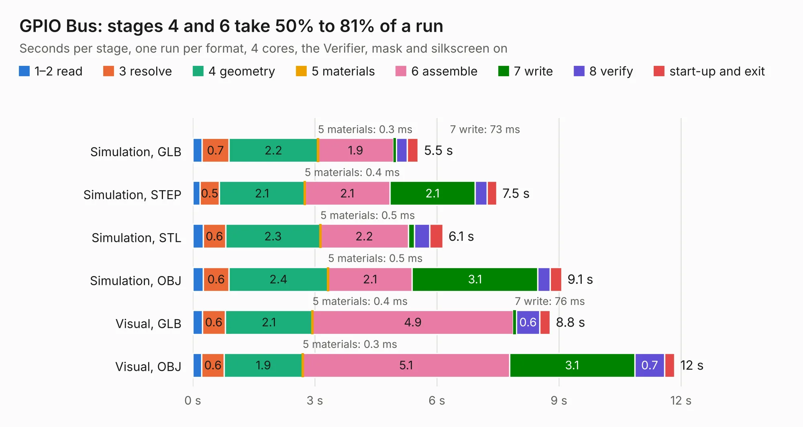

# 279. GPIO Bus

Board 279 of the 3,100 of [Corpus Testing](../Corpus-Testing.md), on [Corpus Page 3](../CorpusTestingPages/Corpus-Testing-03.md#279-gpio-bus).

| Mode and format | 1–2 read | 3 resolve | 4 geometry | 5 materials | 6 assemble | 7 write | 8 verify | start-up and exit | Total |
|---|---:|---:|---:|---:|---:|---:|---:|---:|---:|
| Simulation, GLB | 0.2 | 0.7 | 2.2 | 0.3&nbsp;ms | 1.9 | 73&nbsp;ms | 0.3 | 0.3 | 5.5 |
| Simulation, STEP | 0.2 | 0.5 | 2.1 | 0.4&nbsp;ms | 2.1 | 2.1 | 0.3 | 0.2 | 7.5 |
| Simulation, STL | 0.3 | 0.6 | 2.3 | 0.5&nbsp;ms | 2.2 | 0.2 | 0.4 | 0.3 | 6.1 |
| Simulation, OBJ | 0.3 | 0.6 | 2.4 | 0.5&nbsp;ms | 2.1 | 3.1 | 0.3 | 0.3 | 9.1 |
| Visual, GLB | 0.2 | 0.6 | 2.1 | 0.4&nbsp;ms | 4.9 | 76&nbsp;ms | 0.6 | 0.3 | 8.8 |
| Visual, OBJ | 0.2 | 0.6 | 1.9 | 0.3&nbsp;ms | 5.1 | 3.1 | 0.7 | 0.2 | 11.8 |

<table align="center"><tr><td valign="top">

| Board | Repo: [andrewpaterson/658-Computer](https://github.com/andrewpaterson/658-Computer) Board: `GPIO Bus.kicad_pcb` |
|---|---|
| Folder | Kicad / Pico / GPIO Bus |
| Complexity | 226&nbsp;/&nbsp;1000 (size&nbsp;156, features&nbsp;70) |
| KESE&nbsp;features | through vias, rounded, trapezoid or chamfered pads, knockout text, stack-up, dielectric εr and tanδ |
| Tested | 9th November 2026 |
| Copper&nbsp;layers | 2 |
| File&nbsp;format | KiCad 10 (20260206) |
| Parts,&nbsp;tracks,&nbsp;vias | 19, 484, 64 |
| Triangles,&nbsp;simulation | 448,136 in 86 parts |
| Verifier | PASS in all six runs |

</td><td valign="top">

<table>
<tr><th>File type</th><th>File size</th><th>Peak memory used</th></tr>
<tr><th colspan="3" align="left">Simulation</th></tr>
<tr><td>GLB</td><td align="right">15&nbsp;MB</td><td align="right">297&nbsp;MB</td></tr>
<tr><td>STEP</td><td align="right">67&nbsp;MB</td><td align="right">331&nbsp;MB</td></tr>
<tr><td>STL</td><td align="right">22&nbsp;MB</td><td align="right">289&nbsp;MB</td></tr>
<tr><td>OBJ</td><td align="right">45&nbsp;MB</td><td align="right">355&nbsp;MB</td></tr>
<tr><th colspan="3" align="left">Visual</th></tr>
<tr><td>GLB</td><td align="right">12&nbsp;MB</td><td align="right">348&nbsp;MB</td></tr>
<tr><td>OBJ</td><td align="right">36&nbsp;MB</td><td align="right">347&nbsp;MB</td></tr>
</table>

</td></tr></table>

| Previous | Next |
|:---|---:|
| [278. GPIO Backplane Board](b0278b_658-Computer_GPIO-Backplane-Board.md) | [280. GPIO Controller Board](b0280b_658-Computer_GPIO-Controller-Board.md) |
