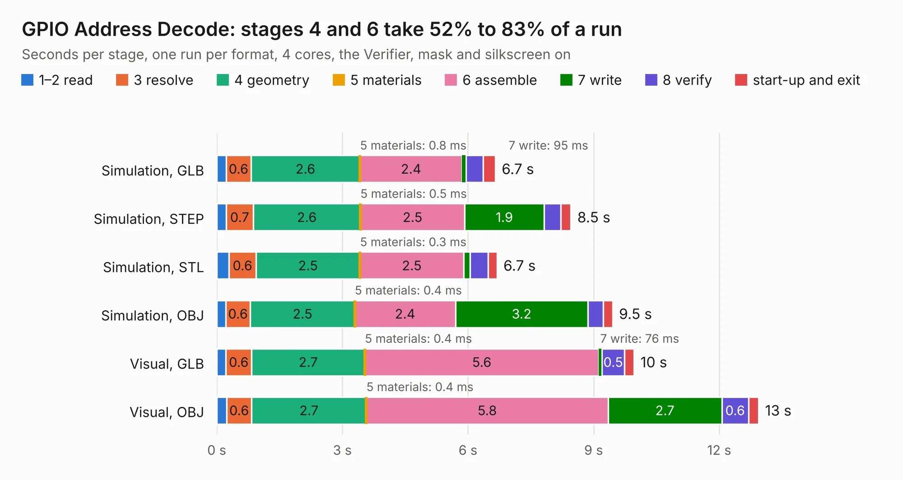

# 280. GPIO Address Decode

Board 280 of the 3,120 of [Corpus Testing](../Corpus-Testing.md), on [Corpus Page 3](../CorpusTestingPages/Corpus-Testing-03.md#280-gpio-address-decode).

| Mode and format | 1–2 read | 3 resolve | 4 geometry | 5 materials | 6 assemble | 7 write | 8 verify | start-up and exit | Total |
|---|---:|---:|---:|---:|---:|---:|---:|---:|---:|
| Simulation, GLB | 0.2 | 0.6 | 2.6 | 0.8&nbsp;ms | 2.4 | 95&nbsp;ms | 0.4 | 0.3 | 6.7 |
| Simulation, STEP | 0.2 | 0.7 | 2.6 | 0.5&nbsp;ms | 2.5 | 1.9 | 0.4 | 0.2 | 8.5 |
| Simulation, STL | 0.3 | 0.6 | 2.5 | 0.3&nbsp;ms | 2.5 | 0.1 | 0.4 | 0.2 | 6.7 |
| Simulation, OBJ | 0.2 | 0.6 | 2.5 | 0.4&nbsp;ms | 2.4 | 3.2 | 0.4 | 0.2 | 9.5 |
| Visual, GLB | 0.2 | 0.6 | 2.7 | 0.4&nbsp;ms | 5.6 | 76&nbsp;ms | 0.5 | 0.2 | 10.0 |
| Visual, OBJ | 0.2 | 0.6 | 2.7 | 0.4&nbsp;ms | 5.8 | 2.7 | 0.6 | 0.2 | 12.9 |

<table align="center"><tr><td valign="top">

| Board | Repo: [andrewpaterson/658-Computer](https://github.com/andrewpaterson/658-Computer) Board: `GPIO Address Decode.kicad_pcb` |
|---|---|
| Folder | Kicad / Pico / GPIO Address Decode |
| Complexity | 239&nbsp;/&nbsp;1000 (size&nbsp;169, features&nbsp;70) |
| KESE&nbsp;features | through vias, rounded, trapezoid or chamfered pads, knockout text, stack-up, dielectric εr and tanδ |
| Tested | 9th November 2026 |
| Copper&nbsp;layers | 2 |
| File&nbsp;format | KiCad 10 (20260206) |
| Parts,&nbsp;tracks,&nbsp;vias | 30, 882, 89 |
| Triangles,&nbsp;simulation | 601,896 in 108 parts |
| Verifier | PASS in all six runs |

</td><td valign="top">

<table>
<tr><th>File type</th><th>File size</th><th>Peak memory used</th></tr>
<tr><th colspan="3" align="left">Simulation</th></tr>
<tr><td>GLB</td><td align="right">21&nbsp;MB</td><td align="right">332&nbsp;MB</td></tr>
<tr><td>STEP</td><td align="right">100&nbsp;MB</td><td align="right">416&nbsp;MB</td></tr>
<tr><td>STL</td><td align="right">30&nbsp;MB</td><td align="right">331&nbsp;MB</td></tr>
<tr><td>OBJ</td><td align="right">62&nbsp;MB</td><td align="right">451&nbsp;MB</td></tr>
<tr><th colspan="3" align="left">Visual</th></tr>
<tr><td>GLB</td><td align="right">18&nbsp;MB</td><td align="right">440&nbsp;MB</td></tr>
<tr><td>OBJ</td><td align="right">53&nbsp;MB</td><td align="right">434&nbsp;MB</td></tr>
</table>

</td></tr></table>

| Previous | Next |
|:---|---:|
| [279. GPIO 32bit Board](b0279b_658-Computer_GPIO-32bit-Board.md) | [281. GPIO Backplane Board](b0281b_658-Computer_GPIO-Backplane-Board.md) |
