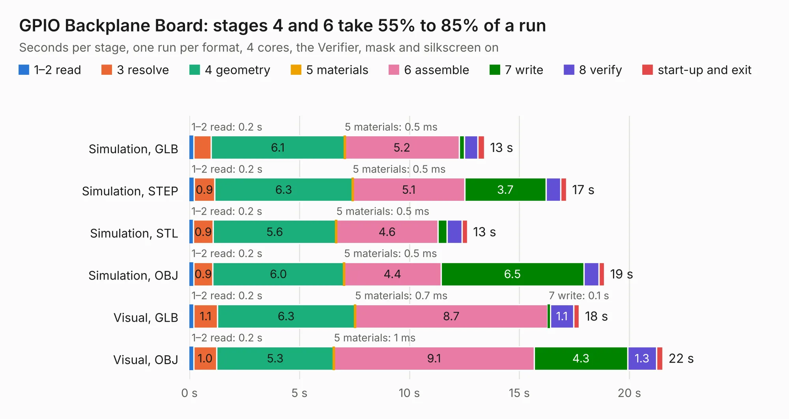

# 281. GPIO Backplane Board

Board 281 of the 3,119 of [Corpus Testing](../Corpus-Testing.md), on [Corpus Page 3](../CorpusTestingPages/Corpus-Testing-03.md#281-gpio-backplane-board).

| Mode and format | 1–2 read | 3 resolve | 4 geometry | 5 materials | 6 assemble | 7 write | 8 verify | start-up and exit | Total |
|---|---:|---:|---:|---:|---:|---:|---:|---:|---:|
| Simulation, GLB | 0.2 | 0.8 | 6.1 | 0.5&nbsp;ms | 5.2 | 0.2 | 0.6 | 0.3 | 13.4 |
| Simulation, STEP | 0.2 | 0.9 | 6.3 | 0.5&nbsp;ms | 5.1 | 3.7 | 0.7 | 0.3 | 17.1 |
| Simulation, STL | 0.2 | 0.9 | 5.6 | 0.5&nbsp;ms | 4.6 | 0.4 | 0.7 | 0.3 | 12.6 |
| Simulation, OBJ | 0.2 | 0.9 | 6.0 | 0.5&nbsp;ms | 4.4 | 6.5 | 0.7 | 0.3 | 18.9 |
| Visual, GLB | 0.2 | 1.1 | 6.3 | 0.7&nbsp;ms | 8.7 | 0.1 | 1.1 | 0.3 | 17.7 |
| Visual, OBJ | 0.2 | 1.0 | 5.3 | 1&nbsp;ms | 9.1 | 4.3 | 1.3 | 0.3 | 21.5 |

<table align="center"><tr><td valign="top">

| Board | Repo: [andrewpaterson/658-Computer](https://github.com/andrewpaterson/658-Computer) Board: `GPIO Backplane Board.kicad_pcb` |
|---|---|
| Folder | Kicad / Pico / GPIO Backplane Board |
| Complexity | 229&nbsp;/&nbsp;1000 (size&nbsp;149, features&nbsp;80) |
| KESE&nbsp;features | through vias, rounded, trapezoid or chamfered pads, curved board outline, knockout text, stack-up, dielectric εr and tanδ |
| Tested | 9th November 2026 |
| Copper&nbsp;layers | 2 |
| File&nbsp;format | KiCad 9 (20241229) |
| Parts,&nbsp;tracks,&nbsp;vias | 6, 733, 49 |
| Triangles,&nbsp;simulation | 1,207,452 in 92 parts |
| Verifier | PASS in all six runs |

</td><td valign="top">

<table>
<tr><th>File type</th><th>File size</th><th>Peak memory used</th></tr>
<tr><th colspan="3" align="left">Simulation</th></tr>
<tr><td>GLB</td><td align="right">39&nbsp;MB</td><td align="right">477&nbsp;MB</td></tr>
<tr><td>STEP</td><td align="right">157&nbsp;MB</td><td align="right">603&nbsp;MB</td></tr>
<tr><td>STL</td><td align="right">60&nbsp;MB</td><td align="right">501&nbsp;MB</td></tr>
<tr><td>OBJ</td><td align="right">121&nbsp;MB</td><td align="right">810&nbsp;MB</td></tr>
<tr><th colspan="3" align="left">Visual</th></tr>
<tr><td>GLB</td><td align="right">23&nbsp;MB</td><td align="right">653&nbsp;MB</td></tr>
<tr><td>OBJ</td><td align="right">69&nbsp;MB</td><td align="right">572&nbsp;MB</td></tr>
</table>

</td></tr></table>

| Previous | Next |
|:---|---:|
| [280. GPIO Address Decode](b0280b_658-Computer_GPIO-Address-Decode.md) | [282. GPIO Bus](b0282b_658-Computer_GPIO-Bus.md) |
