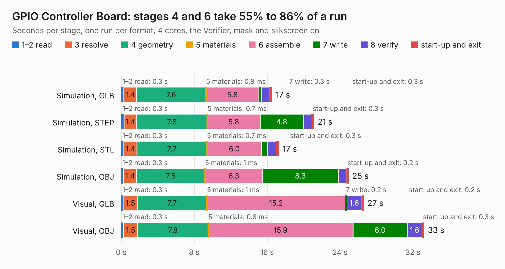

# 283. GPIO Controller Board

Board 283 of the 3,139 of [Corpus Testing](../Corpus-Testing.md), on [Corpus Page 3](../CorpusTestingPages/Corpus-Testing-03.md#283-gpio-controller-board).

| Mode and format | 1–2 read | 3 resolve | 4 geometry | 5 materials | 6 assemble | 7 write | 8 verify | start-up and exit | Total |
|---|---:|---:|---:|---:|---:|---:|---:|---:|---:|
| Simulation, GLB | 0.3 | 1.4 | 7.6 | 0.8&nbsp;ms | 5.8 | 0.3 | 0.9 | 0.3 | 16.5 |
| Simulation, STEP | 0.3 | 1.4 | 7.8 | 0.7&nbsp;ms | 5.8 | 4.8 | 0.9 | 0.3 | 21.2 |
| Simulation, STL | 0.3 | 1.4 | 7.7 | 0.7&nbsp;ms | 6.0 | 0.6 | 1.0 | 0.3 | 17.3 |
| Simulation, OBJ | 0.3 | 1.4 | 7.5 | 1&nbsp;ms | 6.3 | 8.3 | 0.9 | 0.2 | 24.9 |
| Visual, GLB | 0.3 | 1.5 | 7.7 | 1&nbsp;ms | 15.2 | 0.2 | 1.6 | 0.2 | 26.6 |
| Visual, OBJ | 0.3 | 1.5 | 7.8 | 0.8&nbsp;ms | 15.9 | 6.0 | 1.6 | 0.3 | 33.2 |

<table align="center"><tr><td valign="top">

| Board | Repo: [andrewpaterson/658-Computer](https://github.com/andrewpaterson/658-Computer) Board: `GPIO Controller Board.kicad_pcb` |
|---|---|
| Folder | Kicad / Pico / GPIO Controller Board |
| Complexity | 240&nbsp;/&nbsp;1000 (size&nbsp;170, features&nbsp;70) |
| KESE&nbsp;features | through vias, curved board outline, knockout text, stack-up, dielectric εr and tanδ |
| Tested | 9th November 2026 |
| Copper&nbsp;layers | 2 |
| File&nbsp;format | KiCad 10 (20260206) |
| Parts,&nbsp;tracks,&nbsp;vias | 17, 1,375, 127 |
| Triangles,&nbsp;simulation | 1,707,516 in 183 parts |
| Verifier | PASS in all six runs |

</td><td valign="top">

<table>
<tr><th>File type</th><th>File size</th><th>Peak memory used</th></tr>
<tr><th colspan="3" align="left">Simulation</th></tr>
<tr><td>GLB</td><td align="right">57&nbsp;MB</td><td align="right">666&nbsp;MB</td></tr>
<tr><td>STEP</td><td align="right">237&nbsp;MB</td><td align="right">791&nbsp;MB</td></tr>
<tr><td>STL</td><td align="right">85&nbsp;MB</td><td align="right">649&nbsp;MB</td></tr>
<tr><td>OBJ</td><td align="right">175&nbsp;MB</td><td align="right">1.1&nbsp;GB</td></tr>
<tr><th colspan="3" align="left">Visual</th></tr>
<tr><td>GLB</td><td align="right">38&nbsp;MB</td><td align="right">828&nbsp;MB</td></tr>
<tr><td>OBJ</td><td align="right">116&nbsp;MB</td><td align="right">876&nbsp;MB</td></tr>
</table>

</td></tr></table>

| Previous | Next |
|:---|---:|
| [282. GPIO Bus](b0282b_658-Computer_GPIO-Bus.md) | [284. GPIO Power Switch](b0284b_658-Computer_GPIO-Power-Switch.md) |
