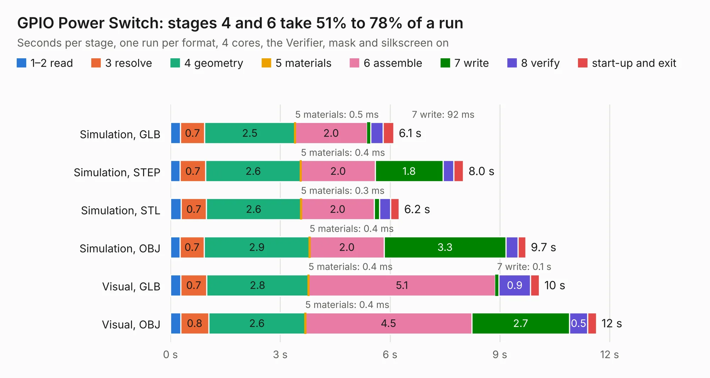

# 284. GPIO Power Switch

Board 284 of the 3,123 of [Corpus Testing](../Corpus-Testing.md), on [Corpus Page 3](../CorpusTestingPages/Corpus-Testing-03.md#284-gpio-power-switch).

| Mode and format | 1–2 read | 3 resolve | 4 geometry | 5 materials | 6 assemble | 7 write | 8 verify | start-up and exit | Total |
|---|---:|---:|---:|---:|---:|---:|---:|---:|---:|
| Simulation, GLB | 0.3 | 0.7 | 2.5 | 0.5&nbsp;ms | 2.0 | 92&nbsp;ms | 0.3 | 0.3 | 6.1 |
| Simulation, STEP | 0.3 | 0.7 | 2.6 | 0.4&nbsp;ms | 2.0 | 1.8 | 0.3 | 0.3 | 8.0 |
| Simulation, STL | 0.3 | 0.7 | 2.6 | 0.3&nbsp;ms | 2.0 | 0.1 | 0.3 | 0.2 | 6.2 |
| Simulation, OBJ | 0.3 | 0.7 | 2.9 | 0.4&nbsp;ms | 2.0 | 3.3 | 0.3 | 0.2 | 9.7 |
| Visual, GLB | 0.3 | 0.7 | 2.8 | 0.4&nbsp;ms | 5.1 | 0.1 | 0.9 | 0.2 | 10.1 |
| Visual, OBJ | 0.3 | 0.8 | 2.6 | 0.4&nbsp;ms | 4.5 | 2.7 | 0.5 | 0.2 | 11.6 |

<table align="center"><tr><td valign="top">

| Board | Repo: [andrewpaterson/658-Computer](https://github.com/andrewpaterson/658-Computer) Board: `GPIO Power Switch.kicad_pcb` |
|---|---|
| Folder | Kicad / Pico / GPIO Power Switch |
| Complexity | 264&nbsp;/&nbsp;1000 (size&nbsp;164, features&nbsp;100) |
| KESE&nbsp;features | through vias, rounded, trapezoid or chamfered pads, filled zones, curved board outline, knockout text, stack-up, dielectric εr and tanδ |
| Tested | 9th November 2026 |
| Copper&nbsp;layers | 2 |
| File&nbsp;format | KiCad 9 (20241229) |
| Parts,&nbsp;tracks,&nbsp;vias | 48, 415, 65 |
| Triangles,&nbsp;simulation | 549,758 in 60 parts |
| Verifier | PASS in all six runs |

</td><td valign="top">

<table>
<tr><th>File type</th><th>File size</th><th>Peak memory used</th></tr>
<tr><th colspan="3" align="left">Simulation</th></tr>
<tr><td>GLB</td><td align="right">19&nbsp;MB</td><td align="right">325&nbsp;MB</td></tr>
<tr><td>STEP</td><td align="right">83&nbsp;MB</td><td align="right">378&nbsp;MB</td></tr>
<tr><td>STL</td><td align="right">27&nbsp;MB</td><td align="right">315&nbsp;MB</td></tr>
<tr><td>OBJ</td><td align="right">56&nbsp;MB</td><td align="right">410&nbsp;MB</td></tr>
<tr><th colspan="3" align="left">Visual</th></tr>
<tr><td>GLB</td><td align="right">15&nbsp;MB</td><td align="right">427&nbsp;MB</td></tr>
<tr><td>OBJ</td><td align="right">44&nbsp;MB</td><td align="right">360&nbsp;MB</td></tr>
</table>

</td></tr></table>

| Previous | Next |
|:---|---:|
| [283. GPIO Controller Board](b0283b_658-Computer_GPIO-Controller-Board.md) | [285. HCP65 24 Pin Tester](b0285b_658-Computer_HCP65-24-Pin-Tester.md) |
