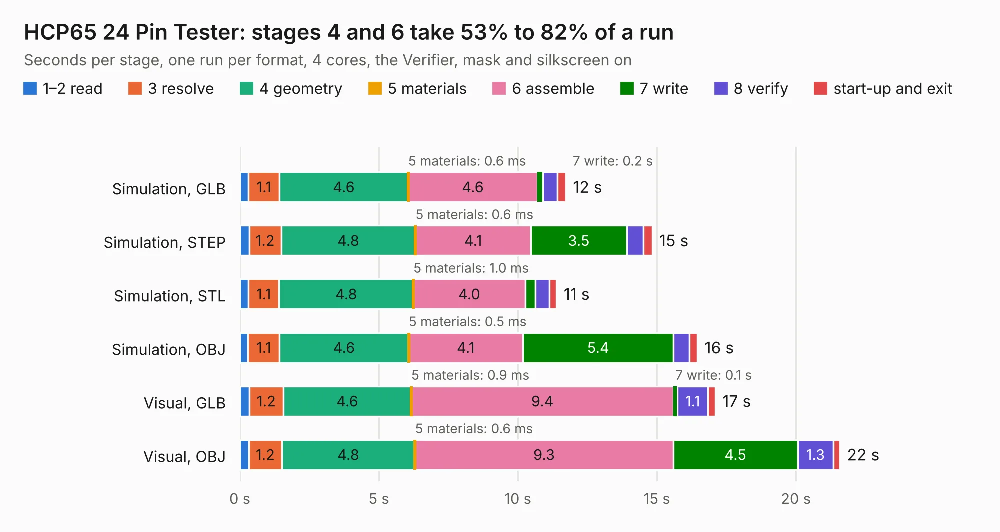

# 285. HCP65 24 Pin Tester

Board 285 of the 3,118 of [Corpus Testing](../Corpus-Testing.md), on [Corpus Page 3](../CorpusTestingPages/Corpus-Testing-03.md#285-hcp65-24-pin-tester).

| Mode and format | 1–2 read | 3 resolve | 4 geometry | 5 materials | 6 assemble | 7 write | 8 verify | start-up and exit | Total |
|---|---:|---:|---:|---:|---:|---:|---:|---:|---:|
| Simulation, GLB | 0.3 | 1.1 | 4.6 | 0.6&nbsp;ms | 4.6 | 0.2 | 0.5 | 0.3 | 11.7 |
| Simulation, STEP | 0.3 | 1.2 | 4.8 | 0.6&nbsp;ms | 4.1 | 3.5 | 0.6 | 0.3 | 14.8 |
| Simulation, STL | 0.3 | 1.1 | 4.8 | 1.0&nbsp;ms | 4.0 | 0.4 | 0.5 | 0.3 | 11.4 |
| Simulation, OBJ | 0.3 | 1.1 | 4.6 | 0.5&nbsp;ms | 4.1 | 5.4 | 0.6 | 0.3 | 16.5 |
| Visual, GLB | 0.3 | 1.2 | 4.6 | 0.9&nbsp;ms | 9.4 | 0.1 | 1.1 | 0.3 | 17.1 |
| Visual, OBJ | 0.3 | 1.2 | 4.8 | 0.6&nbsp;ms | 9.3 | 4.5 | 1.3 | 0.2 | 21.6 |

<table align="center"><tr><td valign="top">

| Board | Repo: [andrewpaterson/658-Computer](https://github.com/andrewpaterson/658-Computer) Board: `HCP65 24 Pin Tester.kicad_pcb` |
|---|---|
| Folder | Kicad / Pico / HCP65 24 Pin Tester |
| Complexity | 263&nbsp;/&nbsp;1000 (size&nbsp;183, features&nbsp;80) |
| KESE&nbsp;features | through vias, rounded, trapezoid or chamfered pads, curved board outline, knockout text, stack-up, dielectric εr and tanδ |
| Tested | 9th November 2026 |
| Copper&nbsp;layers | 2 |
| File&nbsp;format | KiCad 9 (20241229) |
| Parts,&nbsp;tracks,&nbsp;vias | 67, 1,028, 187 |
| Triangles,&nbsp;simulation | 1,062,808 in 104 parts |
| Verifier | PASS in all six runs |

</td><td valign="top">

<table>
<tr><th>File type</th><th>File size</th><th>Peak memory used</th></tr>
<tr><th colspan="3" align="left">Simulation</th></tr>
<tr><td>GLB</td><td align="right">37&nbsp;MB</td><td align="right">459&nbsp;MB</td></tr>
<tr><td>STEP</td><td align="right">167&nbsp;MB</td><td align="right">604&nbsp;MB</td></tr>
<tr><td>STL</td><td align="right">53&nbsp;MB</td><td align="right">470&nbsp;MB</td></tr>
<tr><td>OBJ</td><td align="right">109&nbsp;MB</td><td align="right">744&nbsp;MB</td></tr>
<tr><th colspan="3" align="left">Visual</th></tr>
<tr><td>GLB</td><td align="right">28&nbsp;MB</td><td align="right">673&nbsp;MB</td></tr>
<tr><td>OBJ</td><td align="right">86&nbsp;MB</td><td align="right">654&nbsp;MB</td></tr>
</table>

</td></tr></table>

| Previous | Next |
|:---|---:|
| [284. GPIO Power Switch](b0284b_658-Computer_GPIO-Power-Switch.md) | [286. HCP65 32 Pin Tester](b0286b_658-Computer_HCP65-32-Pin-Tester.md) |
