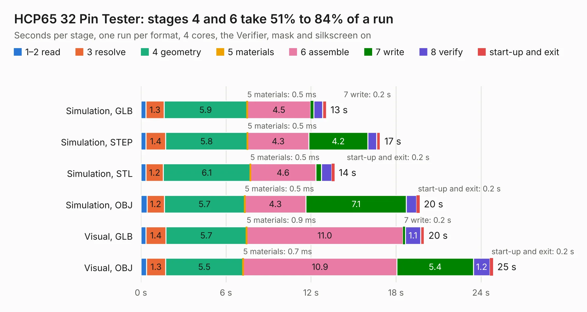

# 286. HCP65 32 Pin Tester

Board 286 of the 3,130 of [Corpus Testing](../Corpus-Testing.md), on [Corpus Page 3](../CorpusTestingPages/Corpus-Testing-03.md#286-hcp65-32-pin-tester).

| Mode and format | 1–2 read | 3 resolve | 4 geometry | 5 materials | 6 assemble | 7 write | 8 verify | start-up and exit | Total |
|---|---:|---:|---:|---:|---:|---:|---:|---:|---:|
| Simulation, GLB | 0.4 | 1.3 | 5.9 | 0.5&nbsp;ms | 4.5 | 0.2 | 0.6 | 0.3 | 13.1 |
| Simulation, STEP | 0.4 | 1.4 | 5.8 | 0.5&nbsp;ms | 4.3 | 4.2 | 0.6 | 0.3 | 16.9 |
| Simulation, STL | 0.4 | 1.2 | 6.1 | 0.5&nbsp;ms | 4.6 | 0.4 | 0.7 | 0.2 | 13.7 |
| Simulation, OBJ | 0.4 | 1.2 | 5.7 | 0.5&nbsp;ms | 4.3 | 7.1 | 0.7 | 0.2 | 19.7 |
| Visual, GLB | 0.4 | 1.4 | 5.7 | 0.9&nbsp;ms | 11.0 | 0.2 | 1.1 | 0.3 | 20.0 |
| Visual, OBJ | 0.4 | 1.3 | 5.5 | 0.7&nbsp;ms | 10.9 | 5.4 | 1.2 | 0.2 | 24.9 |

<table align="center"><tr><td valign="top">

| Board | Repo: [andrewpaterson/658-Computer](https://github.com/andrewpaterson/658-Computer) Board: `HCP65 32 Pin Tester.kicad_pcb` |
|---|---|
| Folder | Kicad / Pico / HCP65 32 Pin Tester |
| Complexity | 268&nbsp;/&nbsp;1000 (size&nbsp;188, features&nbsp;80) |
| KESE&nbsp;features | through vias, rounded, trapezoid or chamfered pads, curved board outline, knockout text, stack-up, dielectric εr and tanδ |
| Tested | 9th November 2026 |
| Copper&nbsp;layers | 2 |
| File&nbsp;format | KiCad 9 (20241229) |
| Parts,&nbsp;tracks,&nbsp;vias | 80, 1,295, 212 |
| Triangles,&nbsp;simulation | 1,295,928 in 131 parts |
| Verifier | PASS in all six runs |

</td><td valign="top">

<table>
<tr><th>File type</th><th>File size</th><th>Peak memory used</th></tr>
<tr><th colspan="3" align="left">Simulation</th></tr>
<tr><td>GLB</td><td align="right">45&nbsp;MB</td><td align="right">548&nbsp;MB</td></tr>
<tr><td>STEP</td><td align="right">206&nbsp;MB</td><td align="right">674&nbsp;MB</td></tr>
<tr><td>STL</td><td align="right">65&nbsp;MB</td><td align="right">525&nbsp;MB</td></tr>
<tr><td>OBJ</td><td align="right">134&nbsp;MB</td><td align="right">880&nbsp;MB</td></tr>
<tr><th colspan="3" align="left">Visual</th></tr>
<tr><td>GLB</td><td align="right">34&nbsp;MB</td><td align="right">805&nbsp;MB</td></tr>
<tr><td>OBJ</td><td align="right">104&nbsp;MB</td><td align="right">778&nbsp;MB</td></tr>
</table>

</td></tr></table>

| Previous | Next |
|:---|---:|
| [285. HCP65 24 Pin Tester](b0285b_658-Computer_HCP65-24-Pin-Tester.md) | [287. HCP65 40 Pin Tester](b0287b_658-Computer_HCP65-40-Pin-Tester.md) |
