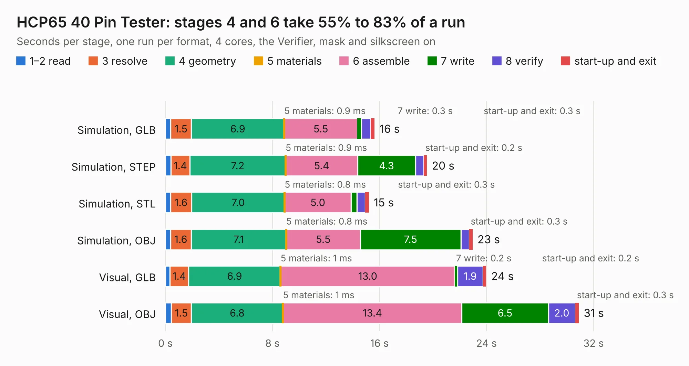

# 287. HCP65 40 Pin Tester

Board 287 of the 3,122 of [Corpus Testing](../Corpus-Testing.md), on [Corpus Page 3](../CorpusTestingPages/Corpus-Testing-03.md#287-hcp65-40-pin-tester).

| Mode and format | 1–2 read | 3 resolve | 4 geometry | 5 materials | 6 assemble | 7 write | 8 verify | start-up and exit | Total |
|---|---:|---:|---:|---:|---:|---:|---:|---:|---:|
| Simulation, GLB | 0.4 | 1.5 | 6.9 | 0.9&nbsp;ms | 5.5 | 0.3 | 0.7 | 0.3 | 15.6 |
| Simulation, STEP | 0.4 | 1.4 | 7.2 | 0.9&nbsp;ms | 5.4 | 4.3 | 0.6 | 0.2 | 19.5 |
| Simulation, STL | 0.4 | 1.6 | 7.0 | 0.8&nbsp;ms | 5.0 | 0.4 | 0.6 | 0.3 | 15.2 |
| Simulation, OBJ | 0.4 | 1.6 | 7.1 | 0.8&nbsp;ms | 5.5 | 7.5 | 0.6 | 0.3 | 23.0 |
| Visual, GLB | 0.3 | 1.4 | 6.9 | 1&nbsp;ms | 13.0 | 0.2 | 1.9 | 0.2 | 24.0 |
| Visual, OBJ | 0.5 | 1.5 | 6.8 | 1&nbsp;ms | 13.4 | 6.5 | 2.0 | 0.3 | 30.9 |

<table align="center"><tr><td valign="top">

| Board | Repo: [andrewpaterson/658-Computer](https://github.com/andrewpaterson/658-Computer) Board: `HCP65 40 Pin Tester.kicad_pcb` |
|---|---|
| Folder | Kicad / Pico / HCP65 40 Pin Tester |
| Complexity | 273&nbsp;/&nbsp;1000 (size&nbsp;193, features&nbsp;80) |
| KESE&nbsp;features | through vias, rounded, trapezoid or chamfered pads, curved board outline, knockout text, stack-up, dielectric εr and tanδ |
| Tested | 9th November 2026 |
| Copper&nbsp;layers | 2 |
| File&nbsp;format | KiCad 10 (20260206) |
| Parts,&nbsp;tracks,&nbsp;vias | 92, 1,612, 251 |
| Triangles,&nbsp;simulation | 1,612,774 in 173 parts |
| Verifier | PASS in all six runs |

</td><td valign="top">

<table>
<tr><th>File type</th><th>File size</th><th>Peak memory used</th></tr>
<tr><th colspan="3" align="left">Simulation</th></tr>
<tr><td>GLB</td><td align="right">56&nbsp;MB</td><td align="right">601&nbsp;MB</td></tr>
<tr><td>STEP</td><td align="right">256&nbsp;MB</td><td align="right">779&nbsp;MB</td></tr>
<tr><td>STL</td><td align="right">81&nbsp;MB</td><td align="right">639&nbsp;MB</td></tr>
<tr><td>OBJ</td><td align="right">168&nbsp;MB</td><td align="right">1.1&nbsp;GB</td></tr>
<tr><th colspan="3" align="left">Visual</th></tr>
<tr><td>GLB</td><td align="right">42&nbsp;MB</td><td align="right">840&nbsp;MB</td></tr>
<tr><td>OBJ</td><td align="right">128&nbsp;MB</td><td align="right">911&nbsp;MB</td></tr>
</table>

</td></tr></table>

| Previous | Next |
|:---|---:|
| [286. HCP65 32 Pin Tester](b0286b_658-Computer_HCP65-32-Pin-Tester.md) | [288. HCP65 56 Pin Tester](b0288b_658-Computer_HCP65-56-Pin-Tester.md) |
