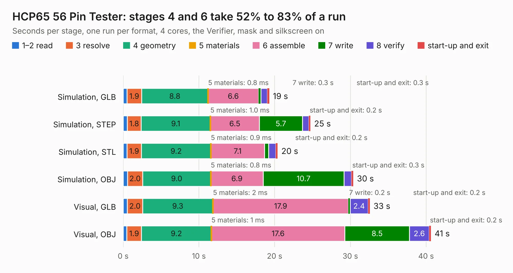

# 287. HCP65 56 Pin Tester

Board 287 of the 3,105 of [Corpus Testing](../Corpus-Testing.md), on [Corpus Page 3](../CorpusTestingPages/Corpus-Testing-03.md#287-hcp65-56-pin-tester).

| Mode and format | 1–2 read | 3 resolve | 4 geometry | 5 materials | 6 assemble | 7 write | 8 verify | start-up and exit | Total |
|---|---:|---:|---:|---:|---:|---:|---:|---:|---:|
| Simulation, GLB | 0.5 | 1.9 | 8.8 | 0.8&nbsp;ms | 6.6 | 0.3 | 0.8 | 0.3 | 19.3 |
| Simulation, STEP | 0.5 | 1.8 | 9.1 | 1.0&nbsp;ms | 6.5 | 5.7 | 0.9 | 0.2 | 24.7 |
| Simulation, STL | 0.5 | 1.9 | 9.2 | 0.9&nbsp;ms | 7.1 | 0.6 | 1.0 | 0.2 | 20.4 |
| Simulation, OBJ | 0.6 | 2.0 | 9.0 | 0.8&nbsp;ms | 6.9 | 10.7 | 1.0 | 0.3 | 30.4 |
| Visual, GLB | 0.5 | 2.0 | 9.3 | 2&nbsp;ms | 17.9 | 0.2 | 2.4 | 0.2 | 32.6 |
| Visual, OBJ | 0.5 | 1.9 | 9.2 | 1&nbsp;ms | 17.6 | 8.5 | 2.6 | 0.2 | 40.6 |

<table align="center"><tr><td valign="top">

| Board | Repo: [andrewpaterson/658-Computer](https://github.com/andrewpaterson/658-Computer) Board: `HCP65 56 Pin Tester.kicad_pcb` |
|---|---|
| Folder | Kicad / Pico / HCP65 56 Pin Tester |
| Complexity | 281&nbsp;/&nbsp;1000 (size&nbsp;201, features&nbsp;80) |
| KESE&nbsp;features | through vias, rounded, trapezoid or chamfered pads, curved board outline, knockout text, stack-up, dielectric εr and tanδ |
| Tested | 9th November 2026 |
| Copper&nbsp;layers | 2 |
| File&nbsp;format | KiCad 10 (20260206) |
| Parts,&nbsp;tracks,&nbsp;vias | 116, 2,318, 308 |
| Triangles,&nbsp;simulation | 1,963,298 in 205 parts |
| Verifier | PASS in all six runs |

</td><td valign="top">

<table>
<tr><th>File type</th><th>File size</th><th>Peak memory used</th></tr>
<tr><th colspan="3" align="left">Simulation</th></tr>
<tr><td>GLB</td><td align="right">68&nbsp;MB</td><td align="right">705&nbsp;MB</td></tr>
<tr><td>STEP</td><td align="right">322&nbsp;MB</td><td align="right">933&nbsp;MB</td></tr>
<tr><td>STL</td><td align="right">98&nbsp;MB</td><td align="right">706&nbsp;MB</td></tr>
<tr><td>OBJ</td><td align="right">207&nbsp;MB</td><td align="right">1.3&nbsp;GB</td></tr>
<tr><th colspan="3" align="left">Visual</th></tr>
<tr><td>GLB</td><td align="right">52&nbsp;MB</td><td align="right">1.0&nbsp;GB</td></tr>
<tr><td>OBJ</td><td align="right">161&nbsp;MB</td><td align="right">1.1&nbsp;GB</td></tr>
</table>

</td></tr></table>

| Previous | Next |
|:---|---:|
| [286. HCP65 40 Pin Tester](b0286b_658-Computer_HCP65-40-Pin-Tester.md) | [288. HCP65 64 Pin Tester](b0288b_658-Computer_HCP65-64-Pin-Tester.md) |
