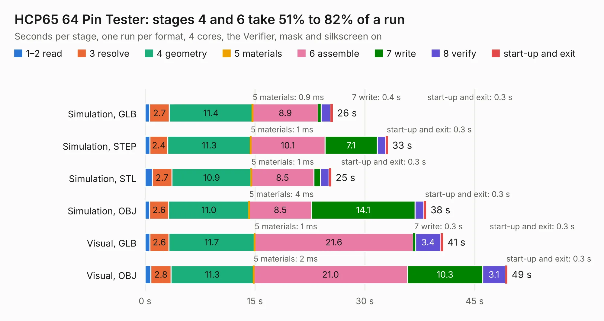

# 289. HCP65 64 Pin Tester

Board 289 of the 3,138 of [Corpus Testing](../Corpus-Testing.md), on [Corpus Page 3](../CorpusTestingPages/Corpus-Testing-03.md#289-hcp65-64-pin-tester).

| Mode and format | 1–2 read | 3 resolve | 4 geometry | 5 materials | 6 assemble | 7 write | 8 verify | start-up and exit | Total |
|---|---:|---:|---:|---:|---:|---:|---:|---:|---:|
| Simulation, GLB | 0.6 | 2.7 | 11.4 | 0.9&nbsp;ms | 8.9 | 0.4 | 1.3 | 0.3 | 25.6 |
| Simulation, STEP | 0.7 | 2.4 | 11.3 | 1&nbsp;ms | 10.1 | 7.1 | 1.2 | 0.3 | 33.2 |
| Simulation, STL | 1.0 | 2.7 | 10.9 | 1&nbsp;ms | 8.5 | 0.9 | 1.2 | 0.3 | 25.4 |
| Simulation, OBJ | 0.6 | 2.6 | 11.0 | 4&nbsp;ms | 8.5 | 14.1 | 1.2 | 0.3 | 38.4 |
| Visual, GLB | 0.7 | 2.6 | 11.7 | 1&nbsp;ms | 21.6 | 0.3 | 3.4 | 0.3 | 40.7 |
| Visual, OBJ | 0.8 | 2.8 | 11.3 | 2&nbsp;ms | 21.0 | 10.3 | 3.1 | 0.3 | 49.5 |

<table align="center"><tr><td valign="top">

| Board | Repo: [andrewpaterson/658-Computer](https://github.com/andrewpaterson/658-Computer) Board: `HCP65 64 Pin Tester.kicad_pcb` |
|---|---|
| Folder | Kicad / Pico / HCP65 64 Pin Tester |
| Complexity | 283&nbsp;/&nbsp;1000 (size&nbsp;203, features&nbsp;80) |
| KESE&nbsp;features | through vias, rounded, trapezoid or chamfered pads, curved board outline, knockout text, stack-up, dielectric εr and tanδ |
| Tested | 9th November 2026 |
| Copper&nbsp;layers | 2 |
| File&nbsp;format | KiCad 10 (20260206) |
| Parts,&nbsp;tracks,&nbsp;vias | 129, 2,539, 331 |
| Triangles,&nbsp;simulation | 2,145,474 in 232 parts |
| Verifier | PASS in all six runs |

</td><td valign="top">

<table>
<tr><th>File type</th><th>File size</th><th>Peak memory used</th></tr>
<tr><th colspan="3" align="left">Simulation</th></tr>
<tr><td>GLB</td><td align="right">74&nbsp;MB</td><td align="right">774&nbsp;MB</td></tr>
<tr><td>STEP</td><td align="right">332&nbsp;MB</td><td align="right">1.0&nbsp;GB</td></tr>
<tr><td>STL</td><td align="right">107&nbsp;MB</td><td align="right">750&nbsp;MB</td></tr>
<tr><td>OBJ</td><td align="right">225&nbsp;MB</td><td align="right">1.4&nbsp;GB</td></tr>
<tr><th colspan="3" align="left">Visual</th></tr>
<tr><td>GLB</td><td align="right">57&nbsp;MB</td><td align="right">1.0&nbsp;GB</td></tr>
<tr><td>OBJ</td><td align="right">177&nbsp;MB</td><td align="right">1.2&nbsp;GB</td></tr>
</table>

</td></tr></table>

| Previous | Next |
|:---|---:|
| [288. HCP65 56 Pin Tester](b0288b_658-Computer_HCP65-56-Pin-Tester.md) | [290. HCP65 Board Tester](b0290b_658-Computer_HCP65-Board-Tester.md) |
